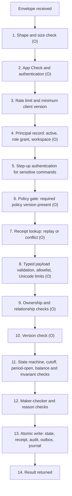

# Application service contracts: command envelope, conventions and command index

| Field | Value |
|---|---|
| Revision | 2.0 · 2026-10-30 (supersedes 0.x requirements contracts) |
| Owner | Backend and API architect (documentation author B2) |
| Purpose | Define the callable-service contract style, the command envelope, idempotency, pagination, versioning and rate-limit conventions, and index every command in the register with its callers, stores, journals, owning module, requirements and detail file. |
| Applies to | CUS, PAR, ADM, ACC, BE (all four clients and the shared backend) |
| Depends on | [Conventions and identifier register](../analysis/CONVENTIONS_AND_ID_REGISTER.md), [glossary](../requirements/GLOSSARY_AND_TERMINOLOGY.md), [policy register](../requirements/POLICY_DECISION_REGISTER.md), [business rules](../requirements/BUSINESS_RULES.md), [authorization](AUTHORIZATION.md), [error responses](ERROR_RESPONSES.md), [events and notifications](EVENT_AND_NOTIFICATION_DESIGN.md), [code reality snapshot](../architecture/CODE_REALITY_SNAPSHOT.md), [ADR-002](../adr/002-trusted-command-boundary.md), [ADR-008](../adr/008-idempotent-command-envelope.md), [financial data model](../database/FINANCIAL_DATA_MODEL.md) |
| Authoritative policies | BR-001 to BR-005 ([business rules](../requirements/BUSINESS_RULES.md)) and BR-006 to BR-026 ([policy register](../requirements/POLICY_DECISION_REGISTER.md)). All are PENDING. This file defines no policy value. |
| Status | Draft for review. Nothing is approved. Only the nine commands tagged "OBSERVED working" exist as code (untracked, emulator-tested only; see [Firebase security review copy](../verification/FIREBASE_SECURITY_REVIEW_COPY.md)). Everything tagged PROPOSED is a design recommendation, not an implemented endpoint. No HTTP, REST or OpenAPI contract is claimed. |

Provenance tags follow the register: **USER-REQ**, **OBSERVED**, **PROPOSED**, **PENDING**. All BDT figures anywhere in the API set are HYPOTHETICAL.

## 1. Reading guide

The API set is organised as one specification (this file), six domain files that define every command in full, and three cross-cutting files.

| File | Content |
|---|---|
| This file | Transport, envelope, pipeline, idempotency, transaction patterns, conventions, versioning, rate limiting, command index, legacy-to-successor map, discrepancies |
| [COMMANDS_IDENTITY_AND_CATALOGUE.md](COMMANDS_IDENTITY_AND_CATALOGUE.md) | Profile, address, preferences, device, applications, evidence, catalogue, kitchens, capacity, stock, reviews, complaints, data requests |
| [COMMANDS_ORDERS_AND_SUBSCRIPTIONS.md](COMMANDS_ORDERS_AND_SUBSCRIPTIONS.md) | Quotes, orders, order processing, subscription agreement and schedule changes, meal obligations, service credits |
| [COMMANDS_PAYMENTS_AND_COD.md](COMMANDS_PAYMENTS_AND_COD.md) | Payment initiation and verification, the inbound gateway notification contract, reconciliation, refunds, cash on delivery |
| [COMMANDS_DELIVERY.md](COMMANDS_DELIVERY.md) | Assignment offers, pickup, delivery states, proof, failure, reassignment, location, handoff, incidents |
| [COMMANDS_EARNINGS_AND_PAYOUTS.md](COMMANDS_EARNINGS_AND_PAYOUTS.md) | Earning recognition, payout requests, maker-checker approval, batches, external confirmation, holds |
| [COMMANDS_LEDGER_AND_GOVERNANCE.md](COMMANDS_LEDGER_AND_GOVERNANCE.md) | Journal catalogue, journals, adjustments, period close, staff roles, policy versions, application decisions, account suspension, exports |
| [AUTHORIZATION.md](AUTHORIZATION.md) | Role by command and role by read-resource matrices, relationship checks, maker-checker, session expectations |
| [ERROR_RESPONSES.md](ERROR_RESPONSES.md) | Error taxonomy, reason codes, client behaviour, accessible messages |
| [EVENT_AND_NOTIFICATION_DESIGN.md](EVENT_AND_NOTIFICATION_DESIGN.md) | Domain events, outbox, notifications, scheduled jobs, email log |

Counts: the register defines **101 commands** (30 OBSERVED plus 71 PROPOSED). Section 12 indexes all 101.

## 2. Transport and entry points

The contracts are **callable-service style**: a typed command envelope goes to a trusted server entry point and returns a typed result. They are not REST resources. The only inbound HTTP endpoint in the whole design is the gateway notification receiver (`handleGatewayNotification`), because the payment gateway is not a Firebase client.

| Entry | What it is | Status |
|---|---|---|
| T1. `executeCommand` callable | One Cloud Functions callable (v2 `onCall`) that dispatches on `command`. Region comes from a deployment parameter with no production default; App Check is enforced (`enforceAppCheck: true`); `maxInstances` 10; timeout 30 s. The caller identity is `request.auth.uid`; a request without it is `unauthenticated`. | OBSERVED (`backend/functions/src/index.js`). It hosts the 9 working commands. The 21 policy-gated names pass authentication then fail with `failed-precondition`. |
| T2. Audience-separated hosts | Same envelope and pipeline, hosted as separate callable entry points per audience (customer and partner apps; staff web apps; finance commands) so permissions, quotas and deployment blast radius differ. Entry-point naming and count are an ADR-002/ADR-008 decision. | PROPOSED, not decided |
| T3. Gateway notification receiver | Inbound HTTPS endpoint for `handleGatewayNotification`. Authenticated by gateway authenticity checks plus mandatory server-to-server validation, never by a Firebase user. | PROPOSED, PENDING gateway documentation check |
| T4. Scheduled jobs | Time-driven invocations of system commands (for example `generateMealObligations`, `expireCredits`). No client principal. | PROPOSED |
| T5. Internal commands | Commands callable only from other trusted code inside the same transaction (`postJournal`, `reserveStock`, `releaseStock`, `issueCredit`, `consumeCredit`). No external route exists for them. | PROPOSED |
| T6. Read services | Reads are not commands. Client reads of operational data are Firestore queries constrained by Rules; finance and ledger reads (Postgres) are served by authorised read services. The entry-point name for read services is an architecture decision; this API set refers to reads by resource key (for example `ledger.journals`). | OBSERVED for Firestore reads (capped at 50, filtered by ownership/publication); PROPOSED for finance read services |

The transport host never makes a command safer than its pipeline: clients are untrusted devices, and **every authorization, price, balance, state transition and role decision is made on the trusted side** (USER-REQ, ADR-002).

## 3. The command envelope

### 3.1 OBSERVED envelope

```json
{
  "command": "saveAddress",
  "requestId": "r_01JABCDEFGH2345",
  "expectedVersion": 3,
  "payload": { "id": "home", "recipientName": "A. Rahman", "addressText": "House 4, Road 2", "contactPhone": "01XXXXXXXXX" }
}
```

(Illustrative values only; no real person, address or phone is used anywhere in the documentation set.)

| Field | Type and validation (OBSERVED in `commands.js`) |
|---|---|
| `command` | String matching `^[A-Za-z0-9_-]{1,128}$`. Unknown names fail after the policy gate with `invalid-argument` "Unknown command." |
| `requestId` | String matching `^[A-Za-z0-9_-]{1,128}$`. Client-generated. Unique per principal per intent. |
| `expectedVersion` | Optional safe integer ≥ 0. For a create, absent or `0`. For an update of an existing record it must equal the stored `version`; absent or different yields `aborted` "Refresh the record and retry with its current version." |
| `payload` | Plain object (prototype `Object.prototype`), `JSON.stringify` length at most **16384 bytes**. Each command allowlists its own field names; any extra field is `invalid-argument` "Invalid fields." The size check runs even for policy-gated commands to bound parsing work. |
| Top-level fields | Exactly `command`, `requestId`, `expectedVersion`, `payload`. Any other top-level key is rejected. |

OBSERVED text rules for strings: Unicode code points are counted (not UTF-16 units), minimum and maximum lengths are enforced, whitespace-only text is rejected when a minimum is required, and C0 control characters other than tab, line feed and carriage return are rejected. Identifiers inside payloads match `^[A-Za-z0-9_-]{1,128}$`. Dates are `YYYY-MM-DD` and must round-trip as real calendar dates.

### 3.2 OBSERVED result and failure shapes

Success result (also what is stored in the receipt and returned on replay): `{ "id": "<last path segment of the target>", "status": "saved" | "pending", "message": "<English text>", "data": { "version": <n> } }`. `status: "pending"` means the caller's principal is not yet active (profile saved, activation requires an approved onboarding policy, DEC-009).

Failure: the callable throws a Firebase `HttpsError` with `code` and `message`. Expected codes in the current code: `unauthenticated`, `invalid-argument`, `permission-denied`, `failed-precondition`, `already-exists`, `aborted`, `not-found`. Any other exception becomes `internal` with the fixed message "Unable to confirm the operation. Retry with the same request ID." The Dart client additionally raises a local `unsupported-field` failure (from `command_payload.dart`) when a draft contains a field the server contract cannot store, preserving the draft and attempting no partial save.

### 3.3 PROPOSED envelope extensions

The OBSERVED server rejects unknown top-level fields, so each extension is a versioned, additive change (section 9).

| Field | Type | Purpose | In fingerprint? |
|---|---|---|---|
| `envelopeVersion` | integer | Selects the envelope and error-shape generation. Absent means version 1 (the OBSERVED shape). | No |
| `workspace` | enum `customer`, `supplier`, `rider`, `admin`, `accounts` | Declares which role grant the caller is acting under, for principals with several grants (BR-023 PENDING). The server checks the principal holds that active grant; the declaration never grants anything. | Yes |
| `reason` | object `{ code: Id, note?: Text(1..500) }` | Mandatory for sensitive commands (listed per command). `code` comes from a server-published reason-code list; `note` is free text, never logged in clear outside the restricted audit store. Missing reason: `invalid_input` / `reason_required`. | Yes |
| `context` | object `{ clientApp, appVersion, locale, platform? }` | Diagnostic and localisation hints. `clientApp` is one of `cus`, `par`, `adm`, `acc` plus build flavour; `appVersion` is the semantic version string; `locale` is `en` or `bn`; `platform` is `android`, `ios` or `web`. Used for minimum-version enforcement, analytics-free diagnostics and choosing the language of server-generated text. Never used for authorization. | **No** (so a retry after an app update or language switch still replays) |

Rules for the extensions:

1. `reason.code` values are enumerated per command family (for example `dispute`, `discrepancy`, `compliance`, `error_correction`, `fraud_suspicion`, `customer_request`). The list is published as a policy version; commands do not accept free-form codes.
2. `workspace` is mandatory when the principal holds more than one role grant, optional otherwise.
3. `context.clientApp` below the minimum supported version yields `precondition` category `business_rule_rejected` with reason `client_upgrade_required`, so the app can show an upgrade screen without data loss.

### 3.4 PROPOSED standard result and error shapes

Result (all new commands):

```json
{
  "requestId": "r_01JABCDEFGH2345",
  "command": "skipMeals",
  "outcome": "committed",
  "id": "obl_20261104_lunch",
  "version": 4,
  "status": "skipped",
  "data": {},
  "receiptId": "<opaque>",
  "serverTime": "2026-11-02T08:30:00Z",
  "policyVersionId": "pv_cutoff_7"
}
```

`outcome` is one of `committed` (state change and receipt committed), `accepted_pending` (the authoritative step committed and a second step completes asynchronously, for example a credit posting; the response names what is pending), `replayed` (the original stored result returned for a repeated request). User-visible text is a message key, never server prose: `messageKey` plus safe field-error keys, resolved to Bangla or English on the client. The OBSERVED English `message` is kept only for envelope version 1.

Error (see [error responses](ERROR_RESPONSES.md)): `{ category, reason, messageKey, fieldErrors?, retryable, retryAfterSeconds?, requestId, correlationId, details? }`.

## 4. Processing pipeline

Every command runs these steps in order. Steps marked (O) exist in the OBSERVED code; unmarked steps are PROPOSED. A failure at any step stops processing and writes nothing.



Notes on ordering:

1. OBSERVED authorization runs **before** the receipt lookup, so a principal deactivated after the original success cannot replay a stored result. This is deliberate and kept.
2. OBSERVED payload validation runs after the receipt lookup, so an identical replay is answered from the receipt without re-validation.
3. The OBSERVED policy gate is evaluated after principal validation and before everything role-specific; it does not depend on the caller's role. Hence all roles receive `failed-precondition` for a gated command and a missing or inactive principal receives `permission-denied`.
4. The OBSERVED bootstrap exception: `saveProfile` is allowed when no principal record exists (creating `principals/{uid}` with `role: null`, `active: false`, `status: "pending"`, `authorizationVersion: 1`) or when the principal is pending with no role.
5. Authorization is always re-derived from the canonical principal record. Claims in the token are routing hints only (see [authorization](AUTHORIZATION.md)).

## 5. Idempotency and receipts

### 5.1 OBSERVED behaviour

- `receiptId = SHA-256(canonical JSON of [uid, requestId])`. Receipts are therefore per principal; two principals using the same `requestId` never collide.
- `fingerprint = SHA-256(canonical JSON of {command, requestId, expectedVersion, payload})`. Canonical JSON sorts object keys recursively and preserves array order.
- Same `receiptId`, same fingerprint: the stored `result` is returned without re-executing (a replay).
- Same `receiptId`, different fingerprint: `already-exists` "Request ID was used with different input."
- The receipt (`requestReceipts/{receiptId}`: `actorId`, `command`, `fingerprint`, `result`, `createdAt`) and an audit event (`auditEvents/{receiptId}`: `actorId`, `command`, `target`, `version`, `createdAt`) are created with `tx.create` in the **same Firestore transaction** as the state change. Concurrent duplicates therefore serialise on the transaction; this is covered by an executed emulator test (see [security review copy](../verification/FIREBASE_SECURITY_REVIEW_COPY.md)).
- A rejected command writes **no** receipt. Reusing the same `requestId` after a rejection is therefore not blocked; reusing it with changed input after a *success* is a conflict. Clients should still create a fresh `requestId` whenever the user edits the input after a rejection.
- If the client omits `id` for creates, the server derives a deterministic target id from `SHA-256([uid, requestId])` (first 32 hex characters), so a retried create targets the same record.

### 5.2 PROPOSED rules for all commands

1. **Client behaviour.** Generate `requestId` once per user intent, persist it with the draft before the first send, reuse it on every retry of that intent, and discard it only after a terminal result or an explicit user edit. Never create a new `requestId` to resolve an `outcome_unknown` result; look up the original (section 5.3).
2. **Fingerprint scope.** Extend the fingerprint to `{command, requestId, expectedVersion, payload, workspace, reason}`; exclude `context` and `envelopeVersion`.
3. **Business uniqueness in addition to `requestId`.** `requestId` protects against one client retrying. Money-moving and lifecycle commands also carry **natural uniqueness constraints** so two different requests cannot create the same effect (INV-04, INV-08, INV-12). Examples: one credit per skipped scheduled-meal origin; one order per accepted quote; one verified COD remittance per deposit reference; one gateway transaction per merchant transaction id; one earning recognition per delivery; one reversal per journal.
4. **System and webhook idempotency keys.** Not client generated: gateway notification `gwevt:{gateway}:{eventKey}`; scheduled job `job:{name}:{window}:{subject}`; outbox consumer `evt:{eventId}:{consumer}`; internal commands inherit the key of the originating command plus a fixed suffix (for example `{requestId}:credit`).
5. **Postgres commands.** A unique key `(principal, requestId)` in the `ent.RequestReceipt` table is inserted first inside the transaction; a concurrent duplicate either waits for and returns the stored result or fails with `conflict` / `request_in_progress` (retryable).
6. **Replay is read-only.** A replayed response never re-emits events, re-posts journals or re-sends notifications. The response carries `outcome: "replayed"`.
7. **Receipt retention.** Receipts must outlive the longest client retry horizon and, for financial commands, the retention of the journals they produced ([data retention](../database/DATA_RETENTION.md) decides the period; no value is set here).
8. **Partial failure.** A command that spans two stores (section 6) is complete only when both steps are committed. The first-committed step is itself idempotent; the second is retried by the outbox consumer under the same key; the response says `accepted_pending` until both are done.

### 5.3 Resolving an uncertain outcome

On a timeout, transport loss or `internal` after the call may have committed, the client re-sends the **identical envelope** (same `requestId`, same payload). The server returns the stored result (`replayed`) or processes it for the first time. The client must show "still confirming" for money-affecting commands and must not offer a second payment, order or skip while the first is unresolved. Where a client cannot re-send (app killed), a receipt-by-requestId read returns a safe projection of the outcome (resource `receipts.own`).

## 6. Transaction patterns, stores and the outbox

Stores: **FS** = Firestore (operational), **PG** = Postgres (ledger and finance), per ADR-005/ADR-006 (B1 owns both; this file states only the contract each command needs).

| Pattern | Definition | Used for |
|---|---|---|
| `FS-TX` | One Firestore transaction: read principal, receipt and target; write target, `requestReceipts`, `auditEvents` and (PROPOSED) an `outbox` document. OBSERVED for the 9 working commands (without outbox). | Operational commands with no money effect |
| `PG-TX` | One Postgres transaction: insert receipt row, change state rows, insert journal and lines when money moves, insert audit row, insert outbox row. Unique constraints enforce INV-04, INV-08, INV-12; balance check enforces INV-01. | Financial commands whose authoritative fact is financial (payment verification, refunds, payouts, remittance, recognition, adjustments) |
| `SAGA` | Operational step in FS then financial step in PG (or the reverse), linked by a deterministic operation key. The authoritative store for each fact is fixed: **money facts in PG, operational state in FS**. The first-committed step writes an outbox event; the other step is applied by an idempotent outbox consumer. Intermediate state is explicit and visible (for example `financialPosting: pending`), never reported as success. A sweeper reconciles stuck operations (see [events and jobs](EVENT_AND_NOTIFICATION_DESIGN.md)). | Order placement with COD invoicing, skip with credit, replacement with price difference |
| `WEBHOOK` | Durable persistence of the raw inbound event, then asynchronous validation and processing (section on the contract in [payments file](COMMANDS_PAYMENTS_AND_COD.md)). | `handleGatewayNotification` |
| `JOB` | A scheduled run that iterates subjects and applies an idempotent per-subject operation. | `generateMealObligations`, `expireCredits` |
| `READ` | No state change. | `searchKitchens` |

**Outbox.** Every state-changing command writes its domain events to an outbox in the same transaction as the state change. A relay publishes at least once; consumers are idempotent by `eventId`. A notification, projection update or read-model refresh is never part of the command's success condition: a notification failure cannot undo a committed order or payment (OBSERVED principle in the earlier error contract, retained).

**Ledger posting rule (INV-01, INV-02, INV-04, INV-16).** A money-moving command posts at most one journal per idempotency key, inside the same PG transaction as its state change, with equal debit and credit totals, integer BDT minor units, an open accounting period, and a reference to its source entity and policy version. Posted lines are never edited; a correction is a reversing or adjusting journal. Clients never write balances.

## 7. Conventions for data in payloads

| Convention | Rule |
|---|---|
| Identifiers | Opaque strings `^[A-Za-z0-9_-]{1,128}$`. Never guessable ownership: a hard-to-guess id is not authorization. |
| Money | Integer BDT **minor units** (paisa), safe integer ≥ 0, in fields named `...Minor`. Currency is always BDT; a `currency` field, if present, must equal `BDT` or the request fails `invalid_input` / `currency_mismatch`. Floats, strings and negatives are rejected. A signed difference is expressed as `direction` plus an unsigned amount. Customer display shows two decimals (USER-REQ, NFR). |
| Client-supplied amounts | Never authoritative. Where a command is a customer consent to a price, the client sends the **expected total** it saw (`expectedTotalMinor`); the server compares with the stored quote and rejects a mismatch (`quote_mismatch`). The server never trusts a client total, discount, fee, credit or price. |
| Timestamps | ISO 8601 UTC instants, set by the server. Client clocks are never evidence. |
| Service dates and slots | `serviceDate` is `YYYY-MM-DD` in the service time zone (Asia/Dhaka is PROPOSED under DEC-008, PENDING). `slot` is one of `slot.breakfast`, `slot.lunch`, `slot.snack`, `slot.dinner`: an identifier, never a translated label. (OBSERVED gap: `saveMenu.mealSlot` is free text up to 40 characters.) Cutoff is evaluated server-side from a policy version (BR-022, FR-050); the command never accepts a cutoff or "now" from the client. See [time and cutoff policy](../architecture/TIME_AND_CUTOFF_POLICY.md). |
| Locale | `en` or `bn` (OBSERVED enum). Server-generated notification text uses the recipient's stored `preferredLocale`. |
| Free text | Unicode-aware length bounds; Bangla text counted by code points; no control characters except tab, line feed, carriage return. |
| Attachments | Not inline. Evidence and documents are uploaded to Storage under rules, then referenced by `evidenceRef` ids in payloads (also keeps payloads below the 16 KB cap). Statements and bulk inputs are processed server-side from references. |
| Policy parameters | Named `policy.<area>.<parameter>` (for example `policy.cod.remittance_deadline_hours`). The API specifies the name, never a value. A command whose policy parameter is not published fails `policy_not_configured`. |
| Reason codes | See section 3.3. |
| Snapshots | Financial documents (quote, invoice, obligation) carry copies of the price version and policy version they used. A later price or policy change never alters a paid obligation (INV-18). |

## 8. Reads, pagination and read models

1. **Reads are not commands.** They never carry an idempotency key and never change state.
2. **Query shape proves authorization.** A client query must include the ownership or publication constraint the Rules require (OBSERVED: Rules reject unconstrained, unfiltered and over-limit lists). Do not fetch globally and filter on the device.
3. **Pagination.** Cursor-based, stable ordering by `(sortField, documentId)`; `limit` default and maximum are policy parameters, with the OBSERVED Rules cap of **50** as the ceiling for Firestore lists. Responses return `nextCursor` (opaque) or none. Offset pagination is not used.
4. **Finance read services (PG).** Same cursor rules, plus `asOf` (instant) or `periodId`, an explicit `definitionVersion` for every aggregate, and `generatedAt`. A figure always names its qualifier: paid, pending, posted, held, reserved, disputed or available ([glossary](../requirements/GLOSSARY_AND_TERMINOLOGY.md) section 4). Every dashboard total is derivable from posted journals and immutable events (INV-20).
5. **Freshness.** Reads that feed consequential actions return `generatedAt`. A partial view marks the unavailable section instead of showing zero.
6. **Read models** for lists (orders, obligations, notifications, payouts) are projections from outbox events. They can lag; a command always re-reads authoritative state.
7. **Resource keys** used in the authorization matrix (examples): `catalogue.public`, `kitchens.index`, `orders.own`, `obligations.own`, `subscriptions.own`, `credits.own`, `invoices.own`, `payments.own`, `earnings.supplier`, `earnings.rider`, `payouts.own`, `ledger.journals`, `ledger.accounts`, `reconciliation.items`, `audit.events`. The complete list is in [authorization](AUTHORIZATION.md).

## 9. Versioning and compatibility

1. **Envelope version.** `envelopeVersion` selects the envelope and error shape. Version 1 is the OBSERVED shape. A server supports N and N-1 for a published window; the minimum supported client version per app is a server-side configuration and is returned as `client_upgrade_required` when violated.
2. **Command contracts are additive.** New optional payload fields and new response fields are allowed without a version bump. Removing or retyping a field, or changing a state-machine rule, is a new command name or a new `envelopeVersion`. Command names are never reused for a different meaning.
3. **Record schema versions.** Records carry `schemaVersion` (OBSERVED: `1`) and `version` (optimistic concurrency, starts at 1, incremented on every write).
4. **Policy versions.** A command that depends on a policy stamps the `policyVersionId` it used on its result and on the records it writes. Policy versions are immutable and effective-dated (`publishPolicyVersion`).
5. **Legacy names.** The 21 policy-gated names are kept so existing callers and tests remain meaningful; section 12.2 maps each to its successor. Retiring an alias is an explicit versioned change.
6. **Deprecation.** A deprecated command keeps working for the published window, returns a `deprecation` hint in the result, and appears in the change log.
7. **Contract tests.** Before any implementation acceptance: schema/contract tests, authorization tests per matrix row, duplicate and concurrent request tests, and SDK-to-emulator integration tests (planned, not executed; see [test cases](../testing/TEST_CASES.md) and [integration test cases](../testing/INTEGRATION_TEST_CASES.md)).

## 10. Rate limiting and abuse controls

OBSERVED: App Check enforcement, `maxInstances` 10, 30 s timeout, 16 KB payload cap, input allowlists and length bounds. **There is no per-principal or per-command quota in the current code.**

PROPOSED (parameter names only; no values are approved):

| Control | Rule |
|---|---|
| Per-principal quotas | `policy.rateLimit.<family>` per principal and per device, by command family. Money and sensitive commands are stricter than profile commands. Exceeded yields `rate_limited` with `retryAfterSeconds` only when known. |
| Authentication attempts | Server-side OTP and sign-in attempt limits with lockout and back-off ([authorization](AUTHORIZATION.md) section on sessions). |
| High-frequency commands | `updateRiderLocation` is rate-limited and coalesced; locations older than the latest accepted are ignored. |
| Webhook | Per-source throttling and size limit; authenticity and validation before any state change; unauthenticated floods cost only a bounded persistence of the raw event. |
| Payment initiation | One open payment attempt per invoice; limited attempts per invoice and per principal. |
| Exports and reports | Asynchronous, queued, quota-limited, step-up authenticated, fully audited. |
| Anomaly signals | Repeated policy-gate hits, repeated `maker_equals_checker`, repeated `quote_mismatch`, bursts of failed validations: flagged to Accounts or operations for human review. Automation never replaces review (USER-REQ). |
| Retry guidance | Clients use exponential back-off with jitter and the same `requestId`; they must not retry non-retryable categories. |

## 11. Roles and kinds legend

| Code | Meaning |
|---|---|
| Guest | Anonymous, no principal. Reads public catalogue only. Cannot call any command (OBSERVED: no `uid` is `unauthenticated`). |
| Cust | Customer |
| Sup | Supplier (kitchen partner). The OBSERVED principal role value is `supplier`. |
| Rdr | Rider (delivery partner). The OBSERVED principal role value is `delivery`. |
| Adm | Admin operations staff (invited only) |
| FinV, AcOp, AcMgr, PayAp, FinAud | Finance Viewer, Accounts Operator, Accounts Manager, Payout Approver, Financial Auditor |
| SupAdm | Super Admin with explicitly bounded privileges (no implicit finance override) |
| Sys | The trusted system: scheduler, outbox consumer, webhook processor |
| Int | Internal only: callable solely from other trusted code in the same transaction |

Kinds: **C** client command through T1/T2; **R** read; **S** system or scheduled; **W** inbound webhook; **I** internal.

## 12. Command index

### 12.1 All 101 commands

Status: **OBS-W** OBSERVED working (code exists and accepts the command); **OBS-G** OBSERVED policy-gated (code returns `failed-precondition`, reference shown); **PROP** PROPOSED. "Journals" are local journal-type labels defined in [ledger and governance](COMMANDS_LEDGER_AND_GOVERNANCE.md) section 1. File codes: **ID** identity and catalogue, **OS** orders and subscriptions, **PC** payments and COD, **DL** delivery, **EP** earnings and payouts, **LG** ledger and governance.

| Command | Domain | Kind | Status | Callers | Stores | Journals | MOD | FR / BR | File |
|---|---|---|---|---|---|---|---|---|---|
| `saveProfile` | Identity | C | OBS-W | Any authenticated principal, including pending (bootstrap) | FS | none | MOD-AUTH | FR-001, FR-002 | ID |
| `saveAddress` | Identity | C | OBS-W | Any active principal (own addresses) | FS | none | MOD-AUTH | FR-002, FR-043 | ID |
| `savePreferences` | Identity | C | OBS-W | Any active principal | FS | none | MOD-NOT | FR-025, FR-049 | ID |
| `saveDevice` | Identity | C | OBS-W | Any active principal | FS | none | MOD-NOT | FR-025 | ID |
| `saveApplication` | Identity | C | OBS-G (DEC-009) | Applicant (pending principal, Cust applying as Sup or Rdr) | FS | none | MOD-AUTH | FR-021, FR-045 | ID |
| `saveEvidence` | Identity | C | OBS-G (DEC-009/BR-003) | Applicant, Sup, Rdr; Cust for manual payment evidence | FS + Storage | none | MOD-AUTH | FR-045, FR-013; BR-003 | ID |
| `submitReview` | Catalogue | C | OBS-G (DEC-013) | Cust | FS | none | MOD-CAT | FR-011 | ID |
| `submitComplaint` | Identity | C | OBS-W | Any active principal | FS | none | MOD-ADM | FR-023 | ID |
| `requestData` | Identity | C | OBS-G (DEC-010) | Any active principal | FS | none | MOD-AUTH | FR-002; DEC-010 | ID |
| `searchKitchens` | Catalogue | R | PROP | Guest, Cust, all roles | FS read model | none | MOD-CAT | FR-026 | ID |
| `saveKitchenProfile` | Catalogue | C | PROP | Sup | FS | none | MOD-CAT | FR-026, FR-027 | ID |
| `saveFood` | Catalogue | C | OBS-W | Sup (approved) | FS | none | MOD-CAT | FR-014, FR-027 | ID |
| `savePlan` | Catalogue | C | OBS-W | Sup (approved) | FS | none | MOD-CAT | FR-014, FR-029 | ID |
| `saveMenu` | Catalogue | C | OBS-W | Sup (approved) | FS | none | MOD-CAT | FR-005, FR-014 | ID |
| `setAvailability` | Catalogue | C | OBS-W | Sup (approved) | FS | none | MOD-CAT | FR-015 | ID |
| `saveMealVariant` | Catalogue | C | PROP | Sup (approved) | FS | none | MOD-CAT | FR-027 | ID |
| `schedulePriceChange` | Catalogue | C | PROP | Sup (approved) | FS | none | MOD-CAT, MOD-PRC | FR-027, FR-030 | ID |
| `setSlotAvailability` | Catalogue | C | PROP | Sup (approved) | FS | none | MOD-CAT | FR-027, FR-046 | ID |
| `saveCapacity` | Catalogue | C | PROP | Sup (approved) | FS | none | MOD-CAT | FR-046 | ID |
| `reserveStock` | Catalogue | I | PROP | Int (inside `confirmQuote`, `replaceMeal`) | FS | none | MOD-CAT | FR-046 | ID |
| `releaseStock` | Catalogue | I, S | PROP | Int, Sys (expiry) | FS | none | MOD-CAT | FR-046 | ID |
| `createQuote` | Commerce | C | PROP | Cust | FS | none | MOD-PRC | FR-030; BR-002, BR-007, BR-008, BR-009, BR-018 | OS |
| `confirmQuote` | Commerce | C | PROP | Cust | FS (SAGA) | none | MOD-PRC | FR-030, FR-032 | OS |
| `placeOneTimeOrder` | Commerce | C | PROP | Cust | FS to PG (SAGA) | `codInvoiced` (COD) | MOD-ORD | FR-028, FR-034; BR-002, BR-012 | OS |
| `placeOrder` | Commerce | C | OBS-G (BR-002) | Cust | alias of `placeOneTimeOrder` | as successor | MOD-ORD | FR-007; BR-002 | OS |
| `cancelOrder` | Commerce | C | PROP (BR-005 gated) | Cust (own), Adm | FS to PG (SAGA) | `journalReversal` of `codInvoiced`; refund or credit by other commands | MOD-ORD | FR-007, FR-039; BR-005 | OS |
| `requestCancellation` | Commerce | C | OBS-G (BR-005) | Cust, Sup | FS | none | MOD-ORD | FR-007, FR-031; BR-005 | OS |
| `acceptOrder` | Commerce | C | OBS-G (DEC-014) | Sup | FS | none | MOD-ORD | FR-017 | OS |
| `declineOrder` | Commerce | C | OBS-G (DEC-014/BR-005) | Sup | FS to PG (SAGA) | none directly | MOD-ORD | FR-017; BR-005 | OS |
| `advancePreparation` | Commerce | C | OBS-G (DEC-014) | Sup | FS | none | MOD-ORD | FR-017 | OS |
| `createSubscriptionDraft` | Subscription | C | PROP | Cust | FS | none | MOD-SUB | FR-029 | OS |
| `saveSubscriptionSchedule` | Subscription | C | PROP | Cust | FS | none | MOD-SUB | FR-029 | OS |
| `quoteScheduleChange` | Subscription | C | PROP | Cust | FS | none | MOD-SUB, MOD-PRC | FR-030, FR-031; BR-001, BR-006, BR-017 | OS |
| `confirmScheduleChange` | Subscription | C | PROP | Cust | FS to PG (SAGA) | via `issueCredit` or new invoice | MOD-SUB | FR-031; BR-017 | OS |
| `skipMeals` | Subscription | C | PROP (BR-001/BR-006 gated) | Cust | FS to PG (SAGA) | `creditIssued` via `issueCredit` | MOD-SUB, MOD-CRD | FR-031, FR-032; BR-001, BR-006 | OS |
| `pauseSlots` | Subscription | C | PROP (BR-001 gated) | Cust | FS (SAGA if financial effect) | per policy | MOD-SUB | FR-031; BR-001 | OS |
| `pauseMeals` | Subscription | C | OBS-G (BR-001/BR-002) | Cust | alias of `pauseSlots` / `skipMeals` | as successor | MOD-SUB | FR-008; BR-001 | OS |
| `subscribe` | Subscription | C | OBS-G (BR-002) | Cust | alias chain (draft, schedule, quote, confirm) | as successor | MOD-SUB | FR-006; BR-002 | OS |
| `resumeSubscription` | Subscription | C | PROP (BR-001 gated) | Cust | FS | none | MOD-SUB | FR-031; BR-001 | OS |
| `replaceMeal` | Subscription | C | PROP (BR-017 gated) | Cust | FS to PG (SAGA) | via `issueCredit` or new invoice | MOD-SUB | FR-031; BR-017 | OS |
| `cancelSubscription` | Subscription | C | PROP (BR-005 gated) | Cust (own), Adm | FS to PG (SAGA) | refund or credit by other commands | MOD-SUB | FR-031, FR-039; BR-005 | OS |
| `generateMealObligations` | Subscription | S | PROP | Sys (scheduled) | FS (JOB) | none | MOD-SUB | FR-016, FR-029, FR-050 | OS |
| `renewSubscription` | Subscription | C, S | PROP | Sys (offer), Cust (accept or decline) | FS | none | MOD-SUB | FR-029, FR-035 | OS |
| `issueCredit` | Credit | I | PROP | Int (from approved skip, replacement, cancellation or adjustment) | PG | `creditIssued`, `promoCreditIssued` | MOD-CRD | FR-032; BR-006 | OS |
| `reserveCredit` | Credit | C | PROP | Cust | PG | none | MOD-CRD | FR-032 | OS |
| `consumeCredit` | Credit | I | PROP | Int (payment completion) | PG | `creditConsumed` | MOD-CRD | FR-032 | OS |
| `releaseCredit` | Credit | C, S | PROP | Cust, Sys (expiry) | PG | none | MOD-CRD | FR-032 | OS |
| `voidCredit` | Credit | C | PROP | AcMgr (checker AcOp request) | PG | `journalReversal` of `creditIssued` | MOD-CRD | FR-032, FR-039 | OS |
| `expireCredits` | Credit | S | PROP (BR-019 gated) | Sys | PG (JOB) | PENDING (BR-019, BR-025) | MOD-CRD | FR-032; BR-019 | OS |
| `submitPaymentReference` | Payment | C | OBS-G (BR-002/BR-003) | Cust | PG | none | MOD-PAY | FR-013; BR-003 | PC |
| `verifyPayment` | Payment | C | OBS-G (BR-003) | Verifier per BR-003 (PROPOSED AcOp with AcMgr check) | PG | `paymentVerified` | MOD-PAY | FR-012, FR-013; BR-003 | PC |
| `initiatePayment` | Payment | C | PROP | Cust | PG (SAGA with FS invoice state) | none | MOD-PAY | FR-033, FR-035 | PC |
| `handleGatewayNotification` | Payment | W | PROP | Gateway (untrusted until validated) | PG (WEBHOOK) | `paymentVerified`, `unmatchedReceipt`, `chargebackReceived` | MOD-PAY | FR-033, FR-041; BR-003 | PC |
| `validateGatewayTransaction` | Payment | S, C | PROP | Sys; AcOp for manual re-validation | PG | `paymentVerified` | MOD-PAY | FR-033, FR-041 | PC |
| `reconcileGatewayStatement` | Payment | C | PROP | AcOp (prepare), AcMgr (approve exceptions) | PG | `gatewaySettled` | MOD-LED, MOD-PAY | FR-041 | PC |
| `initiateRefund` | Payment | C | PROP (BR-005 gated) | AcOp (request), AcMgr or PayAp (approve) | PG | `refundApproved` | MOD-PAY | FR-039; BR-005, BR-015 | PC |
| `recordRefundResult` | Payment | S, C | PROP | Sys (gateway result); AcOp (manual evidence) | PG | `refundExecuted`, `journalReversal` on failure | MOD-PAY | FR-039; BR-005 | PC |
| `recordCodCollection` | COD | C | PROP | Rdr | PG | none | MOD-COD | FR-034; BR-012 | PC |
| `submitCodRemittance` | COD | C | PROP | Rdr | PG | none | MOD-COD | FR-034; BR-013 | PC |
| `verifyCodRemittance` | COD | C | PROP | AcOp (verify), AcMgr (check above limit) | PG | `codRemittanceVerified` | MOD-COD | FR-034; BR-013, BR-020 | PC |
| `flagCodDiscrepancy` | COD | C | PROP | Rdr, AcOp, AcMgr | PG | none | MOD-COD | FR-034; BR-013 | PC |
| `resolveCodDiscrepancy` | COD | C | PROP | AcMgr (checker AcOp request) | PG | `codWrittenOff` or `adjustmentPosted` | MOD-COD | FR-034, FR-039; BR-013, BR-020, BR-026 | PC |
| `assignDelivery` | Delivery | C | OBS-G (BR-004) | Adm dispatcher (actor PENDING BR-004) | FS | none | MOD-DLV | FR-019, FR-021; BR-004 | DL |
| `advanceDelivery` | Delivery | C | OBS-G (BR-004/DEC-014) | Rdr (currently assigned) | FS | none | MOD-DLV | FR-020; BR-004 | DL |
| `reportIncident` | Delivery | C | OBS-G (BR-004/DEC-014) | Rdr, Sup, Cust, Adm | FS | none | MOD-DLV | FR-047, FR-022; BR-004 | DL |
| `offerAssignment` | Delivery | C, S | PROP | Adm dispatcher, Sys (if BR-004 permits) | FS | none | MOD-DLV | FR-037; BR-004 | DL |
| `acceptAssignment` | Delivery | C | PROP | Rdr | FS | none | MOD-DLV | FR-037; BR-004, BR-011 | DL |
| `confirmPickup` | Delivery | C | PROP | Rdr (assigned) | FS | none | MOD-DLV | FR-020, FR-047; DEC-014 | DL |
| `submitDeliveryProof` | Delivery | C | PROP | Rdr (assigned) | FS + Storage | none | MOD-DLV | FR-047, FR-034; BR-012 | DL |
| `reportDeliveryFailure` | Delivery | C | PROP | Rdr (assigned) | FS | none; may place hold | MOD-DLV | FR-047; BR-011, DEC-014 | DL |
| `reassignDelivery` | Delivery | C | PROP | Adm dispatcher | FS to PG (SAGA) | `earningReversed` if already recognised | MOD-DLV | FR-037; BR-004, BR-011 | DL |
| `updateRiderLocation` | Delivery | C | PROP | Rdr (assigned, consenting) | FS (ephemeral) | none | MOD-DLV | FR-048 | DL |
| `recordHandoff` | Delivery | C | PROP | Sup (owning kitchen) | FS | none | MOD-DLV | FR-047; DEC-014 | DL |
| `recognizeSupplierEarning` | Earnings | S | PROP | Sys (on recognition event) | PG | `supplierEarningRecognized` | MOD-SET | FR-036; BR-009, BR-010 | EP |
| `recognizeRiderEarning` | Earnings | S | PROP | Sys (on recognition event) | PG | `riderEarningRecognized` | MOD-SET | FR-037; BR-011 | EP |
| `requestPayout` | Payout | C | PROP | Sup, Rdr (own payable) | PG | none | MOD-SET | FR-038; BR-014 | EP |
| `reviewPayout` | Payout | C | PROP | AcOp | PG | none | MOD-SET | FR-038; BR-014, BR-020 | EP |
| `approvePayout` | Payout | C | PROP | PayAp | PG | none | MOD-SET | FR-038; BR-020 | EP |
| `rejectPayout` | Payout | C | PROP | AcOp, AcMgr, PayAp | PG | none | MOD-SET | FR-038 | EP |
| `createPayoutBatch` | Payout | C | PROP | AcOp | PG | none | MOD-SET | FR-038 | EP |
| `releasePayoutBatch` | Payout | C | PROP | PayAp (not the batch creator) | PG | `payoutReleased` | MOD-SET | FR-038; BR-020 | EP |
| `recordPayoutResult` | Payout | C, S | PROP | AcOp (manual evidence), Sys (processor result) | PG | `payoutSettled`, `payoutFailed` | MOD-SET | FR-038 | EP |
| `placeHold` | Payout | C | PROP | AcOp, AcMgr | PG | none (balance qualifier) | MOD-SET | FR-036, FR-038; BR-014, BR-015 | EP |
| `releaseHold` | Payout | C | PROP | AcMgr | PG | none | MOD-SET | FR-036, FR-038; BR-014 | EP |
| `postJournal` | Ledger | I | PROP | Int only | PG | all | MOD-LED | FR-040 | LG |
| `reverseJournal` | Ledger | C | PROP | AcMgr (checker above limit) | PG | `journalReversal` | MOD-LED | FR-040; BR-020 | LG |
| `requestAdjustment` | Ledger | C | PROP | AcOp, AcMgr | PG | none | MOD-LED | FR-039, FR-040 | LG |
| `approveAdjustment` | Ledger | C | PROP | AcMgr, PayAp (checker, not the requester) | PG | `adjustmentPosted` | MOD-LED | FR-039, FR-040; BR-020 | LG |
| `recordAdjustment` | Ledger | C | OBS-G (BR-002/BR-005) | alias of `requestAdjustment` | PG | as successor | MOD-LED | FR-039; BR-002, BR-005 | LG |
| `closePeriod` | Ledger | C | PROP | AcOp (begin), AcMgr (finalise, not the initiator) | PG | none | MOD-LED | FR-040, FR-041 | LG |
| `reopenPeriod` | Ledger | C | PROP (governed, gated) | AcMgr (request) with independent approver | PG | none | MOD-LED | FR-040; BR-020 | LG |
| `grantStaffRole` | Governance | C | PROP | SupAdm (second approver for finance roles) | FS (+ Auth claims) | none | MOD-AUTH | FR-044; BR-020 | LG |
| `revokeStaffRole` | Governance | C | PROP | SupAdm | FS (+ Auth claims) | none | MOD-AUTH | FR-044 | LG |
| `changeRole` | Governance | C | OBS-G (DEC-009) | alias | FS | none | MOD-AUTH | FR-003, FR-044 | LG |
| `approveSupplier` | Governance | C | OBS-G (DEC-009) | alias of `decideApplication` | FS | none | MOD-AUTH | FR-021, FR-045 | LG |
| `decideApplication` | Governance | C | PROP | Adm verifier | FS | none | MOD-AUTH, MOD-ADM | FR-021, FR-045 | LG |
| `publishPolicyVersion` | Governance | C | PROP | Adm or SupAdm (operational), AcMgr (financial); author is not the publisher | FS (copy to PG) | none | MOD-POL | FR-043, FR-050; BR-006 to BR-026 | LG |
| `saveSettings` | Governance | C | OBS-G (authorization policy) | Adm | FS | none | MOD-ADM | FR-043 | LG |
| `suspendAccount` | Governance | C | PROP | Adm (customers, partners), SupAdm (staff) | FS (+ Auth revoke) | none | MOD-AUTH, MOD-ADM | FR-021, FR-044 | LG |
| `exportReport` | Governance | C | PROP | FinV, AcOp, AcMgr, FinAud (finance); Adm (operational) | PG or FS read, export log | none | MOD-RPT | FR-042 | LG |
| `exportRecords` | Governance | C | OBS-G (DEC-010) | alias of `exportReport` (staff) and `requestData` (self) | as successors | none | MOD-RPT | FR-042; DEC-010 | LG |

Totals by status: OBS-W 9, OBS-G 21, PROP 71.

### 12.2 Legacy (OBSERVED, gated) to successor map

| Legacy name | Gated by (OBSERVED) | PROPOSED successor and relationship |
|---|---|---|
| `placeOrder` | BR-002 | Alias of `placeOneTimeOrder` after `createQuote` and `confirmQuote` |
| `subscribe` | BR-002 | Alias chain `createSubscriptionDraft`, `saveSubscriptionSchedule`, `createQuote`, `confirmQuote` |
| `pauseMeals` | BR-001/BR-002 | `pauseSlots` (exclude dates or slots), `skipMeals` (credit-producing), `resumeSubscription` |
| `acceptOrder`, `declineOrder`, `advancePreparation` | DEC-014 (decline also BR-005) | Kept; refined by obligation and preparation sub-states |
| `requestCancellation` | BR-005 | Kept as the *request* step; decisions by `cancelOrder` or `cancelSubscription` |
| `advanceDelivery` | BR-004/DEC-014 | Kept for Picked Up to On The Way; `confirmPickup` and `submitDeliveryProof` for the other transitions |
| `reportIncident` | BR-004/DEC-014 | Kept; `reportDeliveryFailure` for failed delivery |
| `assignDelivery` | BR-004 | Kept as direct assignment; `offerAssignment`, `acceptAssignment`, `reassignDelivery` for the offer model |
| `approveSupplier` | DEC-009 | `decideApplication` |
| `changeRole` | DEC-009 | `grantStaffRole`, `revokeStaffRole`; partner grants through `decideApplication` |
| `verifyPayment` | BR-003 | Kept for manual-evidence verification; gateway payments use `validateGatewayTransaction` |
| `submitPaymentReference` | BR-002/BR-003 | Kept as an optional manual-evidence fallback (FR-013 demoted; superseded for online payment by FR-033) |
| `recordAdjustment` | BR-002/BR-005 | `requestAdjustment` and `approveAdjustment` |
| `submitReview`, `saveApplication`, `saveEvidence` | DEC-013, DEC-009, DEC-009/BR-003 | Kept |
| `exportRecords` | DEC-010 | `exportReport` (staff) and `requestData` (self) |
| `requestData` | DEC-010 | Kept |
| `saveSettings` | authorization policy | `publishPolicyVersion` for policy-bearing settings; zone and operational settings stay under `saveSettings` |

### 12.3 Register gaps found while specifying (reported, not added)

The register fixes command names; the following needs have no command and are reported to the primary agent for a decision (they are *not* silently added to the index):

| Need | Why | Interim position in this API set |
|---|---|---|
| Mark notification read (SH-01 "Mark all read") | OBSERVED: no client read-state update exists; the old contract had `MarkNotificationRead` | Described in [events and notifications](EVENT_AND_NOTIFICATION_DESIGN.md) as a read-state write limited to the owner's `ent.Notification` |
| Kitchen online/offline and rider duty status (S-01, R-01 toggles) | Status toggles drive acceptance and offers | Folded into `setSlotAvailability` (kitchen) and `saveCapacity`; rider duty is proposed as part of `updateRiderLocation` consent state; a dedicated command may be cleaner |
| Payout destination capture and verification | `requestPayout` needs an approved destination (`ent.PayoutDestination`) | Captured during `saveApplication`; changes treated as sensitive and routed through re-verification; a dedicated pair of commands is recommended |
| Catalogue publication (draft to published) | OBSERVED server always writes `published: false` and says "a future approved publishing command must version them" | Specified as a `publishState` transition inside `saveMealVariant`; may become its own command |
| Dispute opening and decision (BR-015) | `ent.Dispute` exists, no command | Disputes arrive via gateway events and complaints; decisions use `placeHold`, `initiateRefund`, `requestAdjustment` |
| Complaint triage and resolution | `submitComplaint` creates `untriaged`; no handler command | Handled as part of `saveSettings` is wrong scope; a `resolveComplaint` command is recommended |
| Refund approval as its own step | `initiateRefund` carries `step` | Maker-checker expressed with `step: request, approve, reject` on one command |

## 13. Observed implementation facts and documented differences

| # | Observation (source) | Consequence for the design |
|---|---|---|
| 1 | One callable `executeCommand` dispatches on `command` (OBSERVED). | The single-host layout is retained as the baseline; T2 is a proposal. |
| 2 | Policy-gated names return `failed-precondition` "Awaiting approved X policy." and the same code is used for the immutable published-offer rule. | Add `details.reason` so clients distinguish `policy_pending` from `published_offer_immutable`. |
| 3 | Principal roles are `customer`, `supplier`, `delivery`, `admin` only. No finance or staff sub-roles exist. | The Accounts roles and bounded Super Admin are PROPOSED; `delivery` is the Rider role. |
| 4 | Error codes are Firebase kebab-case (`permission-denied`); the earlier taxonomy uses snake_case categories. | A mapping table is in [error responses](ERROR_RESPONSES.md). |
| 5 | `saveMenu.mealSlot` is free text (≤ 40); glossary slots are fixed identifiers. | Migrate to `slot.*` enum; existing documents need a mapping step. |
| 6 | `saveFood`, `savePlan`, `saveMenu` carry no price, portion, allergen, image or stock fields. The Dart client throws `unsupported-field` for anything else. | Price, variant, allergen and capacity move to `saveMealVariant`, `schedulePriceChange`, `saveCapacity`. No client may submit a price on `saveFood`. |
| 7 | `saveAddress` performs no service-zone validation. | Zone validation (FR-043, SC-19) is PROPOSED at `saveAddress` and again at quote time. |
| 8 | `saveDevice` stores the raw push token in `users/{uid}/devices/{id}`. | Tokens are sensitive; never returned to other principals; deleted on sign-out/revocation and invalid-token feedback. |
| 9 | Updates require `expectedVersion`; omission yields `aborted`. | Clients must read before write; documented per command. |
| 10 | `saveFood`/`savePlan`/`saveMenu` replace the document on update (no merge) except `setAvailability` (merge). | Clients must send the complete draft; documented per command. |
| 11 | Receipts exist only for committed commands. | Section 5.1 guidance on reusing `requestId`. |
| 12 | No per-principal rate limit, no outbox, no ledger, no Postgres, no notification sender, no scheduler exist in the code. | All are PROPOSED. |

## 14. Acceptance and verification conditions

The API set is "done as documentation" when: every register command appears in section 12.1 and in exactly one detail file; each detail block states purpose, callers, request fields with validation, response, errors, idempotency, transaction and stores, journals, events, screens and references; matrices in [authorization](AUTHORIZATION.md) agree with the callers stated in each block; error reasons used in blocks exist in [error responses](ERROR_RESPONSES.md); events named in blocks exist in the [event catalogue](EVENT_AND_NOTIFICATION_DESIGN.md); and links resolve. **Executed evidence exists only for the emulator tests recorded in the Firebase security review copy** (twelve command-core tests and the Rules and concurrent-transaction groups on 2026-10-30). Everything else is planned: contract tests, per-row authorization tests, duplicate/concurrent/lost-response tests (SCT-nn-L), journal-balance tests (TEST-201 to TEST-260), webhook replay tests (SC-13).

## 15. Open decisions affecting this file

| Decision | Needed for |
|---|---|
| DEC-011 trusted execution host and region | T1/T2 layout, quotas, deployment |
| DEC-009 identity and role onboarding | Staff roles, application commands, claims |
| DEC-008 time zone and currency | `serviceDate` semantics, minor-unit rounding |
| DEC-010 retention and privacy | Receipt retention, `requestData`, exports |
| BR-001 to BR-026 | Every policy-gated command (see per-command references) |
| API naming of read services and envelope extension adoption | Section 2 T6, section 3.3 |
| Whether `refund approval`, `payout destination`, `publication`, `dispute` and `complaint resolution` become commands | Section 12.3 |
