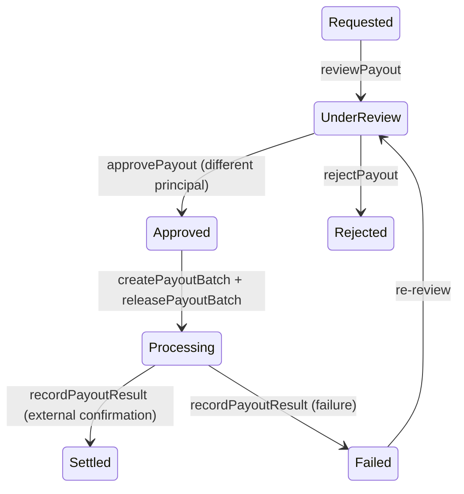

# Commands: earnings and payouts

| Field | Value |
|---|---|
| Revision | 1.0 · 2026-10-30 |
| Owner | Backend and API architect |
| Purpose | Full command contracts for supplier/rider earning recognition and the payout request/maker-checker/batch/settlement lifecycle — file code **EP** in [API_SPECIFICATION.md](API_SPECIFICATION.md) §12. |
| Status | See status column; all PROPOSED. |

Format per command: **Purpose · Callers · Request · Response · Errors · Idempotency/transaction · Events · Screens · Refs.**

## `recognizeSupplierEarning` (PROP, Scheduled/system)
Purpose: post a supplier earning at the approved recognition event (BR-010 PENDING). Callers: Sys, triggered by the recognition milestone. Idempotency: PG-TX, one recognition per source order/obligation. Events: `supplierEarningRecognized`. Screens: S-08, NS-01. Refs: FR-036; BR-009, BR-010.

## `recognizeRiderEarning` (PROP, Scheduled/system)
Purpose: post a rider earning on verified delivery completion. Callers: Sys. Idempotency: PG-TX, unique per `deliveryAssignmentId` (INV-19). Events: `riderEarningRecognized`. Screens: R-08, NR-01. Refs: FR-037; BR-011.

## `requestPayout` (PROP)
Purpose: request transfer of an eligible payable balance. Callers: Sup, Rdr (own balance). Request: `{amountMinor, destinationId}`. Errors: `insufficient_eligible_balance` (INV-14). Idempotency: PG-TX. Screens: S-09, NS-02, NR-02. Refs: FR-038; BR-014.

## `reviewPayout` (PROP)
Purpose: Accounts Operator reviews a payout request against supporting transactions. Callers: AcOp. Screens: NF-07. Refs: FR-038; BR-014, BR-020.

## `approvePayout` (PROP)
Purpose: approve a reviewed request — must be a different principal than the requester/preparer (NFR-016, INV-15). Callers: PayAp. Errors: `maker_equals_checker`. Screens: NF-07. Refs: FR-038; BR-020.

## `rejectPayout` (PROP)
Purpose: reject a request with a reason. Callers: AcOp, AcMgr, PayAp. Screens: NF-07. Refs: FR-038.

## `createPayoutBatch` (PROP)
Purpose: group approved requests for release. Callers: AcOp. Screens: NF-08. Refs: FR-038.

## `releasePayoutBatch` (PROP)
Purpose: release a batch for external transfer — must not be the batch's own creator. Callers: PayAp. Events: `payoutReleased`. Screens: NF-08. Refs: FR-038; BR-020.

## `recordPayoutResult` (PROP)
Purpose: record the external transfer's actual outcome — only this command may mark a payout Settled (INV-14). Callers: AcOp (manual evidence), Sys (processor result). Events: `payoutSettled`, `payoutFailed`. Screens: NS-03, NF-08. Refs: FR-038.

## `placeHold` / `releaseHold` (PROP)
Purpose: restrict or release part of a supplier/rider payable balance (dispute, discrepancy, compliance). Callers: `placeHold`: AcOp, AcMgr. `releaseHold`: AcMgr. Screens: NF-05, NF-06. Refs: FR-036, FR-038; BR-014, BR-015.

## Payout state machine (glossary §4)

