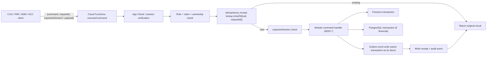

# Backend domain design

| Field | Value |
|---|---|
| Revision | 1.0 · 2026-10-30 |
| Owner | Architecture lead |
| Purpose | Define the shared backend's internal module boundaries (MOD-*), the command pipeline, store ownership between Firestore and the proposed PostgreSQL ledger, the outbox pattern, and scheduled jobs. |
| Applies to | BE, consumed by CUS, PAR, ADM, ACC |
| Depends on | [System architecture](SYSTEM_ARCHITECTURE.md), [multi-app architecture](MULTI_APP_ARCHITECTURE.md), [ADR-005](../adr/005-hybrid-datastore.md), [ADR-008](../adr/008-idempotent-command-envelope.md), [ADR-012](../adr/012-notifications-and-scheduled-jobs.md), [API specification](../api/API_SPECIFICATION.md) |
| Authoritative policies | None defines a value; MOD-POL module hosts policy parameters cited by BR-001…BR-026 |
| Status | PROPOSED — NOT APPROVED. OBSERVED baseline: one callable `executeCommand` in `backend/functions/src`. |

## 1. Module map (MOD-*)

| Code | Module | Responsibility | Primary store |
|---|---|---|---|
| MOD-AUTH | Identity and roles | Authentication, role/claim resolution, staff accounts, application decisions | Firestore |
| MOD-CAT | Catalogue | Kitchens, meals, variants, price versions, capacity, stock reservation | Firestore |
| MOD-SUB | Subscriptions | Subscription agreements, schedules, meal obligations, pause/skip/replace | Firestore |
| MOD-PRC | Pricing | Quotes, price snapshots, discount/tax computation | Firestore (quotes), reads PG for fee parameters |
| MOD-ORD | Orders | One-time orders, order items, cart | Firestore |
| MOD-PAY | Payments | Payment intents/attempts, gateway events/verification, refunds | PostgreSQL |
| MOD-COD | COD | Collections, remittances, discrepancies | PostgreSQL |
| MOD-CRD | Credits | Credit accounts and transactions | PostgreSQL |
| MOD-LED | Ledger | Accounts, journals, periods, reconciliation | PostgreSQL |
| MOD-SET | Settlement | Supplier/rider earnings, holds, payout requests/approvals/batches | PostgreSQL |
| MOD-DLV | Delivery | Assignments, events, proof, rider location | Firestore (short-retention location) |
| MOD-NOT | Notifications | Outbox consumption, preferences, delivery/email log | Firestore |
| MOD-ADM | Admin operations | Zones, incidents, dispatch | Firestore |
| MOD-AUD | Audit | Immutable audit events | Firestore (append-only) + PG mirror for financial events |
| MOD-RPT | Reporting | Derived read models and exports | Reads both stores |
| MOD-POL | Policy | Versioned policy parameters (cutoffs, fees, limits — values from BR-001…BR-026 once approved) | Firestore |

Each module owns its entities (conventions §8) and exposes only the commands listed in [api/API_SPECIFICATION.md](../api/API_SPECIFICATION.md); no module reads another module's store directly — it calls that module's command or reads its published read model.

## 2. Command pipeline (extends ADR-002, ADR-008)

Every command commits its store write(s) and its outbox event(s) in the same transaction as its primary store (Firestore transaction, or a PostgreSQL transaction for ledger-owning modules). A command that must write to both stores (for example, `recognizeSupplierEarning`, which updates an operational flag in Firestore and posts a journal in PostgreSQL) performs the PostgreSQL write first as the financial system of record, then writes an outbox event that a consumer uses to update the Firestore read model; the Firestore update is therefore eventually consistent and is never read as authoritative for money (NFR-030).

## 3. Outbox and jobs (PROPOSED, extends ADR-012)

- **Outbox table/collection:** one row per domain event, written in the same transaction as the state change; a separate consumer processes rows at-least-once and marks them processed idempotently (so consumers must themselves be idempotent, matching NFR-005).
- **Scheduled jobs:** `generateMealObligations` (daily, per active subscription schedule), `expireQuotes`/`releaseStock` (short interval, for expired reservations), `flagOverdueCodRemittance` (per BR-013 parameter once approved), `expireCredits` (only if BR-019 is approved), `closePeriod` reminder (per accounting calendar).
- **Reconciliation job:** compares Firestore operational events against expected PostgreSQL journal postings and raises `ent.ReconciliationException` on any mismatch (NFR-026); it never auto-corrects.

## 4. Failure handling

A command that fails after its primary store commit but before its outbox write is detected by a periodic consistency sweep (NFR-026) and surfaced as an exception, never silently retried into a duplicate effect. A command that times out on the client side but actually committed on the server is safely retried with the same `requestId` and returns the original result (NFR-005, NFR-015).

## Acceptance and verification

Design-only. Verification requires: a replayed `requestId` producing exactly one effect across both stores in an integration test; a simulated mid-transaction crash never producing a visible duplicate or lost event; a reconciliation sweep correctly flagging an injected mismatch.

## Open decisions

The specific managed PostgreSQL provider/region/budget (DEC-010), the outbox consumer's exact delivery guarantee implementation, and every MOD-POL parameter value (BR-001…BR-026) remain open.
