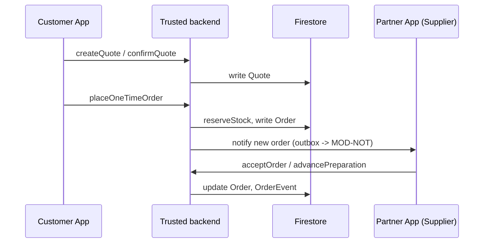
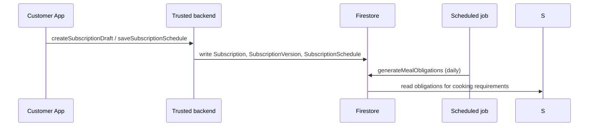
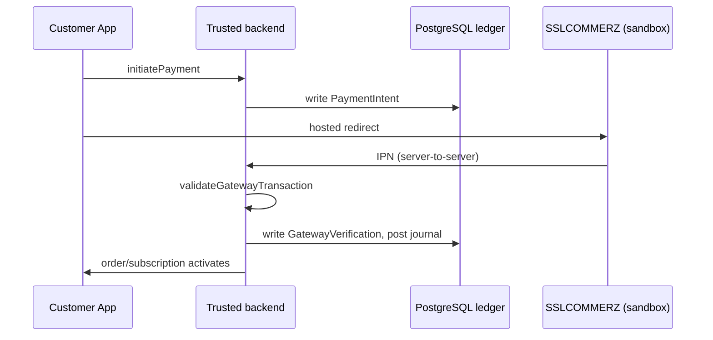
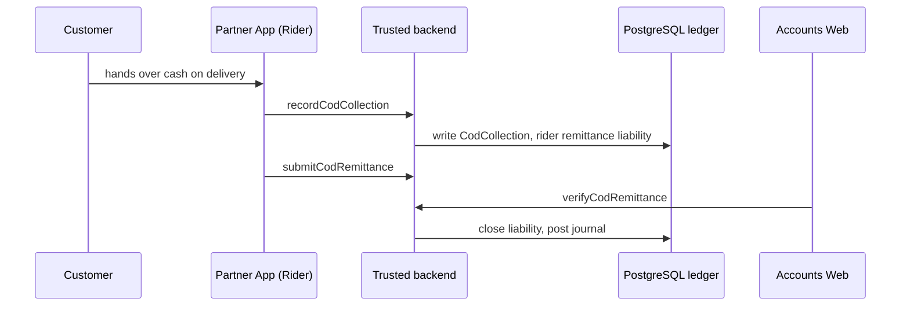
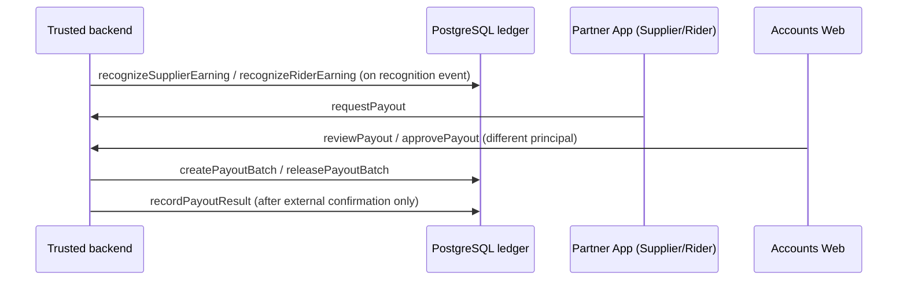

# Data flow

| Field | Value |
|---|---|
| Revision | 2.0 · 2026-10-30 (supersedes 1.0, manual-reference-only flow) |
| Owner | Architecture lead |
| Purpose | Trace how data moves through the system for the core flows: ordering, subscription scheduling, payment, COD, earnings/settlement. |
| Depends on | [Backend domain design](BACKEND_DOMAIN_DESIGN.md), [database/DATA_CONSISTENCY.md](../database/DATA_CONSISTENCY.md) |
| Status | PROPOSED — NOT APPROVED. |

## Order and preparation (extends the original flow)

## Subscription scheduling

## Payment (online, sandbox only in this phase)

## COD collection and remittance

## Earnings and settlement

## Cross-cutting rule

Every arrow into Firestore or PostgreSQL above happens inside a trusted-backend transaction with an idempotency receipt; no client writes a business-authoritative value directly, in any of the five flows.
