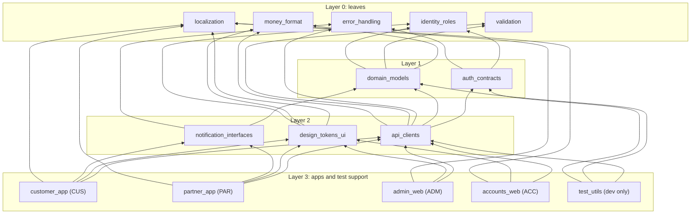
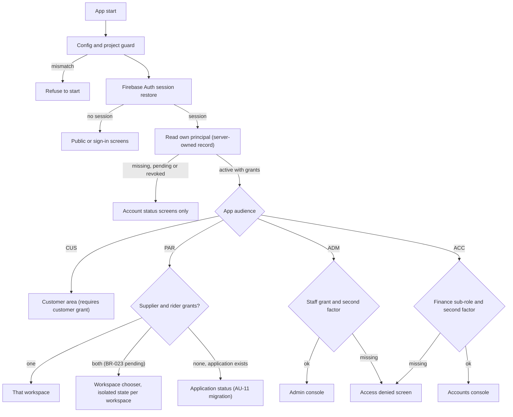

# Multi-application architecture and monorepo

| Field | Value |
|---|---|
| Revision | 1.0 · 2026-10-30 |
| Owner | Architecture lead (author B1) |
| Purpose | Define the four Flutter applications, the monorepo layout, the shared packages and their acyclic dependency map, per-app configuration and release channels, route registration and permission tests, and the migration of today's single combined app. |
| Applies to | CUS, PAR, ADM, ACC and all shared packages |
| Depends on | [Conventions §3](../analysis/CONVENTIONS_AND_ID_REGISTER.md), [system architecture](SYSTEM_ARCHITECTURE.md), [ADR-004](../adr/004-four-app-monorepo.md), [ADR-011](../adr/011-roles-claims-and-sessions.md), [code reality snapshot](CODE_REALITY_SNAPSHOT.md) |
| Authoritative policies | BR-023 (dual-role accounts, PENDING) governs the Partner App workspace switch; no other policy value is defined here |
| Status | Draft for review. Layout, package names and channels are **PROPOSED — NOT APPROVED**. No monorepo, package or build exists; the OBSERVED baseline is a single Flutter package `smart_tiffin`. |

## 1. The four applications

| Code | Application | Platform | Audience | Workspaces | Primary modules | Screen families |
|---|---|---|---|---|---|---|
| CUS | Customer App | Flutter, Android first (iOS-ready) | Guests and customers | Public shell (P-01…P-04) and customer area | MOD-CAT, MOD-SUB, MOD-PRC, MOD-ORD, MOD-PAY, MOD-CRD, MOD-DLV (tracking), MOD-NOT | P-, AU-01…AU-08, AU-12, C-, NC-, SH-@CUS |
| PAR | Partner App | Flutter, Android | Approved suppliers and riders (and applicants) | **Supplier workspace** and **Rider workspace**, one binary | MOD-CAT, MOD-ORD (supplier side), MOD-DLV, MOD-COD, MOD-SET, MOD-NOT | AU-09…AU-11, S-, NS-, R-, NR-, SH-@PAR-S, SH-@PAR-R |
| ADM | Admin Web | Flutter Web, desktop-first | Operations and governance staff | Single workspace with permission-scoped sections | MOD-ADM, MOD-AUTH, MOD-POL, MOD-AUD, MOD-RPT (limited) | AU-13, A-, NA-, SH-@ADM |
| ACC | Accounts Web | Flutter Web, desktop-first | Accounts and finance staff (sub-roles) | Single workspace; features gated by sub-role | MOD-LED, MOD-PAY (reconciliation), MOD-COD (verification), MOD-SET (payouts), MOD-CRD (views), MOD-RPT | NF-, accounts instances of A-12/A-13 responsibilities, SH-@ACC |
| BE | Shared backend | Trusted services | All apps | — | All MOD-* | — |

Admin and Accounts are separate role-protected workspaces even though they share packages and the backend (USER-REQ). An ADM principal has **no implicit finance authority**; ACC and ADM never share a session, an origin or a navigation graph.

## 2. Monorepo layout (PROPOSED)

```text
smart-tiffin/                         (repository root; today the root also holds the documentation set)
  apps/
    customer_app/                     package st_customer_app
    partner_app/                      package st_partner_app
    admin_web/                        package st_admin_web
    accounts_web/                     package st_accounts_web
  packages/
    auth_contracts/                   package st_auth_contracts
    identity_roles/                   package st_identity_roles
    domain_models/                    package st_domain_models
    design_tokens_ui/                 package st_design_tokens_ui
    localization/                     package st_localization
    api_clients/                      package st_api_clients
    validation/                       package st_validation
    error_handling/                   package st_error_handling
    notification_interfaces/          package st_notification_interfaces
    money_format/                     package st_money_format
    test_utils/                       package st_test_utils (dev dependency only)
  contracts/                          command and event schemas, golden fixtures (source for both languages)
  backend/
    functions/                        trusted command boundary, jobs, gateway endpoint
    sql/                              PostgreSQL migrations, constraints, seed of chart of accounts
  firebase/                           Firestore rules and indexes, Storage rules, hosting targets
  docs/                               documentation set (this tree after hand-over)
```

Today (OBSERVED) the repository contains `app/` (one package), `backend/functions`, `firebase/`, and documentation; no `apps/`, `packages/`, `contracts/` or `backend/sql/` exists. The move is described in section 11 and in [migration strategy](../database/MIGRATION_STRATEGY.md).

Tooling choice (open, OD-7): Dart pub workspaces (part of the SDK) versus an additional workspace manager. Prefer the SDK feature unless a concrete need appears; do not add both. The choice is recorded in [ADR-004](../adr/004-four-app-monorepo.md) and [monorepo and build ownership](../setup/MONOREPO_AND_BUILD_OWNERSHIP.md) when made.

## 3. Shared packages

Directory names are fixed by the master prompt. Dart package names carry an `st_` prefix to avoid collisions.

| Package | Responsibility | Contains | Must not contain | Depends on |
|---|---|---|---|---|
| `money_format` | Money value type and formatting | `Money` (integer minor units plus currency code), parsing of user input to minor units, two-decimal display, Bangla and Latin digit rendering, deterministic remainder allocation helper | Floating-point arithmetic on money, tax or fee rules | — |
| `error_handling` | Typed failures | `CommandFailure` taxonomy mapped from server codes, outcome-unknown state, retry classification, localisation keys for errors | UI widgets, transport code | — |
| `validation` | Input validation shared by clients and fixtures | Phone, email, address length, date-only parsing, slot identifiers, id format `^[A-Za-z0-9_-]{1,128}$` | Authorization, pricing | — |
| `localization` | Strings and locale | ARB resources for `en` and `bn`, locale controller, Bangla shaping and number formats, no translated identifiers | Business logic | — |
| `identity_roles` | Roles and permissions vocabulary | Role codes, sub-roles, permission constants, route-permission matrix types, `can(permission)` for UX gating | Authorization decisions the server relies on | — |
| `domain_models` | Generated, typed domain models | Immutable models for entities that cross the wire (quote, order summary, obligation, credit view, payout status), enums for state vocabularies, parsing with explicit errors | Persistence code, widgets | `money_format`, `validation`, `identity_roles` |
| `auth_contracts` | Authentication abstractions | `AuthSession`, `SessionState`, sign-in method descriptors, claims view, `PrincipalState` (pending, active, revoked) | Firebase SDK imports (an adapter lives in `api_clients`) | `identity_roles`, `error_handling` |
| `api_clients` | Transport to the backend | `CommandClient` (single envelope `{command, requestId, expectedVersion?, payload}`), typed command builders, Firestore read adapters, response parsing, request-id generation, retry-with-same-id | UI, policy decisions, secrets | `auth_contracts`, `domain_models`, `error_handling`, `validation`, `money_format` |
| `notification_interfaces` | Messaging abstractions | Token registration contract, inbox model, deep-link route keys, preference model | FCM implementation details beyond an adapter | `domain_models`, `error_handling` |
| `design_tokens_ui` | Visual identity and reusable widgets | Colour tokens per role identity (orange customer, green supplier, blue rider, admin indigo, accounts identity), typography, spacing, glass panels, state views, form fields, money text, responsive breakpoints | Business logic, routing | `localization`, `money_format`, `identity_roles` |
| `test_utils` | Test support | Deterministic fixtures (language-neutral JSON from `contracts/`), fakes for `CommandClient`, fake clock in Asia/Dhaka, golden helpers | Production code paths | `domain_models`, `api_clients`, `auth_contracts`, `identity_roles`, `money_format`, `error_handling` |

The OBSERVED baseline contains the seeds of several of these inside one package: `AppRole` and `ScreenSpec` (`lib/design/spec.dart`), `CommandFailure`, `TiffinRepository` and `commandPayload` (`lib/data`), `tiffinTheme` (`lib/ui/theme.dart`), and the bilingual `tr(en, bn)` helper in `AppSession`. These move to the packages above; see [code reality snapshot](CODE_REALITY_SNAPSHOT.md).

## 4. Dependency map (acyclic)

An arrow means "depends on". Layers are strict: a package may depend only on lower layers. Apps are the top layer and never depend on each other. `test_utils` is only ever a dev dependency of apps.



### 4.1 Rules the map encodes

1. Dependencies point downward only. No package imports an app; no app imports another app; layer 2 packages do not import each other (`api_clients`, `notification_interfaces`, `design_tokens_ui` are siblings).
2. Layer 0 and layer 1 packages are pure Dart (no Flutter, no Firebase) so they can be tested without a device and reused by tooling. `design_tokens_ui` is the only package with Flutter widgets besides apps.
3. Firebase SDK imports are allowed only in the adapter code inside `api_clients` and `notification_interfaces` implementations and in each app's bootstrap. `domain_models`, `auth_contracts` and `identity_roles` never import Firebase.
4. Packages at layers 0 to 2 do not use `test_utils`, even in `dev_dependencies`, because `test_utils` depends on them; they carry tiny local test helpers.
5. Shared code carries no per-role navigation, no financial calculation of authoritative amounts, and no policy values.

### 4.2 App-to-package usage

| Package | CUS | PAR | ADM | ACC |
|---|---|---|---|---|
| `money_format` | yes | yes | yes | yes (extended formatting for statements) |
| `error_handling`, `validation`, `localization` | yes | yes | yes | yes |
| `identity_roles`, `auth_contracts` | yes | yes | yes | yes |
| `domain_models`, `api_clients` | yes | yes | yes | yes |
| `design_tokens_ui` | yes | yes | yes | yes |
| `notification_interfaces` | yes (FCM) | yes (FCM) | in-app inbox only | in-app inbox only |
| `test_utils` | dev | dev | dev | dev |

### 4.3 Verification of the map (planned)

A repository check, run in CI ([CI/CD](../deployment/CI_CD.md)), must (a) resolve the workspace with the package manager, (b) fail on a dependency cycle, (c) fail when any `pubspec.yaml` lists a package above its layer or another app, (d) fail when a layer 0 or 1 package imports `flutter`, `firebase_*` or `cloud_*`. Until the tool exists the map is a design, not a guarantee.

## 5. Per-application configuration

| Item | CUS | PAR | ADM | ACC |
|---|---|---|---|---|
| Dart package | `st_customer_app` | `st_partner_app` | `st_admin_web` | `st_accounts_web` |
| Android application id (PROPOSED) | `com.smarttiffin.customer` | `com.smarttiffin.partner` | — | — |
| Web hosting target | — | — | `admin` site (separate origin) | `accounts` site (separate origin) |
| Firebase app registration | one Android app per environment | one Android app per environment | one web app per environment | one web app per environment |
| App Check provider | Play Integrity (OBSERVED in baseline) | Play Integrity | reCAPTCHA-based web provider (OBSERVED pattern: site key required in Firebase mode) | separate site key from ADM |
| Sign-in methods | per DEC-009 (baseline: email and password, Google, phone) | per DEC-009; applicants and approved partners | invited staff accounts, second factor required (ADR-011) | invited staff accounts, second factor required |
| Locale | `en`, `bn` | `en`, `bn` | `en`, `bn` | `en`, `bn` |
| Role identity colour | warm orange | green (supplier), blue (rider) | admin indigo | distinct accounts identity (design system decides) |
| Minimum OS | PENDING (DEC-001) | PENDING (DEC-001) | evergreen browsers (to be listed) | evergreen browsers (to be listed) |

The baseline Android application id `com.smarttiffin.smart_tiffin` (OBSERVED) is retired when the split happens; nothing indicates it was ever published or registered with Firebase (no `google-services` plugin, no `.firebaserc`; only `.firebaserc.example` exists).

## 6. Environment injection

The baseline injects public Firebase configuration with compile-time definitions (OBSERVED in `app/lib/app/session.dart`): `FIREBASE_ENABLED`, `FIREBASE_API_KEY`, `FIREBASE_PROJECT_ID`, `FIREBASE_APP_ID`, `FIREBASE_MESSAGING_SENDER_ID`, `FIREBASE_REGION`, `FIREBASE_AUTH_DOMAIN`, `FIREBASE_STORAGE_BUCKET`, `USE_FIREBASE_EMULATORS`, `FIREBASE_EMULATOR_HOST`, `APP_CHECK_WEB_SITE_KEY`. Without `FIREBASE_ENABLED` the app starts in a **design mode** with a synthetic repository. The multi-app design keeps the mechanism and adds:

| Rule | Detail |
|---|---|
| One file per environment per app | `config/<app>.<env>.json` consumed by the compiler's define-from-file option; real files are not committed; a template with empty values is |
| Extra keys | `APP_ENV` (`dev`, `staging`, `prod`), `APP_AUDIENCE` (`customer`, `partner`, `admin`, `accounts`), `EXPECTED_PROJECT_ID` |
| Startup guard | The app refuses to start when `FIREBASE_PROJECT_ID` differs from `EXPECTED_PROJECT_ID` or the environment does not match the build flavour; a development build cannot silently reach production |
| Public values only | API key, project and app identifiers, region, site keys; never service accounts, gateway credentials, database credentials or signing keys |
| Design mode | A production build must not contain the design-mode switch enabled; a release check asserts `FIREBASE_ENABLED=true` and `APP_ENV` matches the channel |
| Server-side configuration | Secrets live in the trusted runtime's secret store; see [secrets management](../security/SECRETS_MANAGEMENT.md) and [configuration](../setup/CONFIGURATION.md) |

## 7. Release channels and build verification

| Channel | CUS and PAR | ADM and ACC | Promotion gate (planned) |
|---|---|---|---|
| Development | Local debug against emulators | Local web against emulators | Format, analyze, unit and widget tests |
| Staging | Internal testing track of the Android store (to be confirmed) | Hosting preview channel on the staging project | Route-permission suite, Rules suite, command contract tests, UI checklist |
| Production | Staged rollout from closed to open track | Live hosting site | Release checklist, financial test pack TEST-201…260, security tests, approvals in [release checklist](../deployment/RELEASE_CHECKLIST.md) |

Build verification per app (planned, none executed): dependency-rule check; code formatting check; static analysis with the lint set (OBSERVED: `flutter_lints` in the baseline); unit, widget and route-permission tests; a release build (Android app bundle or web bundle); artefact checks (no design-mode flag, no debug App Check provider, required permissions present). Results are recorded only in [test results](../testing/TEST_RESULTS.md). Hosting and rollout procedures are in [deployment guide](../deployment/DEPLOYMENT_GUIDE.md), [web hosting for admin and accounts](../deployment/WEB_HOSTING_ADMIN_AND_ACCOUNTS.md) and [rollback plan](../deployment/ROLLBACK_PLAN.md).

## 8. Authentication and role routing



Notes. The role shown in the UI is derived from the server-owned principal and grants (OBSERVED baseline subscribes to `principals/{uid}` and ignores any chosen "preview role" when Firebase mode is on). A visually selected account type never grants authorisation. The Partner App keeps one API client, navigation stack, notification channel set and financial view model per workspace; switching workspace tears the previous one down and shows balances that belong only to the active workspace (no shared mutable balances). Whether one person may hold two partner grants is BR-023 (PENDING): the design supports it without assuming it.

## 9. Inter-app communication

The apps do not talk to each other. Each reads and writes only through the backend; a change made in one app reaches the others through committed records and notifications.

| Interaction | Mechanism | Example |
|---|---|---|
| Operational state | Firestore read models updated by commands | Supplier marks order ready → customer tracking view updates |
| Financial state | PostgreSQL facts → outbox → Firestore projection for CUS and PAR; finance queries for ACC | COD remittance verified in ACC → rider's remaining liability updates in PAR |
| Notifications | Outbox → notification module → FCM or in-app inbox | Payout settled → supplier notification with generic text |
| Deep links | Route keys carried in notification data; the receiving app validates session and object access before opening | Tapping a delivery notification opens PAR rider route R-01 only for the assigned rider |
| Shared packages | Compile-time only | `money_format` ensures the same amount renders identically |

Dispatch, incidents and approvals that span ADM and ACC use explicit records (`ent.Ticket`, `ent.Dispute`, `ent.Adjustment`, `ent.PayoutRequest`) with their own state machines, never a shared mutable summary.

## 10. Route registration and permission tests

Each app owns a **route registry**: a list of entries `{screenId, path, audience, requiredPermission, publicAllowed}` declared in the app package. Navigation, deep links and notification links must resolve through the registry; there is no other way to open a screen.

| # | Planned test | What it proves | Pattern in baseline |
|---|---|---|---|
| T1 | Registry completeness: every screen ID the app owns in the [complete screen inventory](../design/COMPLETE_SCREEN_INVENTORY.md) appears exactly once | No orphan or duplicate routes | OBSERVED `screen_coverage_test.dart` checks IDs against an inventory document |
| T2 | Destination existence: every action target resolves to a registered route | No dead ends (P-02 kitchen cards are the known prototype gap) | OBSERVED same test checks `ActionSpec.target` |
| T3 | Isolation: set difference between this app's registry and each other app's registry is empty except for shared `SH-*` instances | An app cannot open another app's screens | New |
| T4 | Permission matrix: for each role × route the guard returns allow or deny exactly as the matrix in [authorization](../api/AUTHORIZATION.md) states | UI gating matches the documented permissions | Partly OBSERVED (`permits(role)`) |
| T5 | Guard fallback: a denied or unknown route shows the denied screen, never a blank page or another role's content | Fail-closed navigation | OBSERVED fallback to a denied screen ID |
| T6 | Staff apps: without a second factor or finance sub-role, ADM and ACC shells show only the sign-in or denied screen | Staff isolation | New |
| T7 | Server parity: the same role × operation matrix is exercised against the command boundary (not the UI) | UI visibility is not enforcement | OBSERVED command tests cover role checks; extend |
| T8 | Notification deep link: a link for an object the user does not own opens the denied screen and leaks nothing | No link-based enumeration | New |

T1 to T6 are client tests; T7 is a backend test; none has been executed by this documentation effort. Allocated identifiers belong in [test cases](../testing/TEST_CASES.md) (range TEST-118…199) and results in [test results](../testing/TEST_RESULTS.md).

## 11. Local development path and deterministic fixtures

| Workspace | Local path | Fixtures | Deployable configuration (not published here) |
|---|---|---|---|
| CUS, PAR | Android emulator or device, Firebase emulators for Auth, Firestore and Functions (OBSERVED ports 9099, 8080, 5001), local PostgreSQL container for ledger tests (PROPOSED) | `test_utils` JSON fixtures, fixed clock in Asia/Dhaka, mock gateway | `config/<app>.dev.json` template; emulator host define |
| ADM, ACC | Browser against the same emulators; hosting emulator for separate origins | Same fixtures plus finance fixtures (balanced journals with HYPOTHETICAL amounts) | `config/<app>.dev.json`; hosting targets in `firebase/` |
| BE | Functions emulator plus local PostgreSQL; contract tests against `contracts/` | Golden command envelopes and responses | Emulator-only project id; no cloud writes |

Fixture rules: no real customer data, no real gateway identifiers, no secrets; every monetary fixture is an integer in minor units and labelled HYPOTHETICAL.

## 12. Migration from the single combined app

| Baseline element (OBSERVED) | Destination (PROPOSED) |
|---|---|
| `app/lib/app/session.dart` (`AppSession`, `createSession`) | Split: sign-in and principal subscription to `api_clients` + `auth_contracts`; bootstrapping to each app |
| `app/lib/data/*` (`TiffinRepository`, `FirebaseTiffinRepository`, `DesignRepository`, `commandPayload`) | `api_clients` (transport), design repository becomes a `test_utils` fake and a design-preview mode of each app |
| `app/lib/design/*` (`ScreenSpec` library, 129 family IDs F129) | Screen specifications distributed per app by screen ID prefix; legacy 94 and proposed 55 identifiers per the [conventions](../analysis/CONVENTIONS_AND_ID_REGISTER.md) |
| `app/lib/ui/theme.dart` (`roleColor`, `tiffinTheme`) | `design_tokens_ui` |
| `assets/fonts` (Noto Sans, Noto Sans Bengali) | `localization` / `design_tokens_ui` assets |
| `app/test/*` (24 test cases in 8 files, by pattern count) | Distributed to the owning package or app; the screen-coverage test reads an inventory document and must follow it to its new location |
| `backend/functions`, `firebase/` | Kept; extended with modules, outbox and PostgreSQL adapters |

Sequence guidance (no dates): create the workspace and the layer 0 packages; move the OBSERVED seeds; split CUS first because it already carries the customer screens; add PAR with a single workspace before the chooser; build ADM and ACC after the ledger commands exist so their first screens are real, not synthetic. [Implementation plan](../planning/IMPLEMENTATION_PLAN.md) owns the order.

## 13. Acceptance and verification conditions

| Condition | Evidence |
|---|---|
| Four app packages build independently with their own configuration | Build logs per app recorded in test results |
| Dependency map holds | Output of the planned dependency check (section 4.3) |
| No cross-app screen access | Tests T1 to T8 executed |
| No privileged credential in any client artefact | Artefact inspection record in [security review planning](../security/SECURITY_REVIEW_PLANNING.md) |
| Partner App workspaces are isolated | Tests proving separate state, notifications and balances; BR-023 outcome recorded |

## 14. Open decisions

OD-7 workspace tooling (SDK workspaces vs a manager) · OD-8 generated models: contract-first schemas generating Dart and backend types versus hand-written models with golden contract tests (recommendation: contract-first; decide before the first command is implemented) · OD-9 final Android application ids and store listing structure · OD-10 whether ADM and ACC share one hosting project with separate sites or use separate projects (separate sites recommended) · BR-023 dual-role policy · DEC-001 minimum Android version.
