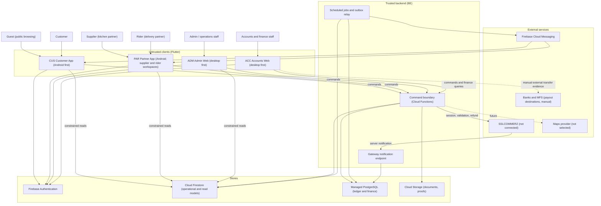

# System architecture

| Field | Value |
|---|---|
| Revision | 2.0 · 2026-10-30 (rewrites revision of 2026-10-28) |
| Owner | Architecture lead (author B1) |
| Purpose | Describe the target architecture of the four-application Smart Tiffin platform and its shared backend: contexts, runtime containers, store responsibilities, trust boundaries, failure behaviour and the evidence needed before any part is called done. |
| Applies to | CUS, PAR, ADM, ACC, BE (all modules MOD-*) |
| Depends on | [Conventions](../analysis/CONVENTIONS_AND_ID_REGISTER.md), [master prompt digest](../analysis/SOURCE_MASTER_PROMPT_DIGEST.md), [SRS](../SRS.md), [glossary](../requirements/GLOSSARY_AND_TERMINOLOGY.md), [policy register](../requirements/POLICY_DECISION_REGISTER.md), [code reality snapshot](CODE_REALITY_SNAPSHOT.md) |
| Authoritative policies | BR-001…BR-005 ([business rules](../requirements/BUSINESS_RULES.md)); BR-006…BR-026 ([policy register](../requirements/POLICY_DECISION_REGISTER.md)). None is approved; this document defines no policy value. |
| Status | Draft for review. The structure below is **PROPOSED — NOT APPROVED** except where a row is tagged OBSERVED or USER-REQ. Nothing described here is implemented beyond the OBSERVED baseline, and nothing has been tested by this documentation effort. |

## 1. What changed and why

The previous revision (2026-10-28) described **one combined Flutter application** with four workspaces over Firebase Authentication, Cloud Firestore, FCM and a "proposed trusted command service". The user's later direction (master prompt, 2026-10-30) replaces this in four ways, each of which is a [PROPOSED] architecture consequence rather than a settled design:

| Change | Source | Consequence |
|---|---|---|
| Four applications instead of one combined app | USER-REQ | CUS, PAR, ADM, ACC with isolated release, routing and permission tests; see [multi-app architecture](MULTI_APP_ARCHITECTURE.md) and [ADR-004](../adr/004-four-app-monorepo.md) |
| Accounts and finance as a first-class domain | USER-REQ | Double-entry ledger, payouts, COD remittance and reconciliation; see [ADR-005](../adr/005-hybrid-datastore.md), [ADR-006](../adr/006-double-entry-ledger.md) |
| Online payment through SSLCOMMERZ (not connected) plus COD | USER-REQ | Gateway abstraction and webhook handling behind the trusted boundary; see [ADR-007](../adr/007-payment-gateway-abstraction-and-cod.md) |
| Flexible subscriptions with per-meal obligations, credits, quotes | USER-REQ | Server quotes with immutable snapshots; subscription agreement distinct from meal obligation; see [ADR-009](../adr/009-quote-and-price-snapshots.md), [ADR-014](../adr/014-subscription-agreement-and-meal-obligations.md) |

Preserved from the previous revision: the untrusted-client principle, the trusted command boundary, Android first, Bangla and English, the four confirmed delivery states, bounded queries and cursor pagination, honest outcome-unknown handling, and the rule that no privileged operation lives in a client.

## 2. Architecture decisions at a glance

| # | Decision | Tag | Detail |
|---|---|---|---|
| 1 | Flutter for all four clients; CUS and PAR are Android-first mobile apps (iOS-ready), ADM and ACC are desktop-first Flutter Web | USER-REQ | [Multi-app architecture](MULTI_APP_ARCHITECTURE.md) |
| 2 | One shared backend and one domain model; no per-app databases | USER-REQ | [Backend domain design](BACKEND_DOMAIN_DESIGN.md) |
| 3 | Firebase Authentication for identity and sessions | USER-REQ (source preference), OBSERVED in `app/` | [ADR-011](../adr/011-roles-claims-and-sessions.md) |
| 4 | Cloud Firestore for operational data and client-readable read models | USER-REQ (source preference), OBSERVED | [Database design](../database/DATABASE_DESIGN.md) |
| 5 | Cloud Functions as the only trusted command boundary (single callable `executeCommand` today) | OBSERVED, extended as PROPOSED | [ADR-002](../adr/002-trusted-command-boundary.md), [ADR-008](../adr/008-idempotent-command-envelope.md) |
| 6 | A managed PostgreSQL database for the ledger, payments, COD, credits, earnings, payouts and reconciliation | PROPOSED — NOT APPROVED | [ADR-005](../adr/005-hybrid-datastore.md); provider, edition, region: PENDING (DEC-010) |
| 7 | Integer minor units (BDT paisa) everywhere; no floating-point money | PROPOSED (DEC-008 pending) | [Financial data model](../database/FINANCIAL_DATA_MODEL.md) |
| 8 | Asia/Dhaka service dates with canonical UTC instants; cutoffs evaluated on the server | PROPOSED (DEC-008, BR-022 pending) | [Time and cutoff policy](TIME_AND_CUTOFF_POLICY.md), [ADR-013](../adr/013-time-zone-and-cutoff-evaluation.md) |
| 9 | Outbox plus scheduled jobs for cross-store consistency and notifications | PROPOSED | [ADR-012](../adr/012-notifications-and-scheduled-jobs.md), [Data consistency](../database/DATA_CONSISTENCY.md) |
| 10 | SSLCOMMERZ behind a gateway abstraction; no credentials, no live traffic | USER-REQ (gateway choice), PROPOSED (abstraction) | [Integration design](INTEGRATION_DESIGN.md) |
| 11 | Monorepo with four apps and shared packages without circular imports | USER-REQ (requirement), PROPOSED (layout) | [ADR-004](../adr/004-four-app-monorepo.md) |

## 3. System context



Reading the diagram: clients never reach PostgreSQL, never write Firestore directly (OBSERVED: the deployed-candidate rules deny all client writes) and never hold gateway, database or messaging credentials. ACC reads finance data through the trusted boundary only. Maps and bank connections are not integrations; they are listed so their absence is explicit.

## 4. Runtime containers (PROPOSED)

| Container | Technology (tag) | Responsibility | Scaling and limits |
|---|---|---|---|
| CUS, PAR | Flutter, Android (OBSERVED toolchain, new split PROPOSED) | Presentation, local drafts, request state, role-appropriate navigation | Per-device |
| ADM, ACC | Flutter Web served from separate Firebase Hosting sites (PROPOSED) | Desktop operations and finance workspaces; separate origins, CSP and App Check keys | CDN-served static assets |
| Command boundary | Cloud Functions (2nd generation) callable `executeCommand` (OBSERVED: Node 22, ESM, `maxInstances: 10`, 30 s timeout, App Check enforced) | Authentication context, authorization, validation, idempotency, calculation, atomic commit, audit, outbox | Development safeguards, not measured capacity |
| Gateway notification endpoint | Separate HTTPS function, not callable (PROPOSED) | Receives provider server notifications; stores raw event durably; never trusts the body | Public endpoint; hardened separately |
| Jobs | Cloud Scheduler triggering functions, optionally Cloud Tasks for retries (PROPOSED) | Meal-obligation generation, outbox relay, expiry sweeps, COD overdue evaluation, reconciliation, certificate expiry | Single-runner lease per job |
| Firestore | Native mode (region PENDING DEC-010) | Operational records, reservations, read models | Contention rules in [indexing strategy](../database/INDEXING_STRATEGY.md) |
| PostgreSQL | Managed service (vendor PENDING) | Ledger and finance records with relational constraints | Pooled private connections from Functions only |
| Storage | Cloud Storage (OBSERVED rules: all client access denied) | Application documents, delivery proofs | Access only through trusted commands and short-lived URLs |

## 5. Boundaries and ownership

The previous responsibility table is preserved and extended for the new components.

| Boundary | Owns | Must not own |
|---|---|---|
| UI (each app) | Input, translated presentation, accessibility, visible request state | Authoritative role, price, payment outcome, balance |
| Feature state | Draft, selected filters, request cancellation, loading and error state | Shared mutable data duplicated across features |
| Repository / API client | Typed transport mapping, constrained queries, listener lifecycle | Business-policy decisions hidden in retry handlers |
| Command boundary (trusted) | Role and ownership checks, segregation of duties, idempotency, calculation, state transition, audit, outbox | Client-supplied authority; unrestricted administrative access |
| Domain modules (MOD-*) | Rules of one bounded context and the entities it owns | Direct writes to another module's entities |
| Firestore | Operational records, reservations with expiry, projections | Ledger truth; automatic foreign keys; implicit uniqueness |
| PostgreSQL | Journals, balances (derived), payment and payout state, uniqueness and balance constraints | Catalogue, delivery tracking, notification inbox |
| Outbox relay and jobs | At-least-once propagation between stores, retries, sweeps | Business decisions; they apply previously committed events only |
| Gateway adapter | Translating internal intents to provider calls and provider payloads to verified facts | Marking success from a browser redirect |
| FCM | Best-effort delivery of signals | The authoritative order, payment or balance record |

## 6. Store responsibilities and the single-home rule

Every entity has exactly one authoritative store (the full assignment is in the [data dictionary](../database/DATA_DICTIONARY.md)). A command has one **home store** where its authoritative change commits atomically together with its idempotency receipt, audit event and outbox event. The other store is brought up to date from the outbox and never from a second write inside the handler.

| Class | Home store | Examples | Cross-store effect |
|---|---|---|---|
| Operational | Firestore | Profile, catalogue, schedule edits, delivery events | Outbox event may drive a finance command (for example delivery completed → earning recognition) |
| Financial | PostgreSQL | Payment verification, COD remittance verification, credit issue, payout approval, refund result, journal reversal | Outbox event updates Firestore read models (payment state on an order, credit balance projection) |
| Saga | Both, sequenced | Checkout: reserve stock (Firestore) → confirm quote → initiate payment (PostgreSQL) → verified → confirm order (Firestore) | Each step is its own committed command; failure paths are explicit compensations |

Rationale and the consistency argument are in [data consistency](../database/DATA_CONSISTENCY.md). The comparison against a Firestore-only and a relational-only design, including the cases where each would be preferable, is in [technology stack](TECH_STACK.md) and [ADR-005](../adr/005-hybrid-datastore.md).

## 7. Read paths

| Reader | Path | Rule |
|---|---|---|
| Any app, operational data | Firestore SDK with queries that carry the ownership conditions required by Rules (OBSERVED: `limit <= 50`, `customerId`/`supplierId`/`courierId`/`recipientId` equality) | Rules evaluate the potential result set; over-broad queries fail; no client-side filtering of foreign data |
| CUS, PAR, financial figures | Firestore read models written only by the outbox projector (balances, receipts, payout status) | A projection is never an input to a financial decision |
| ACC, ADM finance views | Finance queries through the trusted boundary against PostgreSQL | No direct database access from any client; query names belong to the [ledger and governance command document](../api/COMMANDS_LEDGER_AND_GOVERNANCE.md) |
| Reports and exports | Trusted jobs write report projections; `exportReport` returns a signed, logged export | Totals derive from posted journals and immutable events (INV-20) |

## 8. Client architecture

All four apps follow the same layering so that shared packages are meaningful (OBSERVED baseline: `lib/app`, `lib/data`, `lib/design`, `lib/ui`):

```text
Role-specific Flutter views → feature controllers (state) → repositories / api_clients
Repositories → Firebase Auth / authorised Firestore reads / trusted commands
Trusted commands → authorization + validation + store transaction (+ outbox)
Committed events → relay → projections / notification worker → FCM → device
```

Exact state-management and routing packages are not chosen (see [module design](MODULE_DESIGN.md), open decision OD-1). A domain layer exists where calculations are non-trivial (quotes, schedule previews, money formatting) and is not required for every screen. Views and controllers dispose owned listeners; each request has explicit states *idle, loading, committed, rejected, outcome-unknown*. A timeout is not proof of rejection: re-read by the original request identifier before retrying a mutating command (OBSERVED contract: retry the exact same envelope).

## 9. Cross-cutting conventions

| Concern | Convention | Reference |
|---|---|---|
| Money | Integer minor units named `*Minor`, explicit `currency`, display with two decimals; allocation of remainders deterministic | [Financial data model](../database/FINANCIAL_DATA_MODEL.md) |
| Time | Server-generated UTC instants; service dates are `YYYY-MM-DD` interpreted in Asia/Dhaka; slot identifiers `slot.breakfast`, `slot.lunch`, `slot.snack`, `slot.dinner` | [Time and cutoff policy](TIME_AND_CUTOFF_POLICY.md) |
| Identifiers | Opaque; `requestId` is a client-generated stable identifier (letters, digits, `_`, `-`, at most 128 characters, OBSERVED) | [ADR-008](../adr/008-idempotent-command-envelope.md) |
| Versions | `schemaVersion` (decoding), `version` (optimistic concurrency), `policyVersion` (rules applied) are three distinct fields | [Data dictionary](../database/DATA_DICTIONARY.md) |
| Errors | Typed codes mapped to localisable messages; never leak SDK details or payloads | [Error responses](../api/ERROR_RESPONSES.md) |
| Policy values | Named parameters `policy.*`, versioned in `ent.PolicyVersion`, never hard-coded | [Policy register](../requirements/POLICY_DECISION_REGISTER.md) |

## 10. Scalability and failure design

Start with one logical deployment and bounded queries. Page size default 25 with a **hard cap of 50**, aligned with the OBSERVED Firestore rules (`limit <= 50`) and NFR-012. (The earlier revision proposed a cap of 100; that figure is withdrawn to agree with the observed rules.) All figures are targets to be measured, not results.

| Area | Design rule |
|---|---|
| Supplier cooking totals | Date-and-slot projections derived from committed meal obligations, never scans of all subscriptions on screen rebuild |
| Hot documents | No single mutable global counter; per-kitchen-per-slot capacity documents partitioned by date |
| Money reads | Balances are derived from journals (a table of totals may be materialised, but is rebuildable and checked) |
| Retries | Same envelope, same `requestId`; commands are idempotent; external calls never run inside a retried Firestore transaction |
| Gateway outage | Payment initiation degrades to "online payment unavailable" with COD offered only if BR-012 allows; no success is invented |
| Store outage | If PostgreSQL is unavailable, money-moving commands fail closed with a retryable error; catalogue browsing continues from Firestore |
| Partial cross-store failure | The outbox preserves intent; reconciliation jobs detect divergence and open `ent.ReconciliationException` records |
| Backpressure | Per-principal and per-IP rate limits at the boundary (parameters PENDING), App Check required |

Scale, concurrency, budget, recovery objectives and data region remain open under DEC-010. No throughput or cost result has been measured.

## 11. Offline policy (DEC-012, PROPOSED)

Cached reads are marked stale. Every consequential write requires a server result. The Firestore SDK cache is not an approved offline workflow. On sign-out, listeners stop and the next account never sees previous data. Rider proof capture may queue **evidence files locally** for upload but the delivery-state change itself is a server command (see [NR/R screens](../design/NAVIGATION_ARCHITECTURE.md) for navigation, and the delivery module in [module design](MODULE_DESIGN.md)).

## 12. Environments

Three isolated environments (development, staging, production), each with its own Firebase project, PostgreSQL instance and secrets. Clients carry only public configuration; startup is rejected when the project or environment identifier does not match the build (see [multi-app architecture](MULTI_APP_ARCHITECTURE.md) section 6). Development builds must be unable to contact production. Project IDs, region and budget are not decided.

## 13. Verification conditions

This document is design input, not evidence. It may be marked "verified" only when:

| Condition | Evidence required |
|---|---|
| Every container in section 4 has a named owner module and an environment | [Deployment guide](../deployment/DEPLOYMENT_GUIDE.md) records configuration without secrets |
| Single-home rule holds for every command | Command inventory in the [API specification](../api/API_SPECIFICATION.md) tags a home store; contract tests prove no handler writes both stores directly |
| Clients cannot reach PostgreSQL or write Firestore | Rules tests (OBSERVED for writes) plus a network-policy test for the database |
| Idempotent retry holds in both stores | Financial tests TEST-201…260 and security tests TEST-118…199 executed and recorded in [test results](../testing/TEST_RESULTS.md) |
| Time behaviour is unambiguous | Cutoff test matrix in [time and cutoff policy](TIME_AND_CUTOFF_POLICY.md) executed |

## 14. Open decisions

| ID | Question | Blocks |
|---|---|---|
| OD-1 | State-management and navigation package (one for all apps) | Client implementation start |
| OD-2 | PostgreSQL provider, edition, region, connectivity, backup tier (DEC-010) | Ledger implementation, residency statement |
| OD-3 | Backend language going forward (current JavaScript ESM; TypeScript recommended) | Shared contract generation |
| OD-4 | Firebase project layout and App Check providers for web (DEC-010, DEC-011) | Staging |
| OD-5 | Message provider for SMS or email if required (not selected) | Any non-FCM channel |
| OD-6 | Approval of ADR-004…ADR-014 and of the hybrid datastore | All finance implementation |

## 15. Design record

[ADR-001](../adr/001-flutter-firebase.md) (partly superseded) · [ADR-002](../adr/002-trusted-command-boundary.md) · [ADR-003](../adr/003-status-and-reference-payments.md) (payment half superseded) · [ADR-004](../adr/004-four-app-monorepo.md) · [ADR-005](../adr/005-hybrid-datastore.md) · [ADR-006](../adr/006-double-entry-ledger.md) · [ADR-007](../adr/007-payment-gateway-abstraction-and-cod.md) · [ADR-008](../adr/008-idempotent-command-envelope.md) · [ADR-009](../adr/009-quote-and-price-snapshots.md) · [ADR-010](../adr/010-payout-maker-checker.md) · [ADR-011](../adr/011-roles-claims-and-sessions.md) · [ADR-012](../adr/012-notifications-and-scheduled-jobs.md) · [ADR-013](../adr/013-time-zone-and-cutoff-evaluation.md) · [ADR-014](../adr/014-subscription-agreement-and-meal-obligations.md). Diagrams: [diagram index](../diagrams/README.md), [system context](../diagrams/SYSTEM_CONTEXT.md), [application architecture](../diagrams/APPLICATION_ARCHITECTURE.md). Security view: [security architecture](SECURITY_ARCHITECTURE.md).
