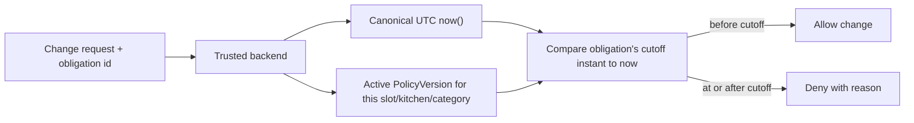

# Time zone and cutoff policy

| Field | Value |
|---|---|
| Revision | 1.0 · 2026-10-30 |
| Owner | Architecture lead |
| Purpose | Define how service dates, delivery slots and cutoffs are represented and evaluated so that a meal is never reinterpreted across a device time zone or language change. |
| Depends on | [ADR-013](../adr/013-time-zone-and-cutoff-evaluation.md), [glossary](../requirements/GLOSSARY_AND_TERMINOLOGY.md) |
| Authoritative policies | BR-022/DEC-032 (cutoff rules and service time, PENDING); DEC-008 (currency/timezone, PROPOSED) |
| Status | PROPOSED — NOT APPROVED for any specific cutoff value. |

## Canonical representation

Every stored timestamp is a UTC instant. Every service-relevant date (delivery date, obligation date, billing period boundary) is derived from that instant using the **Asia/Dhaka** calendar (DEC-008, PROPOSED), producing a date-only key (`YYYY-MM-DD`) that never changes based on the viewer's device time zone or locale. Bangladesh observes no daylight-saving transitions, so Asia/Dhaka is a fixed UTC+06:00 offset; this removes one common source of cutoff bugs but does not remove the need for explicit timezone-aware comparisons.

## Slot identifiers

Meal slots are stored as identifiers (`slot.breakfast`, `slot.lunch`, `slot.snack`, `slot.dinner`), never as a translated label; the UI maps the identifier to the correct English or Bangla label at render time. This prevents a lunch obligation from ever being reinterpreted as a dinner obligation after a language switch (SC-18).

## Cutoff evaluation

A cutoff (for a pause, skip, replacement, or order) is evaluated **only at the trusted backend**, against the canonical server clock, using the policy version active at the time of the request (`ent.PolicyVersion`, MOD-POL). The client never performs the comparison itself and never trusts a device clock for a pickup, delivery, or cutoff decision (carried forward from ADR-003/BR-004's existing guard).

## Configurability (per BR-022, all values PENDING)

Whether cutoff differs by meal slot, by kitchen, or by product category is itself a policy decision (BR-022); until approved, a single cutoff parameter applies uniformly. Holiday closures, cross-midnight order placement, and a kitchen changing its operating hours mid-cycle are all evaluated against the policy version that was active when the affected obligation was created, unless an explicit migration rule is separately approved — this prevents a retroactive policy change from silently altering an already-confirmed obligation.

## Consequences for other modules

Kitchen commitments (MOD-CAT capacity), inventory/stock reservations (MOD-CAT), rider dispatch timing (MOD-DLV) and prepaid balances (MOD-LED, via the credit/adjustment path) all read the same cutoff decision from the trusted backend; none re-derives it independently.

## Acceptance and verification

Design-only. Verification requires: a request arriving just before, exactly at and just after a configured cutoff produces the documented allow/deny result regardless of the client's declared time zone; a cross-midnight order is assigned the correct service date; a mid-cycle kitchen-hours change does not alter an already-created obligation's cutoff.

## Open decisions

The exact cutoff value(s), whether cutoff varies by slot/kitchen/category, and the Asia/Dhaka/BDT currency representation itself (DEC-008) all remain PENDING.
