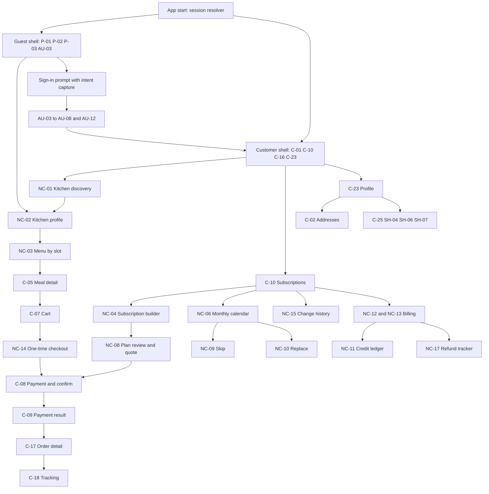

# Customer App module map

| Field | Value |
|---|---|
| Revision | 1.0 · 2026-10-30 |
| Owner | Customer App documentation owner (author D1) |
| Purpose | Define the fifteen functional modules of the Customer App (CUS), assign every Customer, Public, Auth and Shared screen of the Customer App to exactly one module, and state per module the commands, entities, requirements, states, offline behaviour, navigation, guard rules and prototype status. |
| Applies to | CUS (Customer App: Flutter, Android first, iOS-ready; includes the guest shell P-01…P-04) |
| Depends on | [Conventions and identifier register](../analysis/CONVENTIONS_AND_ID_REGISTER.md), [master prompt digest](../analysis/SOURCE_MASTER_PROMPT_DIGEST.md), [legacy prototype digest](../analysis/SOURCE_LEGACY_PROTOTYPE_DIGEST.md), [glossary](../requirements/GLOSSARY_AND_TERMINOLOGY.md), [policy register](../requirements/POLICY_DECISION_REGISTER.md), [business rules](../requirements/BUSINESS_RULES.md), [functional requirements](../requirements/FUNCTIONAL_REQUIREMENTS.md) |
| Authoritative policies | BR-001, BR-002, BR-003, BR-004, BR-005 (all PENDING, text in [BUSINESS_RULES](../requirements/BUSINESS_RULES.md)); BR-006, BR-007, BR-008, BR-012, BR-016, BR-017, BR-018, BR-019, BR-021, BR-022, BR-023, BR-024, BR-025 (all PENDING, text in [POLICY_DECISION_REGISTER](../requirements/POLICY_DECISION_REGISTER.md)) |
| Design reference | Screen contracts: [public and auth screens](../design/screens/CUSTOMER_PUBLIC_AND_AUTH_SCREENS.md), [customer screens](../design/screens/CUSTOMER_SCREENS.md), [new customer screens](../design/screens/CUSTOMER_NEW_SCREENS.md), [shared screens](../design/screens/SHARED_SCREENS.md) |
| APIs and commands | [API specification](../api/API_SPECIFICATION.md), [orders and subscriptions commands](../api/COMMANDS_ORDERS_AND_SUBSCRIPTIONS.md), [identity and catalogue commands](../api/COMMANDS_IDENTITY_AND_CATALOGUE.md), [payments and COD commands](../api/COMMANDS_PAYMENTS_AND_COD.md) |
| Sibling documents | [Kitchen and meal system](KITCHEN_AND_MEAL_SYSTEM.md), [order management](ORDER_MANAGEMENT.md), [custom subscription engine](CUSTOM_SUBSCRIPTION_ENGINE.md), [meal scheduling](MEAL_SCHEDULING.md), [customer credits](CUSTOMER_CREDITS.md), [customer UI/UX](CUSTOMER_UI_UX.md) |
| Status | Draft for review. Nothing in this file is implemented, tested or approved. All BDT figures anywhere in the Customer App documents are HYPOTHETICAL. No policy value is defined here; parameters are named `policy.*`. |

## 1. Scope and how to read this file

This file is the entry point to the Customer App documents. It owns the module map, the app-level navigation structure, the deep-link intents, the guard rules and the behaviour patterns that every module shares (command calls, offline handling, screen states). It does not own:

- Screen-level layouts, element lists and per-state renders. Those live in the four `design/screens/` files linked above. This file links to them and does not duplicate them.
- Money formulas, fee rules and credit calculations. Those live in [pricing and billing](../payments/PRICING_AND_BILLING.md) and [customer credit rules](../payments/CUSTOMER_CREDIT_RULES.md).
- Command parameters and error codes. Those live in the API documents. This file uses the command names registered in the [conventions](../analysis/CONVENTIONS_AND_ID_REGISTER.md) (section 6) and never renames them.
- Supplier, rider, admin and accounts behaviour. Those live in the Partner App, Admin Web and Accounts Web documents.

Provenance tags follow the conventions: **USER-REQ**, **OBSERVED** (prototype, screenshot or current `app/`, `backend/`, `firebase/` files), **PROPOSED**, **PENDING**. A prototype status letter (I interactive, U UI-only, S simulated) is always stated next to the screen it describes and never implies production behaviour.

Screen identifiers: the 94 legacy identifiers are authoritative and unchanged. `NC-01…NC-19` are PROPOSED documentation identifiers, not confirmed routes. Shared screens are instances per app (`SH-01@CUS` and so on).

## 2. Application shape

### 2.1 Shells

| Shell | Who sees it | Content | Provenance |
|---|---|---|---|
| Launch and session resolver | Everyone at start | Resolves the Auth session and the server-held role grant before choosing a shell. First launch passes through AU-01 and AU-02. | PROPOSED (prototype starts at P-01 and reaches AU-01/AU-02 only from the Prototype Hub) |
| Guest shell | Unauthenticated visitors | Guest navigation P-01 Home, P-02 Menu and kitchens, P-03 Plans, AU-03 Account. Guest browsing of kitchens, menus and plans. | OBSERVED (GuestNav) |
| Auth stack | Guests becoming customers | AU-03 to AU-08 and AU-12. | OBSERVED |
| Customer shell | Authenticated customers | Four tabs (below), each with its own stack, plus pushed screens and overlays. | OBSERVED (tabs), PROPOSED (per-tab stacks) |

The Customer App contains no supplier, rider, admin or accounts workspace. The prototype's customer profile offered "Apply as a Cook" and "Apply as a Rider" that opened AU-09 and AU-10 inside the same app. In the four-application structure those application forms belong to the Partner App (see section 5, module 14). The Customer App hands off to the Partner App and never renders partner content or partner balances (SC-25, BR-023).

### 2.2 Tabs

| Role context | Tabs | Provenance |
|---|---|---|
| Guest | P-01 Home · P-02 Menu · P-03 Plans · AU-03 Account (pushed, not reset) | OBSERVED |
| Customer | C-01 Home · C-10 Subscriptions · C-16 Orders · C-23 Profile | OBSERVED |

PROPOSED handling of the new screens: the four customer tabs are kept to preserve the visual identity and muscle memory. Kitchen discovery (NC-01) is reached from the Home search field and the Home quick actions, not from a fifth tab. Whether a dedicated Kitchens tab is better is an open design question for [navigation architecture](../design/NAVIGATION_ARCHITECTURE.md) (section 8, question 1).

Tab behaviour (PROPOSED, consistent with the existing navigation contract): one navigation stack per tab; reselecting a tab returns to its root; the bottom navigation is shown only on tab roots in compact and medium widths; a navigation rail replaces it on expanded and large widths; Back closes an overlay first, then pops a detail, then returns to the shell, and never reopens a signed-out protected screen.

### 2.3 Navigation overview

Overlays (PROPOSED, based on the prototype's single bottom sheet and single confirm dialog): the sign-in prompt, the address sheet, the calendar day sheet, the meal detail sheet for guests, the confirmation dialog for destructive or financial actions. Overlays are typed presentation actions; they never carry sensitive data in route parameters.

### 2.4 Deep-link intents (PROPOSED)

A deep-link intent is a typed request to open a destination, produced by a notification tap, an external link, or a sign-in resume. Route strings are illustrative; the [navigation architecture](../design/NAVIGATION_ARCHITECTURE.md) and its route map are authoritative for final shapes. The prototype has no URLs and no deep links (OBSERVED), so this is new design.

| Intent | Typical source | Parameters (identifiers only, no personal data) | Destination | Notes |
|---|---|---|---|---|
| Open kitchen | Shared link, favourites, order detail | `kitchenId` | NC-02 | Allowed for guests. Unknown or unlisted kitchen shows a neutral unavailable state. |
| Open kitchen menu | Kitchen card, link | `kitchenId`, optional `slotId`, optional service date | NC-03 | Allowed for guests. |
| Open meal | Link, notification about menu update | `kitchenId`, `mealId` | C-05 content | Guest variant is read-only. |
| Open order | Order notification | `orderId` | C-17 | Re-fetched and authorised for the signed-in principal. |
| Open tracking | Delivery notification | `orderId` | C-18 | Falls back to C-17 when the order is not active. |
| Open subscription | Billing or change notification | `subscriptionId` | C-10 detail | |
| Open scheduled meal | Cutoff reminder, change notification | `subscriptionId`, service date, `slotId` | NC-06 with the meal sheet open | Opening never performs a change. |
| Open invoice | Payment reminder | `invoiceId` | C-21 | |
| Open billing period | Weekly or monthly bill notification | `subscriptionId`, period key | NC-12 or NC-13 | |
| Open credit ledger | Credit issued notification | none | NC-11 | |
| Open refund | Refund update | `refundId` | NC-17 | |
| Open ticket | Support reply | `ticketId` | SH-07 | |
| Open notifications | Any | none | SH-01 | |
| Resume purchase | After sign-in | Stored purchase intent (section 2.5) | NC-03, NC-04, NC-14 or C-11 content | Revalidated, never replayed blindly. |

Rules for every intent (PROPOSED, consistent with the existing navigation contract): store only a safe route intent while signing in; after authentication re-fetch the target and authorise it; validate the identifier shape and ownership on the server; a missing, foreign, revoked or stale target shows a neutral "not found or not available to you" state that reveals nothing about the object; duplicate notification taps never duplicate navigation or writes; Back from a notification destination returns to the appropriate shell root, not to an absent source stack.

### 2.5 Purchase intent capture and resume

OBSERVED defects this section closes: the prototype opened a "Sign in to continue" sheet and stored the target as `afterLogin`, but only customer accounts consumed it (gap 1), the plan picker ignored the meal and plan passed from guest screens (gap 2), and sign-out did not clear session state (gap 6).

PROPOSED contract:

| Item | Specification |
|---|---|
| What is captured | Destination intent plus a non-sensitive selection: kitchen, items with variant and quantity, slot, service date, plan, subscription draft reference. No address, no payment data, no personal data. |
| Where it is held | On the device only, as a single versioned object per install, until sign-in completes or is abandoned. |
| When it is consumed | After successful authentication of a customer principal. A non-customer or pending-applicant principal clears it without using it. |
| How it is applied | The selection is loaded into the target screen as a draft, then revalidated against current availability, price version and cutoff. Differences are shown before anything is committed (for example "one meal is no longer available"). |
| When it is cleared | On consumption, on explicit sign-out, on sign-in with a different principal, and after a time limit `policy.intent.max_age_minutes` (named parameter, no value approved). |
| What it is not | It is not a cart on the server and not a reservation. It never grants stock. |

### 2.6 Role and guard rules

A role is a server-validated grant (claim plus record), never a UI selection. Route guards in the app improve experience only; every read and write is re-authorised on the trusted side (ownership and role checks in security rules and command handlers). See [authorization](../api/AUTHORIZATION.md) and ADR-011 (planned: [roles, claims and sessions](../adr/011-roles-claims-and-sessions.md)).

| Rule | Statement |
|---|---|
| G-1 | A guest may open P-01…P-04, AU-01…AU-08, AU-12, NC-01, NC-02, NC-03 and the guest meal detail. Guests see only publicly approved kitchen and catalogue data. |
| G-2 | Any action that needs identity (subscribe, checkout, track, pause, orders, billing, credits, profile, support tickets) opens the sign-in prompt and captures intent (section 2.5). |
| G-3 | Choosing "Customer", "Supplier (Cook)" or "Rider" on AU-12 expresses intent only. It never grants authorisation. |
| G-4 | A signed-in customer sees only own addresses, orders, subscriptions, obligations, invoices, receipts, credits, refunds, tickets and notifications. Object identifiers in a link are never trusted for access. |
| G-5 | A principal that also holds a partner grant sees only customer content in this app. Partner workspaces, balances and notifications exist only in the Partner App. No balance, notification or profile field is shared across roles (SC-25, BR-023). |
| G-6 | When the session expires or the grant is revoked, the app ends listeners, clears protected view state and cached private data, and returns to the guest shell. It must not flash prior content. |
| G-7 | A denied or missing object shows a neutral state. The message never confirms whether the object exists. |
| G-8 | Biometric unlock (prototype AU-03 fingerprint sheet is simulated) may only unlock an existing local session. It never replaces server authentication. |
| G-9 | A pending partner applicant is not given a customer privilege or a partner privilege by that status. AU-11 behaviour belongs to the Partner App. |

## 3. Shared behaviour patterns

### 3.1 Command call pattern

Every mutating call uses the single command envelope `{command, requestId, expectedVersion?, payload}` (see [API specification](../api/API_SPECIFICATION.md); ADR-008 planned: [idempotent command envelope](../adr/008-idempotent-command-envelope.md)).

| Step | Client behaviour |
|---|---|
| Intent | The client generates `requestId` when the customer first confirms an intent and stores it with the pending operation. A retry of the same intent reuses it. A changed intent (edited content) gets a new one. |
| Guard | The confirming control becomes busy and ignores further taps. Back during submission cannot cancel a committed server operation or lose the `requestId`. |
| Success | Success is shown only after the trusted side acknowledges the commit, together with a stable receipt reference taken from `ent.RequestReceipt`. A toast alone is never evidence. |
| Rejection | Validation, cutoff, availability, price-change and permission rejections show a specific reason and keep the customer's input. |
| Policy gate | Commands the backend answers with `failed-precondition` because a policy is not approved (for example `requestCancellation`, `pauseMeals`, `placeOrder`, `subscribe`) show a neutral "not available yet" message. Internal builds may show the BR reference. The app must not bypass the gate. |
| Stale | A version conflict shows the newer server state and asks the customer to review before retrying. Nothing is overwritten silently. |
| Unknown outcome | A timeout or lost connection moves the screen to "Checking your request" and reconciles by `requestId`. It does not create a second operation. When the receipt is found the original result is shown; when it is not found the retry with the same `requestId` is safe (SC-04, SC-13). |

Idempotent retry is the protection against double skip, double order, double payment and double credit. The unique constraints that make it hold (for example INV-08, one credit per skipped scheduled meal origin) are server-side; the client's job is to reuse the `requestId` and display the stable receipt.

### 3.2 Offline contract (PROPOSED, DEC-012 PENDING)

| Capability | Offline behaviour |
|---|---|
| Reads of kitchens, menus, orders, subscriptions, calendar, invoices, credit history | Show the cached copy with an "Updated <time>" label and an accessible retry. Cached data is labelled stale and is never used to validate a price, an availability or a cutoff. |
| Writes that change service, money or credit | Blocked while offline with an explanation. No queued success, no optimistic confirmation. |
| Drafts (subscription builder, cart, address form, application-free forms) | Held locally and survive offline, app restart and a language switch. They are revalidated on reconnect. |
| Local settings (language, theme, text preferences) | Applied immediately and stored locally. |
| Sign-in, OTP, payment, redirect return | Require connectivity. |
| Cached private data | Cleared on sign-out, revocation and principal change. |

### 3.3 Screen state set

Every data-bearing screen implements, as applicable: initial loading (skeleton, no fabricated food, amount or status), empty (one relevant action), error (specific, retry only where safe, support reference without raw exception or personal data), offline, permission denied (no private detail), stale or conflict, partial or unknown outcome, disabled (reason caption next to the control), success. The prototype's six variants (normal, empty, loading, error, offline, denied) are a subset. Details and visual treatment: [customer UI/UX](CUSTOMER_UI_UX.md) section 6 and the screen files.

### 3.4 Layering note (implementation boundary, PROPOSED)

Presentation (widgets, navigation) is kept apart from business behaviour (state and use cases) and from Firebase data access. One state-management approach and one router are chosen when implementation starts, after SDK verification; no overlapping frameworks are added speculatively. Money is carried as integer BDT minor units end to end and formatted only at the edge by the shared formatting package. The Customer App never computes an authoritative price, eligibility, payment status or credit.

## 4. Coverage of screens by module

All 66 Customer App screens are assigned to exactly one module. "Action" is the PROPOSED migration action; the authoritative mapping is in the [complete screen inventory](../design/COMPLETE_SCREEN_INVENTORY.md). Prototype status letters are as reported by the source digest.

| Module | Screens (prototype status) | Proposed action |
|---|---|---|
| 1 Guest, authentication, onboarding | P-01 (I), P-04 (I), AU-01 (I), AU-02 (I), AU-03 (I, simulated auth), AU-04 (I), AU-05 (I, any six digits), AU-06 (I), AU-07 (I), AU-08 (I), AU-12 (I) | Extend (real authentication, server role checks, OTP contract) |
| 2 Discovery and home | C-01 (I), P-02 (I), NC-01 | C-01 Extend; P-02 Extend (fixes the dead-end kitchen cards); NC-01 New |
| 3 Kitchen profile | C-06 (U), NC-02 | C-06 Replace (legacy ID kept as alias of NC-02); NC-02 New |
| 4 Menu and meal detail | C-04 (I), C-05 (I), NC-03 | C-04, C-05 Extend; NC-03 New |
| 5 Cart and one-time order | C-07 (I), NC-14 | C-07 Extend; NC-14 New |
| 6 Subscription builder and hub | C-10 (I/S), C-11 (I), P-03 (I), NC-04, NC-05, NC-19 | C-10, C-11, P-03 Extend; NC-04, NC-05, NC-19 New |
| 7 Schedule, calendar and changes | C-13 (I/S), C-14 (I), C-15 (I, not saved), NC-06, NC-09, NC-10, NC-15 | C-13, C-14, C-15 Extend; NC-06, NC-09, NC-10, NC-15 New |
| 8 Quote review and price explanation | C-12 (U), NC-07, NC-08 | C-12 Extend; NC-07, NC-08 New |
| 9 Checkout and payment | C-08 (I), C-09 (I), C-22 (S) | Extend (backend-authoritative quotes and payment states) |
| 10 Orders and tracking | C-16 (I), C-17 (I), C-18 (I, animated sample), C-19 (I, not saved) | Extend |
| 11 Billing, invoices, refunds | C-20 (U), C-21 (U/S), NC-12, NC-13, NC-17 | C-20, C-21 Extend; NC-12, NC-13, NC-17 New |
| 12 Service credits | NC-11, NC-16 | New |
| 13 Support and complaints | C-25 (U), SH-02 (I, local only), SH-04 (I/S), SH-06 (I), SH-07 (U) | Extend |
| 14 Profile, preferences, addresses | C-02 (I, local), C-03 (I, not saved), C-23 (I), C-24 (I, not saved), SH-05 (I), SH-08 (I), NC-18 | Extend; NC-18 New |
| 15 Notifications | SH-01 (I), SH-09 (I, local), SH-10 (I/S) | Extend |

Count check: Public 4 (P-01, P-02, P-03, P-04) + Auth 9 (AU-01…AU-08, AU-12) + Shared 9 (SH-01, SH-02, SH-04…SH-10) + Customer 25 (C-01…C-25) + New 19 (NC-01…NC-19) = 66. AU-09, AU-10 and AU-11 (Partner App) and AU-13 (Admin Web) are outside the Customer App.

## 5. Module specifications

Each module lists screens, commands, entities, requirements, states, offline behaviour, navigation, guards and the prototype's simulated-versus-real status. Command names are those of the conventions register (existing OBSERVED commands and PROPOSED additions). Reads are authorised reads of the named entities; read-contract details are in the API documents.

### 5.1 Guest, authentication and onboarding

| Aspect | Specification |
|---|---|
| Screens | P-01 Guest home, P-04 Role info, AU-01 Splash, AU-02 Language pick, AU-03 Universal sign-in, AU-04 Forgot password, AU-05 OTP verification, AU-06 New password, AU-07 Customer sign-up, AU-08 Customer onboarding, AU-12 Choose account type. Contracts: [public and auth screens](../design/screens/CUSTOMER_PUBLIC_AND_AUTH_SCREENS.md). |
| Commands | Session establishment through the identity provider (provider set pending DEC-009). After sign-in: `saveProfile`, `saveAddress`, `savePreferences`, `saveDevice` (OBSERVED, working). No money command. |
| Entities | `ent.Principal`, `ent.Customer`, `ent.Address`, `ent.Device`, `ent.RoleGrant` (read of own claims), `ent.RequestReceipt`. |
| Requirements | FR-001, FR-002, FR-003, FR-049. Policies: DEC-009 identity and roles, DEC-012 offline, BR-023 dual-role accounts. |
| States | Session: guest · authenticating · verification pending · authenticated customer · locked after repeated failures · expired or revoked. Onboarding: not started · skipped · completed. Validation errors are persistent per field with a summary. |
| Offline | Sign-in, OTP and password reset require connectivity and say so. Guest content opens from cache with the offline banner. Language choice is stored locally immediately. |
| Navigation and intent | First launch: AU-01 then AU-02 then P-01. Later launches skip to the session resolver. AU-12 customer path goes to AU-07 (or AU-08 for an identity-provider sign-up); Supplier and Rider cards hand off to the Partner App. After AU-08 or sign-in the app consumes a stored purchase intent (section 2.5) or opens C-01. |
| Guards | G-1, G-2, G-3, G-8. The prototype's AU-13 admin sign-in does not exist in this app. |
| Prototype status | Authentication is simulated: demo accounts, sample-account chips, remember-me (UI-only), a fingerprint sheet with "Simulate scan", a Google picker with fixed accounts, and an OTP that accepts any six digits except `000000`. None of these ships. Production needs real authentication with server role checks, a verified expiring rate-limited OTP (parameters `policy.auth.otp_validity_seconds`, `policy.auth.otp_max_attempts`, `policy.auth.otp_resend_seconds`, no values approved) and recovery. Language is not persisted in the prototype (gap 19): it must be. Sign-out must clear stored state (gap 6). Google identity must prefill later applications where a handoff exists (gap 3). |

### 5.2 Kitchen and meal discovery, and Home

| Aspect | Specification |
|---|---|
| Screens | C-01 Customer home, P-02 Guest menu and kitchens, NC-01 Kitchen discovery search. Contracts: [customer screens](../design/screens/CUSTOMER_SCREENS.md), [new customer screens](../design/screens/CUSTOMER_NEW_SCREENS.md). |
| Commands | `searchKitchens` (read). Preferences via `savePreferences` influence defaults only. |
| Entities | `ent.Kitchen`, `ent.Meal`, `ent.MealCategory`, `ent.ServiceZone`, `ent.SlotAvailability`, `ent.Review` (summary), `ent.Customer` (saved preferences). |
| Requirements | FR-026, FR-004, FR-005, FR-050. Policies: BR-022 (availability by cutoff), BR-024 (kitchens that stop accepting orders). |
| States | Loading skeleton · results · no match (suggest clearing filters) · no kitchen serves the selected address (show nearby alternatives only if the data exists) · error · offline with cached results labelled. |
| Offline | Cached last results with timestamp. Search and filter changes need connectivity. |
| Navigation and intent | Every kitchen card in every list opens NC-02 for the same `kitchenId` (see [kitchen and meal system](KITCHEN_AND_MEAL_SYSTEM.md) section 3). Query and filter state survive Back. Intents: open kitchen, open kitchen menu. C-01 keeps its prototype composition: notification bell, avatar, address pill, active-subscription hero, quick actions, ongoing delivery, routine, special-menu chips and meal cards (all OBSERVED), while the hero and routine now show the next obligations from every active subscription instead of one hard-coded plan. |
| Guards | Guests may use P-02 and NC-01. C-01 requires a customer session. |
| Prototype status | P-02 derives kitchens from the meal list (count, maximum rating, image) and its **kitchen cards are not clickable** (OBSERVED dead end, gap 15). In production kitchens come from `ent.Kitchen`, search is server-side and bounded, and every card opens a valid destination. Search over English, Bangla and kitchen name was client-side over a fixed array. The special-menu chip row (all, thali, diet, office) and the "Under ৳200" chip are sample filters; production price bands come from configuration, not code. |

### 5.3 Kitchen profile

| Aspect | Specification |
|---|---|
| Screens | NC-02 Kitchen profile detail, C-06 Kitchen detail (legacy alias). |
| Commands | None (read-only). Favouriting is module 14. |
| Entities | `ent.Kitchen`, `ent.ServiceZone`, `ent.SlotAvailability`, `ent.Plan`, `ent.Review`, `ent.PolicyVersion` (published kitchen-facing policies). |
| Requirements | FR-026, FR-011 (review display). Policies: BR-024, BR-005 (cancellation wording, PENDING). Scenarios: SC-07, SC-17. |
| States | Open now · closed for now · temporarily unavailable · not serving the selected address · verified, under review or not verified badge states · unlisted or not found (neutral). |
| Offline | Cached profile with timestamp. Reviews and availability are labelled stale. |
| Navigation and intent | From any kitchen card, favourites, order detail and links. Exits: NC-03 menu, plans list for this kitchen (leads to NC-04 with the kitchen fixed), reviews. Intent: open kitchen. |
| Guards | Guests allowed (guest-safe content only, see the kitchen document). |
| Prototype status | C-06 is UI-only (U): verified chips and meals grouped by kitchen, reachable only from C-05. Production NC-02 is reachable for guests and customers and shows the full profile. |

### 5.4 Menu and meal detail

| Aspect | Specification |
|---|---|
| Screens | C-04 Full menu, C-05 Meal detail, NC-03 Kitchen menu by meal slot. Guest meal detail uses the C-05 content in a read-only variant. |
| Commands | None for reading. Adding to the working cart is a local selection; the register has no cart command. The API author confirms whether `ent.Cart` is written directly under owner-only rules or locally only (cross-reference need). |
| Entities | `ent.Meal`, `ent.MealVariant`, `ent.PriceVersion`, `ent.SlotAvailability`, `ent.MealCategory`, `ent.KitchenCapacity` (availability signal only), `ent.Cart`. |
| Requirements | FR-005, FR-026, FR-046; supplier-side authoring is FR-027. Policies: BR-002, BR-008 (price display), BR-021 (one kitchen per cart or agreement). |
| States | Available · limited stock (server-provided only) · sold out for this slot or date (with reason) · not served on this date · kitchen closed · past cutoff · price pending change. |
| Offline | Cached menu with timestamp; adding to cart works locally but checkout needs connectivity. |
| Navigation and intent | NC-03 is the kitchen-specific entry; C-04 is the cross-kitchen browse with search and category chips. Exits: C-07 Cart, NC-04 Subscription builder. Intents: open meal, open kitchen menu. |
| Guards | Guests may browse. Adding beyond the guest preview needs sign-in (section 2.5). |
| Prototype status | C-05 enforces one kitchen per cart with a confirmation when switching; sold-out items are disabled with the reason "Restocks tomorrow"; reviews are static. All meal data is hard-coded sample data. Production data comes from the catalogue with price versions, allergens and variants. |

### 5.5 Cart and one-time order

| Aspect | Specification |
|---|---|
| Screens | C-07 Cart, NC-14 One-time order checkout. Contracts as in section 2.3. |
| Commands | `createQuote`, `confirmQuote`, `placeOneTimeOrder`, `reserveStock` and `releaseStock` (trusted side, triggered by the commands above). Legacy `placeOrder` (policy-gated) is the OBSERVED predecessor of `placeOneTimeOrder` (cross-reference need). |
| Entities | `ent.Cart`, `ent.Quote`, `ent.Order`, `ent.OrderItem`, `ent.StockReservation`, `ent.Address`, `ent.PaymentIntent`. |
| Requirements | FR-028, FR-007, FR-030, FR-046. Policies: BR-002, BR-007, BR-008, BR-012, BR-018, BR-021, BR-022. Scenarios: SC-03, SC-20. |
| States | Cart: empty · has items · items changed since added. Checkout: editing · quote active · quote expired · confirming · unknown outcome · placed. |
| Offline | Cart editable locally. Quote and placement blocked offline. |
| Navigation and intent | C-07 to NC-14 to C-08 (payment and confirmation) to C-09 to C-17. Intents: resume purchase, open order. |
| Guards | Signed-in customer only. |
| Prototype status | C-07 is a single line (`cartMeal` times `cart`) with a fixed "BDT 40" delivery line and a local total. C-08 has a prototype outcome simulator. Neither is production behaviour. Full flow: [order management](ORDER_MANAGEMENT.md). |

### 5.6 Subscription builder and hub

| Aspect | Specification |
|---|---|
| Screens | C-10 Subscriptions (tab root), C-11 Plan picker, P-03 Guest plans, NC-04 Custom subscription builder, NC-05 Weekly schedule editor, NC-19 Subscription renewal offer. |
| Commands | `createSubscriptionDraft`, `saveSubscriptionSchedule`, `createQuote`, `confirmQuote`, `renewSubscription`, `cancelSubscription` (policy-gated). Legacy `subscribe` (policy-gated) is the OBSERVED predecessor (cross-reference need). |
| Entities | `ent.Subscription`, `ent.SubscriptionVersion`, `ent.SubscriptionSchedule`, `ent.Plan`, `ent.Quote`, `ent.MealObligation` (preview), `ent.Address`. |
| Requirements | FR-029, FR-006, FR-030, FR-004. Policies: BR-002, BR-016, BR-021, BR-022. Scenarios: SC-02, SC-18, SC-22. |
| States | Agreement states Draft · Pending Payment · Scheduled · Active · Paused · Partially Modified · Completed · Cancelled · Expired (see [subscription engine](CUSTOM_SUBSCRIPTION_ENGINE.md) section 5). |
| Offline | Drafts persist locally and survive language switch and restart; quote, confirmation and payment need connectivity. |
| Navigation and intent | P-03 and C-10 lead to NC-04 (kitchen fixed from the plan or kitchen). NC-05 is a sub-editor of NC-04. NC-19 is reached from C-10 and from the renewal notification. Intents: open subscription, resume purchase. |
| Guards | Guests may preview plans on P-03; creating a draft needs sign-in. |
| Prototype status | C-10 is a single hard-coded plan summary (used, left, paused) with Pause, Calendar, Change plan, Address, Billing and a Cancel that only toasts. C-11 offers fixed plans and **ignores** the meal and plan passed from guest screens (gap 2). The production hub lists every active subscription independently and never assumes one monthly lunch-and-dinner plan. |

### 5.7 Schedule, calendar and changes

| Aspect | Specification |
|---|---|
| Screens | C-13 Meal calendar, C-14 Pause meals, C-15 Modify today's meals, NC-06 Monthly schedule calendar, NC-09 Meal skip request, NC-10 Meal replacement quotation, NC-15 Subscription change history. |
| Commands | `quoteScheduleChange`, `confirmScheduleChange`, `skipMeals`, `pauseSlots`, `resumeSubscription`, `replaceMeal`. Legacy `pauseMeals` (policy-gated) is the OBSERVED predecessor. Mapping between the quotation command and the obligation-level commands is PROPOSED in the [subscription engine](CUSTOM_SUBSCRIPTION_ENGINE.md) section 8 and finalised by the API author. |
| Entities | `ent.MealObligation`, `ent.PauseRequest`, `ent.Substitution`, `ent.Adjustment`, `ent.SubscriptionVersion`, `ent.CreditTransaction` (read), `ent.AuditEvent` (read of own history). |
| Requirements | FR-031, FR-008, FR-050. Policies: BR-001, BR-005, BR-006, BR-017, BR-022. Scenarios: SC-01, SC-04, SC-05, SC-06, SC-18, SC-19. |
| States | Obligation states Scheduled · Skipped · Replaced · Preparing · Ready · Handed Off · Delivered · Failed · Cancelled, plus the derived display state "changes closed" (cutoff passed). |
| Offline | Calendar read from cache with timestamp; every change blocked offline; unsent change drafts are kept. |
| Navigation and intent | C-10 and C-01 to C-13 or NC-06 to a day or meal sheet to NC-09, NC-10 or C-14. NC-15 from C-10. Intent: open scheduled meal. |
| Guards | Own subscription only; server decides eligibility and cutoff. |
| Prototype status | C-13 day sheet shows done, today disabled with "Cutoff passed", paused, upcoming. C-14 uses static date fields and a toggle; confirming sets a local `paused` flag with an Undo toast. C-15 is a local picker that only toasts. None of these changes any kitchen commitment. Production persists changes, requests a server quotation and updates the kitchen commitment. Full behaviour: [meal scheduling](MEAL_SCHEDULING.md). |

### 5.8 Quote review and price explanation

| Aspect | Specification |
|---|---|
| Screens | C-12 Plan review, NC-07 Delivery price explanation, NC-08 Custom plan review. |
| Commands | `createQuote`, `confirmQuote`, `quoteScheduleChange`, `confirmScheduleChange`. |
| Entities | `ent.Quote` (immutable snapshot), `ent.PriceVersion`, `ent.PolicyVersion`, `ent.CreditAccount` (credit line preview). |
| Requirements | FR-030. Policies: BR-002, BR-007, BR-008, BR-018, BR-006. ADR-009 (planned): [quote and price snapshots](../adr/009-quote-and-price-snapshots.md). |
| States | Quote active (with expiry) · expired · superseded by a newer quote · confirmed · rejected because a component changed. |
| Offline | Reviewing a loaded quote is possible; confirming is not. An expired or stale quote cannot be confirmed. |
| Navigation and intent | NC-04 or C-11 to NC-08 or C-12. NC-07 opens from any fee line. Exit: C-08 for payment, or back to edit. |
| Guards | Own quote only. |
| Prototype status | C-12 is UI-only: start date, address, pay-with, a Policy note and a **Pay & subscribe** button that goes straight to a success result. No quote exists in the prototype. Every production quote shows meal costs, delivery, service fees, discount, tax, service credit and the confirmed payable amount. |

### 5.9 Checkout and payment

| Aspect | Specification |
|---|---|
| Screens | C-08 Checkout (payment and confirmation step), C-09 Payment result, C-22 Payment methods. |
| Commands | `initiatePayment`; `submitPaymentReference` (OBSERVED, policy-gated, optional manual-evidence fallback pending BR-003); credit reservation as part of confirmation (see [customer credits](CUSTOMER_CREDITS.md)). |
| Entities | `ent.PaymentIntent`, `ent.PaymentAttempt`, `ent.Invoice`, `ent.Receipt`, `ent.CreditAccount`, `ent.Order` or `ent.Subscription`. |
| Requirements | FR-033, FR-034, FR-035, FR-013 (fallback). Policies: BR-002, BR-003, BR-012, BR-016. Payment states: Pending · Initiated · Awaiting Confirmation · Verified · Failed · Cancelled · Expired · Refunded · Partially Refunded · Disputed · Unknown. Scenarios: SC-03, SC-13, SC-20. |
| States | Method list loading · methods available or ineligible with reason · confirming · redirected to the gateway · awaiting confirmation · verified · failed · cancelled · expired · unknown. |
| Offline | Payment initiation and result confirmation need connectivity. A returning redirect with no connectivity shows "We are confirming your payment" and retries status. |
| Navigation and intent | NC-14 or NC-08 or C-12 to C-08 to C-09 to C-17 or C-10. Intents: open order, open invoice. |
| Guards | Own payable only; the server decides eligible methods. |
| Prototype status | C-08 lists four payment methods (bKash, Nagad, Card, COD) as static chips and has a **prototype outcome simulator** (success, failed, cancelled, unknown). C-09 renders the chosen outcome. C-22 lists methods and "Add" shows a "not connected yet" toast (S). The simulator and static chips are removed in production. SSLCOMMERZ is planned only; nothing is connected. Success is never taken from a browser redirect. |

### 5.10 Orders and tracking

| Aspect | Specification |
|---|---|
| Screens | C-16 Orders (tab root), C-17 Order detail, C-18 Live tracking, C-19 Rate meal. |
| Commands | `requestCancellation` (OBSERVED, policy-gated) or `cancelOrder` (PROPOSED, policy-gated), `submitReview` (policy-gated), `submitComplaint` (working). |
| Entities | `ent.Order`, `ent.OrderItem`, `ent.MealObligation`, `ent.DeliveryAssignment`, `ent.DeliveryEvent`, `ent.DeliveryProof`, `ent.RiderLocation`, `ent.Review`, `ent.Receipt`. |
| Requirements | FR-009, FR-010, FR-011, FR-047, FR-048. Policies: BR-004, BR-005, DEC-013, DEC-014. Delivery states: Pending → Picked Up → On The Way → Delivered, with failed or undeliverable as an exception outcome. Scenario: SC-21. |
| States | Order list tabs Active · Upcoming · Past. Detail shows separate payment, preparation and delivery labels. Tracking: status-only · live location available · location unavailable · offline last known. |
| Offline | Cached orders and last known status with timestamp; rating, cancellation and complaint need connectivity. |
| Navigation and intent | C-16 to C-17 to C-18, C-19, C-21, SH-06. Intents: open order, open tracking. |
| Guards | Own orders only. |
| Prototype status | C-17 timeline is driven by the order ID (a stub). C-18 is an animated CSS grid map with a simulated rider marker; it is not a route or location feed. C-19 collects ratings and only toasts. Production tracking is status-based first (FR-010); live location is FR-048, consent-based and privacy-bounded. |

### 5.11 Billing, invoices and refunds

| Aspect | Specification |
|---|---|
| Screens | C-20 Billing, C-21 Invoice, NC-12 Weekly subscription billing, NC-13 Monthly subscription billing, NC-17 Refund status tracker. |
| Commands | `initiatePayment` (pay a due instalment). No customer command starts a refund; refunds follow a cancellation or complaint decision (BR-005) and are read here. |
| Entities | `ent.Invoice`, `ent.Receipt`, `ent.PaymentIntent`, `ent.Refund`, `ent.Adjustment`, `ent.CreditTransaction`, `ent.Subscription`, `ent.MealObligation`. |
| Requirements | FR-012, FR-035, FR-039, FR-013 (fallback). Policies: BR-002, BR-005, BR-016, BR-018, BR-025. Scenarios: SC-01, SC-02, SC-14. |
| States | Invoice: issued · due · partially paid · paid (verified) · overdue · adjusted. Refund tracker: stages in [customer credits](CUSTOMER_CREDITS.md) section 7. |
| Offline | Cached invoices; PDF only when a receipt exists; payment needs connectivity. |
| Navigation and intent | C-10 or C-23 to C-20 to C-21 or NC-12 or NC-13. NC-17 from billing and from refund notifications. Intents: open invoice, open billing period, open refund. |
| Guards | Own billing only. |
| Prototype status | C-20 is UI-only with a next-payment card; C-21 is a static breakdown with a Download PDF toast. Production lines reconcile to recorded charges, payments, credits and adjustments. Billing frequency is independent of subscription duration. |

### 5.12 Service credits

| Aspect | Specification |
|---|---|
| Screens | NC-11 Customer service-credit ledger, NC-16 Service credit redemption. The credit effect also appears in NC-09, NC-10, NC-08 and C-08. |
| Commands | `reserveCredit`, `releaseCredit` (customer-initiated through checkout), `consumeCredit` (trusted flow). Division of calls is PROPOSED in [customer credits](CUSTOMER_CREDITS.md) section 5 and is a cross-reference need for the API author. |
| Entities | `ent.CreditAccount`, `ent.CreditTransaction`, `ent.Adjustment`, `ent.Quote`. |
| Requirements | FR-032, FR-039. Policies: BR-006, BR-019, BR-023 not applicable, BR-025. Invariants INV-07, INV-08, INV-17. Scenarios: SC-04, SC-23. |
| States | Credit entry: Issued · Reserved · Consumed · Released · Voided · Expired (expiry only if BR-019 is approved). |
| Offline | Cached balance with timestamp, labelled "may be out of date". Reservation and redemption need connectivity. |
| Navigation and intent | From C-23, C-20, NC-12, NC-13 and checkout. Intent: open credit ledger. |
| Guards | Own account only. |
| Prototype status | No credit screen exists in the prototype. A-05 recorded a credit approval without moving money. The Customer App never shows a credit as cash. |

### 5.13 Support and complaints

| Aspect | Specification |
|---|---|
| Screens | C-25 Complaints, SH-04 Help and support, SH-06 Report a problem, SH-07 Ticket status, SH-02 Chat. Contracts: [shared screens](../design/screens/SHARED_SCREENS.md). |
| Commands | `submitComplaint` (OBSERVED, working). Ticket creation uses the same family; attachments use authorised storage upload. |
| Entities | `ent.Complaint`, `ent.Ticket`, `ent.Order` (context), `ent.AuditEvent`. |
| Requirements | FR-023. Policies: DEC-013 (categories, transitions, visibility, response targets, PENDING), BR-005 (financial outcome). |
| States | Ticket: draft · submitted · in progress · resolved, as defined by DEC-013 (PENDING). Attachment upload: idle · uploading · failed · done. |
| Offline | Drafts are kept; submission and uploads need connectivity. |
| Navigation and intent | C-17 Report to SH-06 with the order reference; C-25 lists tickets to SH-07; SH-04 offers chat, call and ticket. Intent: open ticket. |
| Guards | Own tickets only; chat content is audit-safe and never exposes another party's contact details. |
| Prototype status | SH-02 messages are local and say "Messages are not sent". SH-04 FAQ rows toast "content pending review". SH-06 attachments are simulated. SH-07 is a static progress sample (U), C-25 two static tickets (U). Production connects to real ticket data. Calls and chat with a rider use a third-party provider only after privacy, cost and failure requirements are documented. |

### 5.14 Profile, preferences and addresses

| Aspect | Specification |
|---|---|
| Screens | C-23 Customer profile (tab root), C-02 Saved addresses, C-03 Add address, C-24 Food preferences, NC-18 Kitchen preference favourites, SH-05 Settings and language, SH-08 Edit profile. |
| Commands | `saveProfile`, `saveAddress`, `savePreferences`, `saveDevice` (OBSERVED, working); `requestData` (policy-gated, privacy requests). |
| Entities | `ent.Customer`, `ent.Address`, `ent.ServiceZone`, `ent.Device`, `ent.Setting`. No dedicated favourites entity is registered; storing favourites inside the saved preferences is PROPOSED (cross-reference need). |
| Requirements | FR-002, FR-049, FR-026. Policies: DEC-009, DEC-010 (privacy and retention), BR-021, BR-023. Scenarios: SC-18, SC-19. |
| States | Address: draft · saved and zone-validated · outside service area · in use by an active subscription. Profile fields: clean · dirty (Save enabled) · saving · re-verification required for sensitive changes. |
| Offline | Forms keep drafts; saves need connectivity. Language and theme apply locally at once and are persisted. |
| Navigation and intent | C-23 to SH-08, C-02, C-24, C-20, SH-01, C-25, SH-04, SH-05. The address pill on C-01 opens the address sheet to C-03 or C-02. The Partner App handoff entries ("Apply as a Cook", "Apply as a Rider") are information links, not embedded forms. |
| Guards | Own data only. Role and approval chips on SH-08 are read-only and reflect the server state (the prototype always showed "Approved", gap 10). |
| Prototype status | C-02 delete is local; C-03 saves nothing and its Home, Office, Other control is fixed (gap 11); the pin-on-map control is a sample; C-24 and the profile save toast do not persist (gap 16). Production saves are persisted and **zone-validated by the server**; a local address label never overrides zone validation (SC-19). A map provider is not chosen; an API key and privacy review are required before any map is added. |

### 5.15 Notifications

| Aspect | Specification |
|---|---|
| Screens | SH-01 Notifications, SH-09 Notification settings, SH-10 Email history. |
| Commands | `saveDevice` (push token after consent), `savePreferences` (notification preferences). Marking a notification read is not in the command register; the API author decides between an owner-only direct write and a command (cross-reference need). |
| Entities | `ent.Notification`, `ent.Device`, `ent.Setting`. |
| Requirements | FR-025. Policies: DEC-015 (timing, recipients, opt-in, history; PENDING). ADR-012 planned: [notifications and scheduled jobs](../adr/012-notifications-and-scheduled-jobs.md). |
| States | List: loading · empty · all · unread. Permission: not asked · granted · denied (core journeys continue). Email status: Queued · Accepted · Delivered · Failed. |
| Offline | Cached list; read state syncs on reconnect. |
| Navigation and intent | A notification tap creates a deep-link intent (section 2.4). Header icons on SH-01 open SH-09 and SH-10. |
| Guards | Own notifications only. Payloads carry no full address, no secret code and no amount detail beyond what policy allows. |
| Prototype status | The customer list shows three hard-coded entries that navigate to C-17, C-21 and C-04. The unread count is hard-coded to three (gap 7) and the badge is keyed on the label "Notifications" (gap 8, translation-fragile). SH-09 toggles are local; "Essential" notifications are always on and locked with a toast. SH-10 retry animation is simulated. Production unread counts come from the server and the badge is keyed on identity, not text. |

## 6. Closure of prototype gaps owned by the Customer App

| Gap (source digest section 10) | Closed by |
|---|---|
| 1 `afterLogin` only used for customers | Section 2.5 |
| 2 Plan picker ignores meal and plan | Modules 5.6 and 5.8, section 2.5 |
| 3 Google identity not carried forward | Module 5.1 |
| 4 Application exit always to AU-12 | Handoff to Partner App (module 5.14) |
| 6 Sign-out does not clear state | G-6, module 5.1 |
| 7 Hard-coded unread count | Module 5.15 |
| 8 Badge keyed on label | Module 5.15 |
| 10 Profile approval chip always Approved | Module 5.14 |
| 11 AddAddress control fixed and address not added | Module 5.14 |
| 14 Rider history filter | Not applicable (Partner App) |
| 15 Guest kitchen cards not clickable | Modules 5.2 and 5.3 |
| 16 Toast-only saves | Modules 5.7, 5.10, 5.14 |
| 19 Language not persisted | Module 5.1, 5.14 |
| 20 No role guard | Section 2.6 |
| 21 40 px icon button | [Customer UI/UX](CUSTOMER_UI_UX.md) section 7 |

## 7. Acceptance conditions

The conditions below are written for the documentation set; the requirements author maps them to AC identifiers. They are planned checks, not executed results.

| # | Condition |
|---|---|
| 1 | Every one of the 66 Customer App screens appears in exactly one module in section 4, and every module lists its screens, commands, entities, requirement and policy references. |
| 2 | Every command named in this file exists in the conventions register (section 6); the exceptions are listed as cross-reference needs. |
| 3 | Every kitchen card, in every list, opens the kitchen profile for the same kitchen, for a guest and for a customer; an unlisted kitchen shows a neutral state, never a blank page or a dead end. |
| 4 | A guest who selects a protected action is returned, after signing in as a customer, to the same kitchen, selection and screen with values revalidated; a non-customer principal does not consume the intent. |
| 5 | No screen in this app can be used to read or write another customer's data, a partner's balances or any admin or accounts content, verified by own, foreign, nonexistent, stale and revoked identifier tests. |
| 6 | Each mutating action reuses its `requestId` on retry; a lost response yields one committed effect and a stable receipt reference (SC-04). |
| 7 | While offline, no money, service or credit change is possible and no success is displayed; drafts survive offline, restart and a language switch. |
| 8 | A policy-gated command (BR-001, BR-005 and others) cannot be bypassed from the app and shows neutral wording while PENDING. |

## 8. Open decisions and cross-reference needs

| # | Question | Linked decisions | Effect |
|---|---|---|---|
| 1 | A dedicated Kitchens tab versus Home search entry | none (design) | Tab set and muscle memory |
| 2 | Sign-in provider set, recovery, biometric unlock | DEC-009, [BR-023](../requirements/POLICY_DECISION_REGISTER.md) | Module 5.1 |
| 3 | Offline write policy | DEC-012 | Section 3.2 |
| 4 | Multi-kitchen subscriptions and carts | BR-021 | Modules 5.4, 5.5, 5.6 |
| 5 | Notification timing, audience, history | DEC-015 | Module 5.15 |
| 6 | Ticket categories, transitions, review eligibility | DEC-013 | Modules 5.10, 5.13 |
| 7 | Map provider and location consent | FR-048, DEC-010 | Modules 5.10, 5.14 |
| 8 | Cart persistence and favourites storage; notification read flag; relation of legacy `placeOrder`, `subscribe`, `pauseMeals`, `requestCancellation` to proposed commands | API author | Modules 5.4, 5.5, 5.6, 5.14, 5.15 |
| 9 | Overlap between C-08 and NC-14, and C-06 versus NC-02 | Screen inventory | Section 4 |
