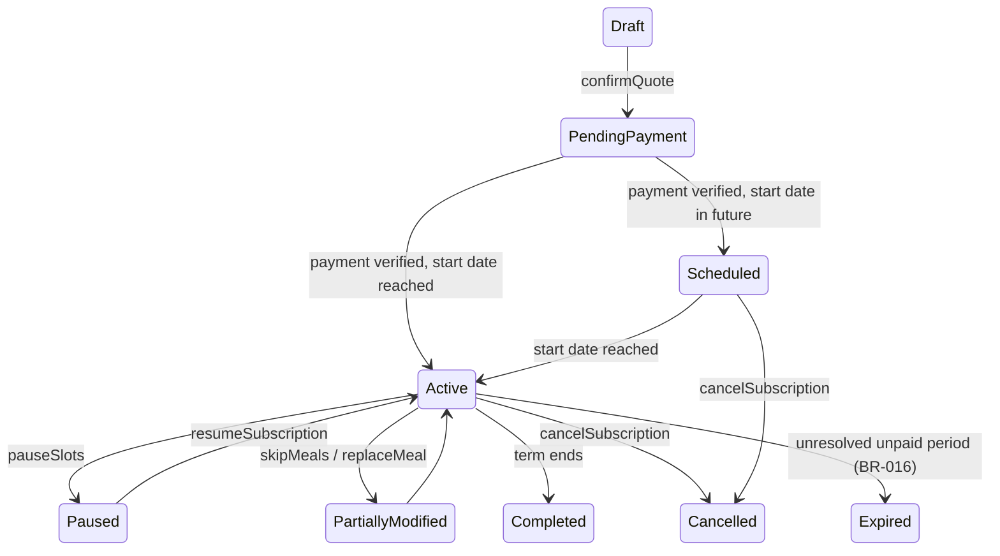

# Custom subscription engine (Customer App)

| Field | Value |
|---|---|
| Revision | 1.0 · 2026-10-30 |
| Owner | Customer App domain author |
| Purpose | Define the flexible daily/weekly/monthly/custom subscription builder, the agreement-vs-obligation model, and the full lifecycle state machine. |
| Applies to | CUS |
| Depends on | [ADR-014](../adr/014-subscription-agreement-and-meal-obligations.md), [api/COMMANDS_ORDERS_AND_SUBSCRIPTIONS.md](../api/COMMANDS_ORDERS_AND_SUBSCRIPTIONS.md) |
| Status | PROPOSED — NOT APPROVED. |

## 1. Agreement vs obligation (ADR-014)

`ent.Subscription` (the agreement: kitchen, schedule rules, term, billing terms, versioned) generates `ent.MealObligation` records (one per date+slot+meal+quantity) via the scheduled job `generateMealObligations`. A skip, pause, replacement, upgrade or downgrade touches only the affected obligation(s); the agreement's version history stays intact (fixes the legacy prototype's single hard-coded `monthly-ld` plan, conflict register C-09).

## 2. Purchase models

One-time order (no agreement, see [ORDER_MANAGEMENT.md](ORDER_MANAGEMENT.md)); daily plan (one or more slots for one date); weekly subscription (7-day or configured weekly recurrence); monthly subscription (month or configured monthly cycle); custom subscription (fully personalised per-date, per-slot selection). Subscription duration and billing frequency are independent settings (glossary; a monthly-duration agreement may be billed weekly if BR-002 approves).

## 3. Builder flow (NC-04, NC-05)

Select kitchen → pick meals per date/slot (weekday recurrence with explicit exceptions, legacy example: Saturday breakfast A, lunch B, dinner C; Sunday lunch D) → set start date/duration/delivery window → full schedule preview → `createQuote`/`confirmQuote` → payment.

## 4. Lifecycle state machine (USER-REQ)

No change to an already-dispatched meal obligation is permitted unless an explicit exception policy (DEC-014) allows it. The original agreement and every approved modification remain in history (`ent.SubscriptionVersion`).

## 5. No hard-coded duration

Nothing in this engine names a fixed duration, plan, or kitchen in code; every structure comes from the customer's own selections against the catalogue (USER-REQ).

## Acceptance and verification

Design-only. Verification requires: a schedule preview matching the generated obligations exactly; a skip touching only its one obligation; a cancelled agreement never silently erasing its history.

## Open decisions

BR-001, BR-006, BR-016, BR-017, BR-021 — all PENDING.
