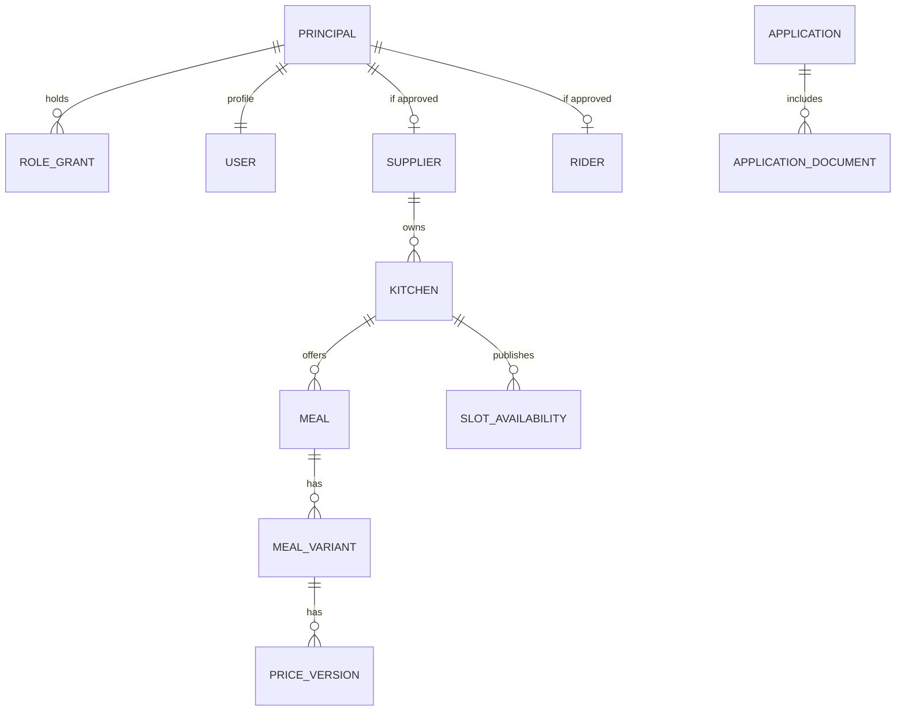
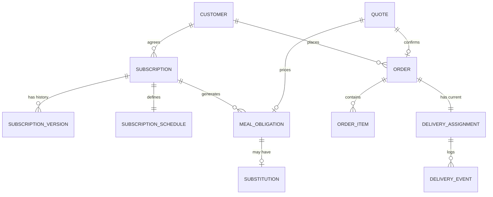
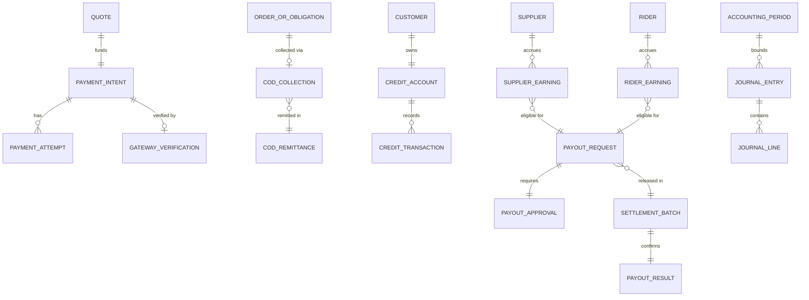
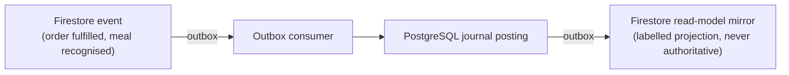

# Entity relationships

| Field | Value |
|---|---|
| Revision | 1.0 · 2026-10-30 |
| Owner | Architecture lead |
| Purpose | Mermaid ER diagrams for the operational (Firestore) and financial (PostgreSQL) domains, and how they connect through the outbox. |
| Depends on | [Database design](DATABASE_DESIGN.md), [data dictionary](DATA_DICTIONARY.md), [financial data model](FINANCIAL_DATA_MODEL.md) |
| Status | PROPOSED — NOT APPROVED. |

## Identity and catalogue (Firestore)

## Commerce (Firestore, snapshotted financially into PostgreSQL)

## Financial (PostgreSQL)

## Cross-store link

## Acceptance and verification

Design-only. Verification requires a schema-level check that every PostgreSQL foreign-key-style reference (e.g. `CodRemittance.riderId`) resolves to an existing Firestore principal id at write time, enforced at the trusted-backend command layer since no native cross-store foreign key exists.
