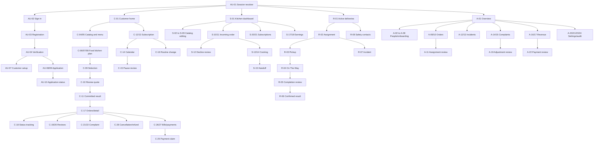
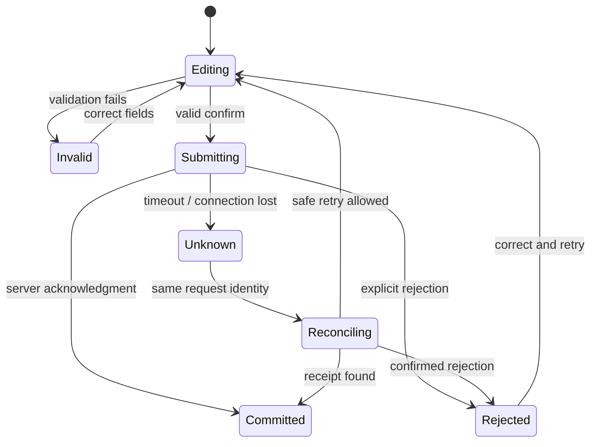

# Navigation architecture and user flows

| Field | Value |
|---|---|
| Revision | 2.0 · 2026-10-30 (rewrites the shell table for the legacy 94-ID + proposed 55-ID inventory across four apps; supersedes the F129-based IDs below) |
| Owner | Design system author |
| Depends on | [Complete screen inventory](COMPLETE_SCREEN_INVENTORY.md), [multi-app architecture](../architecture/MULTI_APP_ARCHITECTURE.md) |
| Status | Proposed route contract; no router implemented. |

2026-10-30 · Proposed route contract; no router implemented.

Use the legacy screen IDs (authoritative, [complete inventory](COMPLETE_SCREEN_INVENTORY.md)) and the proposed NC/NS/NR/NA/NF IDs as manifest keys, not hard-coded labels. Select one router per app (Flutter Web apps use real browser history unlike the legacy in-memory stack navigator, see [architecture/REACT_TO_FLUTTER_MIGRATION.md](../architecture/REACT_TO_FLUTTER_MIGRATION.md)). Proposed route convention: `/auth/<page>` (shared), `cus://customer/<feature>/:id`, `par://supplier/<feature>/:id` and `par://rider/<feature>/:id` (one Partner App, two route trees), `adm://admin/<feature>/:id`, `acc://accounts/<feature>/:id`. Shared sheets are typed presentation actions; sensitive record IDs are not trusted merely because they appear in a URL.

## Shells and entry points (rewritten for the legacy 94-ID inventory, 2026-10-30)

| Shell | App | Primary destinations | Secondary reachable paths |
|---|---|---|---|
| Public / guest | CUS | P-01 Guest home → P-02 Menu/kitchens, P-03 Plans | P-04 Role info → AU-12/AU-09/AU-10; protect-and-resume sheet → AU-03 |
| Auth | CUS/PAR/ADM/ACC (shared package) | AU-01 Splash → AU-02 Language → AU-03 Sign-in | AU-04…08 recovery/signup/onboarding; AU-09…11 partner applications; AU-12 choose type; AU-13 Admin/Accounts secure sign-in |
| Customer | CUS | C-01 Home (tab) · C-10 Subscriptions (tab) · C-16 Orders (tab) · C-23 Profile (tab) | Home → C-04 menu, NC-01 kitchen discovery, NC-04 subscription builder; profile → C-02/20/22/24, SH-* |
| Supplier workspace | PAR | S-01 Dashboard (tab) · S-04 Menu (tab) · S-06 Orders (tab) · S-08 Earnings (tab) | Dashboard → S-02/03, NS-04/05; earnings → NS-01/02/03 |
| Rider workspace | PAR | R-01 Deliveries (tab) · R-07 History (tab) · R-09 Profile (tab) | Deliveries → R-02/03/04, NR-01/02/03/04 |
| Admin | ADM | NA-01 Operations console · A-08 Users (tab) · A-10 Orders (tab) · A-15 Settings (tab) | NA-01 → A-02/03/04, A-06/07, NA-02/03/04; NA-05 limited finance view |
| Accounts | ACC | NF-01 Finance overview · NF-02/03 Payments/COD · NF-07/08 Payouts | NF-01 → NF-05/06/09/10/11/12/13/14/15/16/17 |

Keep a stack per primary tab, with state restoration limited to safe view state. Tablet widths use a navigation rail; wide administrative views use sidebar plus master/detail. Back closes an overlay, then pops detail, then returns to the current shell; it must never reopen a signed-out protected screen. Reselecting a tab returns to its root according to one consistent contract. Unsaved edits prompt SH-16.

## Authentication and deep links

1. Resolve Auth session and authoritative access/approval record before selecting a shell. Login role tabs only choose intent.
2. Supplier/Rider pending applications go to AU-10; revoked/disabled/wrong-role access goes to AU-12. No client-controlled role field grants privileges.
3. For a deep link/FCM tap, store only safe route intent during sign-in, then re-fetch and authorize the target. Validate route shape, resource identity and current assignment/ownership.
4. Missing records, foreign objects and revoked assignments show SH-15, without revealing private entity data. Do not keep rendering cached sensitive details after access ends.
5. Duplicate notification taps do not duplicate navigation or writes. Back from a notification destination returns to an appropriate shell, not an absent source stack.

## Complete journey map

Each role also reaches SH-01/02 notifications, SH-03–09 account/legal/security/language and SH-10–14 support/privacy via its profile or settings entry. SH-16–20 overlays are reachable from their listed parent actions. Full exact per-screen edges remain in the inventory. Later X routes are separately gated and omitted from the live R1 router unless explicitly approved; design coverage still includes them.

## Interaction-state transitions

State transitions are not screen navigation shortcuts. Only committed results may show success; a timeout must not create a second order or payment claim. Critical changes require confirmed connectivity under the proposed offline contract. Back during submission must not cancel a committed server operation or lose the request identifier.

## Route verification plan

Generate tests from the expanded route/capture manifest: every R1 page has an authorized entry path and back path; every control resolves or performs a specified inline action. Run each object route with own, foreign, nonexistent, stale and revoked IDs. Test role switching/sign-out, restored tab stacks, Android back, keyboard dismissal, translated labels, FCM cold/warm launch and delayed session restoration. A static edge audit is preparation only; actual Flutter navigation must be executed before completion.
