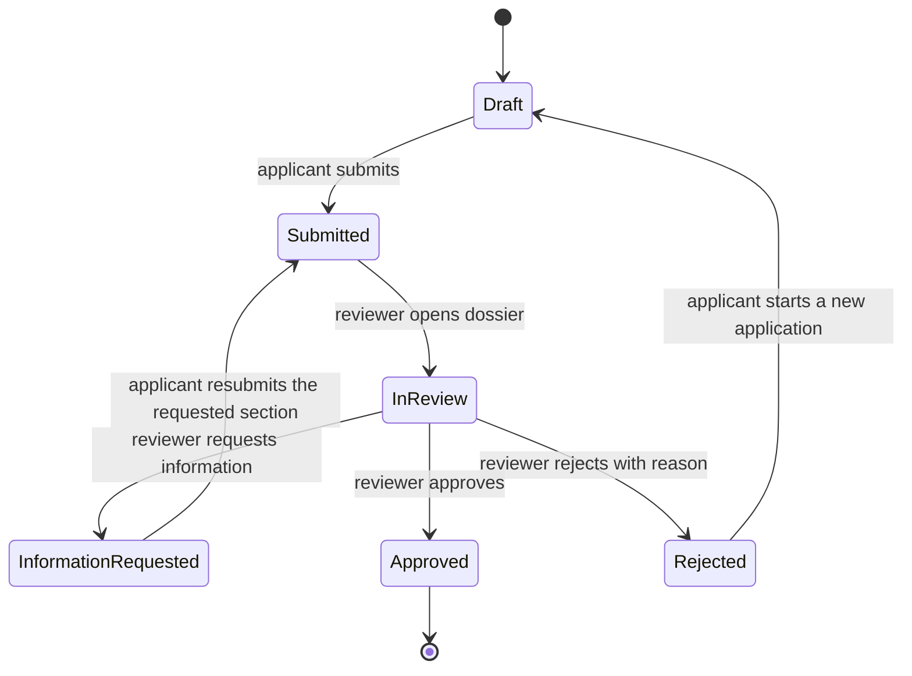

# Partner application screens (AU-09, AU-10, AU-11)

| Field | Value |
|---|---|
| Revision | 1.0 · 2026-10-30 |
| Owner | Screen design lead (author E3) |
| Purpose | Define the supplier (kitchen) and rider application journey: the shared StepForm engine, every field of the six kitchen steps and eight rider steps with validators and conditional rules, drafts, correction ("fix") mode, status states, the removal of the prototype admin shortcut, and server-side approval. |
| Applies to | Partner App (PAR) applicant flow before any workspace grant; hand-off entry from the Customer App (C-23) and the public shell (P-04, AU-12); review side lives in Admin Web (NA-03, A-06, A-07) |
| Depends on | [Conventions and ID register](../../analysis/CONVENTIONS_AND_ID_REGISTER.md), [legacy prototype digest](../../analysis/SOURCE_LEGACY_PROTOTYPE_DIGEST.md), [master prompt digest](../../analysis/SOURCE_MASTER_PROMPT_DIGEST.md), [glossary](../../requirements/GLOSSARY_AND_TERMINOLOGY.md), [policy decision register](../../requirements/POLICY_DECISION_REGISTER.md), [partner app architecture](../../partner-app/PARTNER_APP_ARCHITECTURE.md), [supplier modules](../../partner-app/SUPPLIER_MODULES.md), [rider modules](../../partner-app/RIDER_MODULES.md), [partner UI/UX](../../partner-app/PARTNER_UI_UX.md), [identity and catalogue commands](../../api/COMMANDS_IDENTITY_AND_CATALOGUE.md), [ledger and governance commands](../../api/COMMANDS_LEDGER_AND_GOVERNANCE.md), [authorization](../../api/AUTHORIZATION.md), [error responses](../../api/ERROR_RESPONSES.md), [design system](../DESIGN_SYSTEM.md), [accessibility](../ACCESSIBILITY.md) |
| Authoritative policies | BR-004 (assignment eligibility and completion evidence, PENDING), BR-023 / DEC-033 (dual-role accounts, PENDING), BR-024 / DEC-034 (compliance lapse, PENDING); cross-cutting DEC-009 (identity and role policy) and DEC-010 (privacy and retention) in [assumptions and constraints](../../requirements/ASSUMPTIONS_AND_CONSTRAINTS.md). None is approved. |
| Status | Draft for review. Nothing is implemented or tested by this document. Prototype statuses (I/U/S) describe the legacy React prototype only. Every requirement below is tagged USER-REQ, OBSERVED, PROPOSED or PENDING. |

## 1. Scope and reading guide

### 1.1 Screens covered

| ID | Name | Prototype component | Prototype status | Migration action | Form |
|---|---|---|---|---|---|
| AU-09 | Kitchen application (6 steps) | `SupplierApply` → `StepForm` · `apply.tsx` | **I** | Extend | Full screen, stepped |
| AU-10 | Rider application (8 steps) | `RiderApply` → `StepForm` · `apply.tsx` | **I** | Extend | Full screen, stepped |
| AU-11 | Application status | `UnderReview` · `apply.tsx` | **I** | Extend (admin shortcut removed) | Full screen |

The engine (`StepForm`) is not a screen. It is a reusable component contract defined in section 4 and instantiated twice (AU-09, AU-10).

### 1.2 Provenance and test notation

- USER-REQ: master-prompt rows AU-09 ("preserve supplier multi-step application, documents, approval, corrections, conditional fields, drafts"), AU-10 ("preserve rider multi-step application with vehicle-dependent eligibility, documents, verification, corrections"), AU-11 ("remove prototype admin-shortcut access from applicant journey; enforce server approval"), plus the authentication rule that a visually selected account type never grants authorisation.
- OBSERVED: behaviour reported for the React prototype (the source code is not in this workspace and was not re-verified). Observed numeric validators (phone at least 11 digits, capacity 1 to 500, applicant age at least 18) are carried only as prototype values. They are not approved policy; production values are the named parameters `policy.application.*` in section 13.
- PROPOSED: engineering recommendation. Field keys such as `fullName` are PROPOSED names for design discussion; the prototype's own keys are not known.
- PENDING: depends on an unapproved decision (BR/DEC). The design supplies a configurable parameter and never a default value.
- Test cases in this file are **planned**. None has been executed. Executed evidence belongs only in [test results](../../testing/TEST_RESULTS.md). Rows marked "new" have no TEST number yet; the testing author assigns numbers (TEST-026…099 functional, TEST-118…199 security/UI) and back-references the case labels used here. Acceptance IDs for FR-045 follow the existing one-to-one FR/AC numbering (AC-045); the requirements author confirms at integration.

### 1.3 What this file does not decide

Which documents are mandatory for a given kitchen type or vehicle, the minimum rider age, capacity bounds, NID formats, the legal text of the partner agreement, how long drafts and rejected applications are retained, the waiting period before re-applying, who may verify applicants, and whether one person may hold both partner roles. Each is PENDING and appears as a named parameter or a decision row in section 13.

## 2. Onboarding design rules

1. **Selection is intent, not authority.** Choosing "Cook" or "Rider" on AU-12 or P-04 starts an application. It grants nothing. Access to the supplier or rider workspace exists only when the server holds an approved role grant (`ent.RoleGrant`) for that principal.
2. **Approval is a server decision.** Only `decideApplication` (Admin Web, authorised reviewer) can move an application to Approved or Rejected, and only that command creates the partner grant. The client never sets a status, a reference, an approval flag, a kitchen id or a role.
3. **No admin shortcut.** The prototype's AU-11 policy note that links to "Admin › A-07" is removed. An applicant screen contains no route, link, label or hint that leads to an admin screen. AU-13 stays unlinked from every applicant, public and customer screen.
4. **Fail closed.** A pending, rejected or information-requested applicant who reaches a workspace route by any means (deep link, stale session, tampered client) receives a denied state, because the check is made again by the command and data rules, not only by navigation.
5. **Collect the minimum.** Every field is justified by a review purpose (identity, safety, service capability, payout destination). Sensitive values are masked on review and in history, and never appear in notifications, e-mail, logs or analytics (the prototype already states "Emails never contain NID images, codes or passwords").
6. **Never lose the applicant's work.** A session expiry, a network loss or an app restart returns the applicant to the same step with the entered data.
7. **Tell the truth about status.** The screen shows only what the server recorded: Submitted, In Review, Information Requested, Approved or Rejected. A local draft is never presented as a submission, and "Submitted" is shown only after the server acknowledged the command.

## 3. Application lifecycle (server-authoritative)

### 3.1 States

Glossary model: **Draft · Submitted · In Review · Information Requested · Approved · Rejected**. The prototype names map as follows.

| Glossary state | Prototype state (OBSERVED) | Set by | Applicant sees (AU-11) |
|---|---|---|---|
| Draft | local draft (`st-draft-Cook`, `st-draft-Rider`) | applicant, `saveApplication` (draft) | AU-09/AU-10 resume prompt; no AU-11 yet |
| Submitted | pending (Clock, warning) | applicant, `saveApplication` (submit) | "Submitted, waiting for review" |
| In Review | pending (timeline step "In review") | admin workflow when a reviewer opens the dossier (see [admin screens](ADMIN_SCREENS.md), NA-03/A-07) | "In review" step active; same pending hero |
| Information Requested | info (Alert) | reviewer, `decideApplication` (request information, section and reason) | Alert with reviewer message and **Update application** |
| Approved | approved (Check) | reviewer, `decideApplication` (approve), which creates the role grant atomically | Approved hero and **Open my dashboard** |
| Rejected | rejected (XCircle) | reviewer, `decideApplication` (reject, reason required) | Reason, policy note, **Start a new application** |

### 3.2 Rules attached to the lifecycle

- Transitions are atomic with an audit event (`ent.AuditEvent`) and an outbox notification (`ent.OutboxEvent` → `ent.Notification`). Every command carries `requestId`; replaying the same `requestId` returns the original result, so a double tap on Submit creates one `ent.Application`.
- A decision never overwrites history. The application keeps an append-only history (submitted, in review, information requested with section and reason, updated and resubmitted, approved or rejected) from which the AU-11 timeline and history card are rendered.
- Approval creates the partner role grant and, for a kitchen, links an `ent.Kitchen` owned by an `ent.Supplier`; for a rider, an `ent.Rider` and (for motorcycle) an `ent.Vehicle`. The approved applicant's client must refresh its identity claims before the workspace opens (section 9, approved state).
- Self-approval is impossible: a reviewer cannot decide an application whose principal is the reviewer (TEST-021 covers the general rule).
- A person may submit one kitchen application and one rider application. Whether both may be approved on one account is BR-023 / DEC-033 (PENDING). The design supports several grants with independent workspaces, balances and authorisation (SC-25) and does not assume the answer.
- Re-application after rejection starts a new `ent.Application`; the waiting period, if any, is `policy.application.reapply_wait_days` (PENDING). The rejected application and its documents stay readable by authorised staff for audit under the retention parameter `policy.retention.application_documents` (DEC-010).
- Expiry of an approved partner's documents is not an application state. It is handled in S-11 (supplier) and R-09 (rider) and, where policy requires, suspends the partner (SC-17, BR-024).

## 4. StepForm engine contract

`StepForm` is the single stepped-form component used by AU-09 and AU-10. It is defined as data plus behaviour so that adding, removing or reordering a field does not require a new screen. The design target is a schema-driven Flutter widget in the partner app; the schema version is stored on every saved application so that the server validates against the same definition the client rendered.

### 4.1 Responsibilities

| The engine does | The engine never does |
|---|---|
| Render steps and fields from a typed definition; show progress; validate; hold the working draft; present the review; call `saveApplication` and `saveEvidence` through the command client | Decide eligibility, set status, grant a role, compute a reference, or hold business policy constants (it reads them as parameters) |
| Show conditional fields and conditional requirements | Trust its own validation as final (the server validates again) |
| Keep the draft and restore it after interruption | Store uploaded file contents in the draft (files go to private storage as evidence) |

### 4.2 Definition model

| Element | Attributes |
|---|---|
| Form | `formKind` (kitchen or rider), `schemaVersion`, ordered `steps`, `reviewStep` (always last) |
| Step | `stepKey`, EN and BN titles, `fields`, optional `safetyNote`, `completionRule` (all required fields valid) |
| Field | `key`, EN and BN label, `type` (section 4.3), `required`, `reqIf` (conditional requirement), `show` (conditional display), `cond` (policy-pending marker), `validators`, `sensitivity` (ID, contact, financial, location, third-party, none), `maskOnReview`, `helpText`, `evidenceType` (upload fields) |
| Submission | `applicationId` (server issued), `requestId`, `expectedVersion`, `schemaVersion`, field values, evidence references, acceptance records |

### 4.3 Field type catalogue (OBSERVED types, PROPOSED behaviour)

| Type | Behaviour | Validation hooks | Accessibility notes |
|---|---|---|---|
| `text` | Single line, trimmed, length bounds | required, min/max length, pattern | label bound to input; error announced on blur and on Next |
| `tel` | Numeric keypad; normalised to the canonical international form; shows national format | digits only, minimum length (prototype: at least 11 digits), mobile numbering check through a maintained phone-number library | keypad hint; no auto-correct |
| `email` | Email keyboard; lowercased | format check; verified-identity match | autofill hint |
| `number` | Numeric keypad; integer | range (capacity prototype: 1 to 500) | unit shown in the label |
| `date` | Platform date picker; stored as an ISO date | not in the future; age rule for DOB (prototype: at least 18) | picker is keyboard and screen-reader operable; typed entry alternative |
| `select` | Single choice from a closed list | value must be in the list | list announced with selected state |
| `chips` | Multi-select toggle chips | minimum selected count | each chip is a toggle with a selected announcement; targets at least 48 dp |
| `upload` | Camera or file picker; uploads immediately as evidence; shows name, size and state | type, size and count limits (`policy.evidence.*`), server content check | state announced (uploading, uploaded, failed); replace and remove need confirmation |
| `check` | Checkbox with full-row hit area | must be ticked when required | row is the target, not the box only |
| `area` | Multi-line text | length bounds | grows with text scale |

Prototype upload fields only simulate a file named `"<key>.jpg"` (OBSERVED, status S). Production uploads are real and verified by the server.

### 4.4 Conditional rules

- `show` (conditional display): bank name only when the payout method is Bank; motorcycle licence number, registration number, insurance number, licence document and registration document only when the vehicle is Motorcycle. Hidden fields are excluded from validation, from the review and from the submitted payload. If the controlling answer changes, values of newly hidden fields are discarded from the submission but kept in the draft until submit, so a mistaken tap does not destroy typed data.
- `reqIf` (conditional requirement): trade licence is required when the kitchen type is Restaurant or Cloud kitchen. Whether it is required for a Home chef is not stated in the source and remains `policy.application.kitchen.required_documents` (PENDING).
- `cond` marker: fields marked conditional show the tag "Conditional · policy pending". They stay visible, so the reviewer and applicant both see that the requirement is not final. The tag disappears only when the policy version that approves the requirement is published; the engine reads the requirement from the published policy version, not from code.
- Conditional rules are evaluated on the server with the stored `schemaVersion` and the policy version at submission time.

### 4.5 Validation timing and error presentation

1. Per field on blur (format only, never on every keystroke).
2. Per step on **Next**: all visible fields of that step; the first invalid field takes focus and is announced; an error summary appears at the top of the step.
3. Whole form on **Submit**: every step is validated; the engine jumps to the first step with an error and marks failing step chips.
4. Server validation on submit: field errors returned by the server (typed error with field key and code, see [error responses](../../api/ERROR_RESPONSES.md)) are mapped back onto the same fields and steps.
5. Messages are bilingual translation resources, specific ("Enter an 11-digit mobile number") and never generic ("Invalid").

### 4.6 Navigation and footer behaviour

| Control | Behaviour |
|---|---|
| Progress bar and step chips | Show "Step n of N". Tapping a chip moves to a step that was already reached; later steps stay locked until earlier steps are valid. Chips are exposed as a progress group to screen readers. |
| **Back** (step 0) | Opens the confirmation "Leave application?" with Keep editing and Leave. Leave saves the draft first, then returns to the **origin** (the screen that started the flow: AU-12, P-04 or C-23). The prototype always returned to AU-12 (prototype gap 4); the origin is now a navigation parameter. |
| **Back** (step above 0) | Previous step; no validation; no data loss. |
| **Save draft** | Persists the draft locally and, for an authenticated applicant, to the server; shows "Saved at hh:mm" inline rather than only a toast. |
| **Next** | Validate the current step, then advance. |
| **Submit** (Review step) | Validates all steps, shows a final confirmation, then sends `saveApplication` (submit) with a new `requestId`. |
| Review cards with **Edit** | Jump to the step; Next from an edited step returns straight to Review. |

### 4.7 Drafts

- **Where.** Prototype: `localStorage` keys `st-draft-Cook` and `st-draft-Rider` (OBSERVED), cleared on submit. Production: app-private encrypted storage on the device, keyed by principal and form kind, plus a server draft (`ent.Application`, state Draft) so the draft survives a device change. A draft holds field values only, never file contents; uploaded evidence is linked by reference.
- **When.** On **Save draft**, on leaving a step, and after a short idle period. A save failure never blocks typing; the engine shows "Not saved yet" and retries.
- **Conflicts.** The server draft carries a `version`. If another device saved a newer draft, the engine offers "Continue with the newer draft" or "Keep this device's version"; it never merges silently.
- **Sign-out and shared devices.** The prototype did not clear store, `myApp` or role on sign-out (prototype gap 6). Production clears the local draft cache of the signed-out principal unless the applicant chooses to keep it; the server draft remains.
- **Retention.** Drafts that are not submitted expire after `policy.application.draft_retention_days` (PENDING, DEC-010). The applicant is told when a draft will expire.

### 4.8 Evidence upload handling

Each upload field maps to an `ent.ApplicationDocument` of a declared `evidenceType`. The client requests an upload slot through `saveEvidence`, uploads to private storage, and the server records type, size, content hash and server timestamp. The server checks file type by content, size and count against `policy.evidence.allowed_types`, `policy.evidence.max_size_bytes` and `policy.evidence.max_files_per_field`. Replacing a file creates a new version and keeps the old one for audit. A document is never public; viewing is restricted to the owner and authorised reviewers. A file with no server acknowledgement is shown as "Not uploaded" and blocks Submit. Image upload does not verify identity; verification is a reviewer decision.

### 4.9 Submit sequence

1. Applicant taps Submit; the engine disables the button and shows "Sending".
2. Client validates everything; on failure it stops and jumps to the first bad step.
3. `saveApplication` (submit) with `requestId`, `schemaVersion`, `expectedVersion` and acceptance records.
4. Server validates again, checks evidence completeness, records the agreement acceptance (policy version, time, principal), assigns the application id and the human-readable reference (prototype format `ST-APP-xxxx`, now server-issued), sets Submitted, writes the audit event and enqueues the reviewer notification.
5. Client receives the acknowledgement, clears the local draft and resets to AU-11 with the application id.
6. If the response is lost, the client retries with the same `requestId`. If still unsure, AU-11 reads the own-application record; if none exists the draft is intact and the engine offers Submit again.

### 4.10 Fix mode (correction after Information Requested)

- Entered from AU-11 **Update application** with `id` and `fix` (the requested section).
- Only the requested step opens. Other steps are read-only on the Review step. Next goes straight to Review.
- A warning note quotes the reviewer message (plain text, sanitised, no internal notes).
- The server enforces the same restriction: a resubmission may change only the requested section's fields and evidence. Fields outside it are rejected with a typed error even if a modified client sends them.
- Submit calls `saveApplication` (resubmit) with `expectedVersion`; the server clears the information request, appends "Updated and resubmitted" and returns the application to Submitted. Old documents in the section remain as superseded versions.
- The prototype allowed one section per request (the reviewer picks a section except the last, reason at least 5 characters). Multi-section requests are PROPOSED and need the admin screens to agree (NA-03).

### 4.11 Engine states

| State | Behaviour |
|---|---|
| Loading | Skeleton of progress bar and first step while the schema, zone list and draft load; fields appear only when the schema version is known. |
| Empty | Not applicable to the form; an empty draft is the normal first step. An empty zone list shows "No service areas are open yet" and blocks only the steps that need it. |
| Success | Submit acknowledged; reset to AU-11. Draft saved shows an inline timestamp. |
| Error | Field errors in place; request errors as a banner with Retry; the draft is never discarded. |
| Offline | Editing and local draft work. Uploads and Submit are disabled with a reason caption ("Needs a connection"). Nothing is reported as sent. |
| Denied | A principal that is suspended or has no verified contact cannot start a form; a clear message and a route to SH-04 support. |
| Session expired | The draft is kept; the app asks for re-authentication and returns to the same step. |
| Schema changed | If the server rejects `schemaVersion` as outdated, the engine reloads the new definition, keeps matching values and highlights new or changed fields. |

### 4.12 Engine acceptance checks (planned)

| Case | Scenario | Expected outcome |
|---|---|---|
| E1 | Fill every required field of each form and submit | One `ent.Application` in Submitted with a server reference; local draft cleared. |
| E2 | Leave a required field empty on the last step and press Submit | Engine jumps to the first invalid step; nothing is sent. |
| E3 | Select vehicle Motorcycle, then change to Bicycle | Motorcycle fields and documents leave the review and payload; the draft still holds them until submit. |
| E4 | Tap Submit twice quickly | One application; the second tap is ignored and, if sent, replays the first result. |
| E5 | Kill the app mid-form and reopen | Same step, same values; uploaded files still linked. |
| E6 | Client sends a changed field outside the requested section in fix mode | Server rejects with a typed error; stored application unchanged. |
| E7 | Submit while offline | Submit is disabled with a reason; draft is saved locally; after reconnect Submit works. |

## 5. KITCHEN_STEPS field detail (AU-09, six steps)

| Step | Fields | Validators / conditional rules |
|---|---|---|
| 1 Personal | name, phone, email, NID | Phone ≥ 11 digits (OBSERVED prototype rule, carried as `policy.application.phone_min_digits`) |
| 2 Kitchen | name, type (HomeChef/Cloud kitchen/Restaurant), address, service-area chips, photo | Service area must intersect an open `ent.ServiceZone` |
| 3 Operations & menu | capacity, meal times, working days, sample menu | Capacity 1–500 (OBSERVED, carried as `policy.application.capacity_range`) |
| 4 Payout | method (bKash/Nagad/Bank), bank name (conditional on Bank), account, holder | Bank name required only when method = Bank; never collects a PIN/OTP |
| 5 Documents | NID front/back, kitchen photos, trade licence (conditional), hygiene cert (conditional) | Trade licence required when type ∈ {Restaurant, Cloud kitchen} (OBSERVED `reqIf` rule) |
| 6 Agreement & review | two acknowledgement checkboxes | Both required before Submit |

## 6. RIDER_STEPS field detail (AU-10, eight steps)

| Step | Fields | Validators / conditional rules |
|---|---|---|
| 1 Personal (+DOB) | name, phone, email, NID, date of birth | Age ≥ 18 (OBSERVED, carried as `policy.application.min_rider_age`) |
| 2 Address & zone | address, service zone | Zone must be open |
| 3 Emergency contact | name, phone | — |
| 4 Vehicle | type (Motorcycle/Bicycle/Walker), registration, insurance (conditional) | Motorcycle-only fields (`show` rule) require registration + insurance; Bicycle/Walker need neither |
| 5 Availability & phone | shifts, device OS (Android/iPhone), GPS permission checkbox | GPS checkbox informs whether live-location consent (FR-048) can be offered |
| 6 Payout | method, account, holder | Same no-PIN rule as kitchen payout |
| 7 Documents | NID, selfie, + motorcycle-only documents | Motorcycle documents required only when vehicle = Motorcycle |
| 8 Review | agreement checkbox | Required before Submit |

## 7. AU-11 Application status — screen contract

**Identity.** AU-11, shared by supplier and rider applicants, Partner App. Prototype component `UnderReview`, status I. Migration action: Extend (admin shortcut removed).

**Purpose.** Show the applicant their current decision state and the single next action for that state, never exposing another applicant's data.

**States and primary action** (server-derived from `ent.Application.status`, never client-set):

| State | Shown | Primary action |
|---|---|---|
| Pending | "Admin reviews every application" with submitted timestamp | None (wait) |
| Information Requested | The reviewer's note for the named section | "Update application" → AU-09/AU-10 in fix mode |
| Rejected | The reviewer's reason | "Start a new application" → a fresh AU-09/AU-10 draft |
| Approved | "Your dashboard is ready" | "Open my dashboard" → S-01 (supplier) or R-01 (rider), only after the server has actually granted the role |

**Always shown:** a Timeline (Submitted / In Review / Decision), a History card from `ent.AuditEvent`, "Contact support" → SH-04, "Sign out" → sign-out flow. **Explicitly removed:** the legacy prototype's "Admin › A-07" shortcut link; an applicant has no route to the reviewer's own screen.

**Backend:** reads `ent.Application` scoped to the caller's own principal id only; `decideApplication` is never callable from this screen.

**Acceptance (planned):** AU11-1 — an applicant sees only their own application regardless of guessed id; AU11-2 — the dashboard action is unavailable until the server-granted role actually exists, even if the status locally shows Approved from a stale cache.

## 8. F129 reconciliation

The F129 planning inventory's Auth section (`F129/AU-01…12`) is reconciled in full in [design/INVENTORY_RECONCILIATION.md](../INVENTORY_RECONCILIATION.md). This file's three legacy IDs (AU-09, AU-10, AU-11) absorb F129's application-evidence (`F129/AU-09`), application-pending (`F129/AU-10`) and supplier/rider application (`F129/AU-08`) rows; nothing from those F129 rows is lost — the document/evidence retention and purpose fields they specified are carried in §4.8 above.
