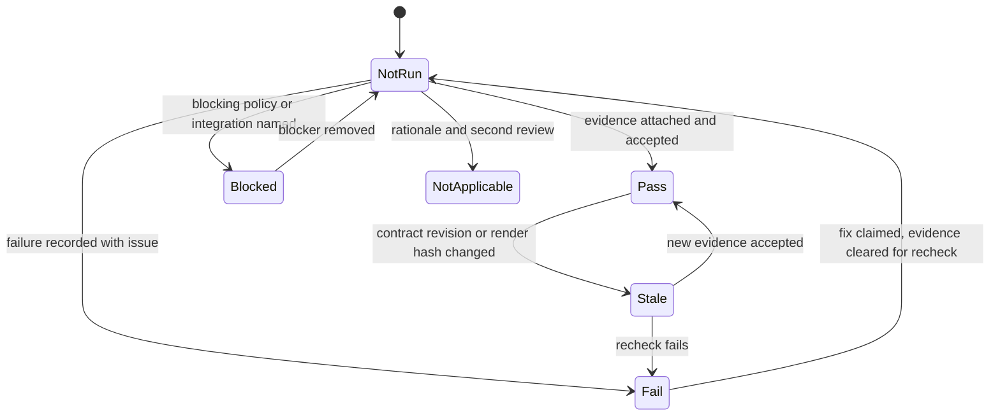

# Tooling screens X-01 and X-02 (design gallery and verification report)

| Field | Value |
|---|---|
| Revision | 1.0 · 2026-10-30 |
| Owner | Design and QA lead (author E4, integrated by the documentation lead) |
| Purpose | Specify the two legacy "System" screens, X-01 (design system gallery) and X-02 (verification report), as process and tooling artefacts, and define the evidence rules that stop X-02 from ever reporting a pass that was not earned. |
| Applies to | DEV tooling only. X-01 and X-02 are **not** product screens in the Customer App (CUS), Partner App (PAR), Admin Web (ADM) or Accounts Web (ACC). |
| Depends on | [Design system](../DESIGN_SYSTEM.md), [component specifications](../COMPONENT_SPECIFICATIONS.md), [screen verification checklist](../SCREEN_VERIFICATION_CHECKLIST.md), [responsive layouts](../RESPONSIVE_LAYOUTS.md), [accessibility plan](../ACCESSIBILITY.md), [PDF production plan](../PDF_PRODUCTION_PLAN.md), [complete screen inventory](../COMPLETE_SCREEN_INVENTORY.md), [conventions](../../analysis/CONVENTIONS_AND_ID_REGISTER.md), [legacy prototype digest](../../analysis/SOURCE_LEGACY_PROTOTYPE_DIGEST.md), [master prompt digest](../../analysis/SOURCE_MASTER_PROMPT_DIGEST.md) |
| Authoritative policies | None. These screens carry no business policy. They only record whether other screens meet the documented design and test criteria. |
| Status | Draft for review. Nothing is implemented, nothing is approved, and no verification result exists. Every test in this file is a planned design, not an executed result. |

Sibling contracts: [Admin screens](ADMIN_SCREENS.md), [Accounts screens](ACCOUNTS_SCREENS.md). Test documents: [UI/UX test checklist](../../testing/UI_UX_TEST_CHECKLIST.md), [test results](../../testing/TEST_RESULTS.md), [test strategy](../../testing/TEST_STRATEGY.md).

## 1. Scope, boundaries and counting

1. **What X-01 and X-02 are.** In the legacy React prototype the two "System" screens were part of the 94-screen registry, shown inside the Prototype Hub. They exist so that designers, developers, reviewers and QA can inspect reusable design rules (X-01) and record per-screen verification results (X-02). They never carry customer, supplier, rider, staff or financial data.
2. **What they are not.** They are not routes of any of the four applications, they have no role, no principal, no backend command and no entity. A product user must never be able to reach them, and no product navigation links to them (OBSERVED in the prototype: reachable from the Hub only).
3. **Counting.** The 94 legacy identifiers stay authoritative ([conventions §4](../../analysis/CONVENTIONS_AND_ID_REGISTER.md)). 92 of them plus the 55 proposed screens are product screens; X-01 and X-02 are the two tooling items (migration action **Tool**). The combined 149 named contracts therefore contain 147 product contracts and 2 tooling contracts.
4. **Name collision warning.** The earlier planning inventory also used the identifiers `X-01` to `X-07` for *later-release product designs* (live map, turn-by-turn directions, treasury, messaging, gateway checkout, offers, biometrics). Those are always cited here as `F129/X-01` to `F129/X-07` and are reconciled in section 8. A bare `X-01` or `X-02` always means the legacy tooling screen.
5. **Delivery (PROPOSED, not decided).** Preferred shape: an internal tooling entry point that is compiled only for debug, profile or an explicit design-tooling build, never into a release flavour of CUS, PAR, ADM or ACC. Whether this is a route inside each app, a separate package target in the monorepo, or a web build on an internal origin is decided in [monorepo and build ownership](../../setup/MONOREPO_AND_BUILD_OWNERSHIP.md). If a web build exists, it must not share an origin, hosting site or credentials with the production Admin or Accounts web apps ([web hosting plan](../../deployment/WEB_HOSTING_ADMIN_AND_ACCOUNTS.md)).
6. **Data rule.** All gallery and report content is synthetic. Fixtures follow the prototype's "Sample" chip convention. Currency amounts are labelled HYPOTHETICAL and use integer minor units. No real names, phone numbers, addresses, payment identifiers or store identifiers appear (conventions §10).

## 2. Evidence rules (apply to every X-02 cell)

These rules are the core of this file. They implement master-prompt instruction X-02: "test-backed screen verification with traceable evidence; never mark all screens passing by assumption", and the QA rule that screen review is "screenshot-based per route with recorded passing evidence, not compile success".

| Rule | Statement |
|---|---|
| E-1 Default is not run | Every cell of every row starts as **Not run**. The report starts at "0 of N screens verified" for the current manifest. There is no import that pre-fills a pass. |
| E-2 A pass needs evidence | A cell can become **Pass** only when at least one evidence record is attached. An evidence record names: the check, the screen identifier and app instance, the variant (device class, locale, theme, text scale), the contract revision, the build identity (commit or build number), the evidence type, a reference (test run identifier, image path with content hash, or review note), the reviewer, and the date. |
| E-3 No computed or bulk pass | There is no "mark all", "pass group", "pass column" or "approve remaining" control. The row result is computed from its cells and cannot be typed in. |
| E-4 Evidence is never inherited | Evidence for one screen, locale, theme or device does not cover another. A shared component passing in the gallery (X-01) does not pass the screens that use it; each screen needs its own evidence. |
| E-5 Staleness | Evidence is bound to the contract revision and the render hash of the screen. If either changes, the affected cells become **Stale** and the row returns to **Pending** until re-evidenced. |
| E-6 Independent review | For manual checks the reviewer must not be the person who implemented that screen. The tool records both identities. |
| E-7 Compilation is not evidence | A successful build, analyzer run or widget test that does not exercise the check is not evidence for that check. A passing unit test is evidence only for the behaviour it asserts. |
| E-8 Prototype results do not transfer | Results from the React prototype, the `st-qa` data, or any simulated-data run are not evidence for the Flutter product. Fixture runs are labelled **fixture evidence**; only a run against a real integrated backend can be labelled **integration evidence**, and neither is production evidence. |
| E-9 Not applicable needs a reason | A cell may be **Not applicable** only with a written rationale reviewed by a second person (the master plan requires explicit rationale; "missing" is not "not applicable"). Not-applicable cells are displayed distinctly and counted separately. |
| E-10 Blocked is not pass | A cell for behaviour that depends on a pending policy (BR/DEC) or an unbuilt integration is **Blocked** with the register entry named. Blocked rows never count as verified. |
| E-11 Fail needs an issue | A **Fail** cell requires an issue reference (defect record in [bug reports](../../testing/BUG_REPORTS.md) or an equivalent tracker) and a short description of the observed problem. |
| E-12 Results of record live in the repository | The authoritative result is an exported, human-reviewed record committed to `testing/` or `verification/` (see [test results](../../testing/TEST_RESULTS.md)). Local draft state in the tool (including browser storage) is only a working copy and is never evidence by itself. |
| E-13 Honest denominators | Summary tiles show counts with denominators ("12 of 149 verified, 3 failed, 9 blocked, 125 not run"), never an unexplained percentage. |

Evidence types accepted per check are listed in the X-02 contract (section 5.5). Evidence types never accepted: "looks fine" notes without a reference, images without a build identity, self-review by the implementer, and logs that do not name the screen.

## 3. X-01 — Design system gallery

### 3.1 Identity and ownership

| Item | Value |
|---|---|
| Screen ID | X-01 |
| Application | DEV tooling (not CUS, PAR, ADM or ACC) |
| Prototype component | `Gallery` in `gallery.tsx`, prototype status **I** (interactive) |
| Migration action | **Tool** (carried over as a tooling artefact; Replace in implementation language, from React to Flutter) |
| Legacy aliases | None. Do not confuse with `F129/X-01` (live map). |
| Proposed neighbours | X-02 (companion), [design system](../DESIGN_SYSTEM.md), [component specifications](../COMPONENT_SPECIFICATIONS.md) |

### 3.2 Purpose and users

- **Purpose.** A single place to inspect every design token, reusable component, state preview and layout rule of the shared design system in each role identity, locale, theme and device class, so that designers and reviewers can compare screens against rules instead of memory. It also lets a developer discover whether a component already exists before building another (supports the "no duplicate components" rule).
- **Users.** Designers, Flutter developers, reviewers and QA staff. No product role is involved and no sign-in to a product backend is required or allowed.
- **Not for.** Customers, partners, administrators and accounts staff. Not a place to approve policy, copy, prices or legal text.

### 3.3 Provenance

| Tag | Content |
|---|---|
| OBSERVED | Prototype gallery shows: role switcher, buttons, chips, timeline, stats, rows, inputs, notes, state icons and a Bangla wrapping sample. Hub devices: Small Android 360×740, Phone 390×844, Large phone 430×932, Phone landscape 844×390, Tablet 820×1180, Laptop 1280×800, Desktop 1440×900. Prototype size bands: compact below 600, medium 600–839, expanded 840–1199, large from 1200. |
| USER-REQ | Master prompt X group: "complete token gallery, stable registry, accessible status previews, device classes, bilingual reviews"; failure modes "unregistered routes, overflow, missing state, ineffective buttons". Preserve brand identity: warm orange customer, green supplier, blue rider, appropriate admin identity. |
| PROPOSED | Coverage cross-check against the component specification, token readouts computed from token values, screen-usage index from the registry, 48 logical pixel target overlay, reduced-transparency and reduced-motion previews, Accounts accent preview, desktop table preview. |
| PENDING | None. The band boundaries differ between the prototype (600/840/1200) and the earlier design proposal (600/1024); [responsive layouts](../RESPONSIVE_LAYOUTS.md) is authoritative once written. |

### 3.4 Layout and visual reference

Desktop-first tool layout (not a product shell): left index tree of gallery sections, a top control bar, a central preview canvas, and a right inspector.

| Region | Content |
|---|---|
| Control bar | Role identity switcher (customer orange, supplier green, rider blue, admin indigo, accounts accent), theme (light, dark, system), language (English, বাংলা), text scale preview, reduced-motion toggle, reduced-transparency toggle, device frame selector, search box |
| Index tree | Tokens, typography, iconography, components (one entry per component in the component specification), states, layout recipes, tables and money formatting, accessibility previews, registry |
| Preview canvas | The selected token or component rendered inside the chosen device frame with a visible "Sample" chip; variants laid out as a labelled matrix (default, focus, pressed, disabled with reason, busy, error, empty) |
| Inspector | Token name and value, component anatomy, link to the matching section of the design system and component specification, computed contrast ratio for the pair being viewed, list of screens that use this component (from the registry) |

Visual reference: the prototype gallery layout is described only in the digest (no image is in the workspace); the tool itself must follow the [design system](../DESIGN_SYSTEM.md) tokens, with admin indigo for tool chrome so that it is never mistaken for a customer surface.

### 3.5 Elements and behaviour

| Control | Action | Destination | Command / read | Permission | Notes |
|---|---|---|---|---|---|
| Role identity switcher | Re-skin the preview with the chosen role accent | Same view | Local state only | Tool user | Never changes any session or role; label says "preview identity" |
| Theme switch | Light, dark, system | Same view | Local state | Tool user | Dark must keep contrast; glass panels show an opaque fallback preview |
| Language switch | English or বাংলা | Same view | Local state | Tool user | Labels come from ARB resources; identifiers are never translated |
| Text scale selector | Preview at the scales named in the accessibility plan | Same view | Local | Tool user | Shows reflow, not just larger text |
| Device frame selector | Resize the canvas to a stored device class | Same view | Local | Tool user | Offers prototype Hub sizes plus a wide monitor size (PROPOSED) |
| Reduced-motion and reduced-transparency toggles | Switch the preview to the reduced variant | Same view | Local | Tool user | Mirrors the accessibility plan |
| Index entry | Scroll to a section | Section | None | Tool user | Deep-linkable by component identifier |
| Component variant matrix cell | Select a variant for inspection | Inspector | None | Tool user | Disabled variants show the reason caption |
| Token row | Copy token name | Clipboard | None | Tool user | Copies the name, not the colour literal, to encourage token use |
| Contrast readout | Compute the ratio for foreground and background | Inspector | Computed in the tool | Tool user | A computed ratio is shown; it is **not** recorded as an accessibility result unless captured as X-02 evidence |
| "Used by" list | Open the screen contract | Screen contract document or registry row | Registry read | Tool user | Source: registry metadata |
| Spec link | Open the matching design system or component specification section | Document | None | Tool user | Link target must exist (checked at build time) |
| Coverage panel | Show components without a gallery entry and gallery entries without a specification | Panel | Registry and manifest diff | Tool user | Orphans are reported as findings, not silently ignored |
| "Report a gap" | Create a pre-filled issue note for X-02 | X-02 draft issue | Local draft | Tool user | Does not mark any check |

### 3.6 Navigation

Entry: internal tooling launcher only; no product link. Exits: X-02 (companion), documentation links. Back returns to the previous gallery section. The tool has no sign-out because it has no sign-in; it must not read or retain a product session.

### 3.7 Backend services

None. X-01 uses a build-time generated registry (screen identifiers, names, apps, release labels, prototype statuses) and static fixtures. It must not call `executeCommand` or any product command, must not read production Firestore or ledger stores, and holds no service credentials. Entities: none. Ledger effect: none.

### 3.8 States

| State | Behaviour |
|---|---|
| Loading | Skeleton of the index and canvas while the registry loads |
| Empty | A section with no registered component shows "No component registered" and appears in the coverage panel |
| Success | Not applicable (no command); copy actions announce "Copied" once |
| Error | If the registry fails to load, show the failure and keep the last good copy marked stale; never fabricate entries |
| Offline | Works offline (static assets); external spec links are disabled with a reason |
| Denied | Not applicable (no roles). If the tool is opened from a production origin it refuses to start and explains why |
| Stale | Registry older than the manifest shows a stale banner with the build identity |
| Unregistered route | A screen opened that is missing from the registry is reported as a finding (master prompt failure mode) |

### 3.9 Validation and permissions

No user input is persisted. Search input is bounded and treated as literal text. Access control is by delivery: the tool exists only in non-release builds. A release-build check (planned) must fail if the tool entry point is reachable (see acceptance case X-01/F2).

### 3.10 Responsive

Designed for desktop (index, canvas, inspector side by side). Laptop width collapses the inspector into a drawer. A narrow window stacks the three regions; the canvas scrolls inside its own container and device frames scale down without clipping controls. The gallery itself is a verification subject for the responsive and overflow checks.

### 3.11 Accessibility, shortcuts and bilingual notes

Tree and variant matrix are keyboard navigable (arrow keys, Enter to select, Esc to close drawer); the matrix has row and column headers for screen readers. Shortcut `/` focuses search; no single-key shortcut changes anything persistent. The gallery shows its own accessibility previews (focus ring, 48 logical pixel target overlay, semantic label text) and the Bangla wrapping sample from the prototype extended with long compound words. All gallery chrome is bilingual.

### 3.12 Business rules and failure handling

The gallery is evidence-neutral: it can show that a component exists and what its rules are, but it cannot certify that a product screen follows them (rule E-4). Failure handling: a missing token or component is a finding; a broken specification link is a build failure; an attempt to run with production configuration is refused.

### 3.13 Acceptance and tests (planned, not executed)

| Case | Type | Given / when / then |
|---|---|---|
| X-01/S1 | Success | Given the component specification lists N components, when the coverage panel runs, then the set of gallery entries equals the set of specified components and the panel reports zero orphans |
| X-01/S2 | Success | Given the Bangla sample at 200% text scale in a narrow frame, when it is rendered, then no text is clipped and the primary action stays reachable (captured as X-02 evidence for the gallery's own row) |
| X-01/F1 | Failure | Given a component added to the specification without a gallery entry, when the coverage check runs, then the check fails and names the component |
| X-01/F2 | Failure / permission | Given a release build of any of the four apps, when the build is inspected, then X-01 and X-02 entry points are absent; if present the release check fails |
| X-01/D1 | Duplicate | Given a component registered twice under different names, when the registry is generated, then generation fails with the duplicate names listed |
| X-01/P1 | Permission | Given a production origin or a production configuration, when the tool starts, then it refuses to run and shows no product data |

Related plans: TEST-109 (every unique view in English and Bangla, large text, selected widths), TEST-116 (accessibility checks), [UI/UX test checklist](../../testing/UI_UX_TEST_CHECKLIST.md). SCT scenario tests do not apply because the gallery has no domain command.

### 3.14 Traceability

| Item | Reference |
|---|---|
| Requirements | FR-049 (localisation, themes, responsive layouts and accessibility across apps); NFR for accessibility and responsiveness ([NFR](../../requirements/NON_FUNCTIONAL_REQUIREMENTS.md)) |
| Business rules | None |
| Modules | None (DEV tooling); cross-cutting design system package |
| Entities / commands / INV | None |
| Scenarios | SC-18 (bilingual screen and narrow device verification) uses X-01 as the reference and X-02 as the recorder |
| Documents | [Design system](../DESIGN_SYSTEM.md), [component specifications](../COMPONENT_SPECIFICATIONS.md), [responsive layouts](../RESPONSIVE_LAYOUTS.md), [accessibility](../ACCESSIBILITY.md) |

### 3.15 Mapping of the gallery to the design documents

| Gallery section | Design system section | Component specification entry | Verified by |
|---|---|---|---|
| Role identity and theme | Visual direction; accent tokens (customer, supplier, rider, admin, accounts) | Role shell | X-02 checks Design and Light/Dark |
| Colour, radius, spacing, shadow, motion tokens | Token table | (tokens are not components) | X-02 check Design |
| Glass material and fallbacks | Glass token and the contrast rules | Glass summary card | Check Design, Light/Dark; computed contrast readout is a hint only |
| Typography and Bangla shaping | Typography, icons and content | Input field, Selection group | Check EN/BN |
| Iconography | Single icon family rule | Status badge, Primary/secondary/destructive button | Check Icons/Buttons |
| Buttons, inputs, selection groups | Component specification | Button, Input field, Selection group | Checks Icons/Buttons, Functional UI |
| Cards and rows (food, plan, order/job, amount summary) | Component specification | Food card, Plan card, Order/job row, Amount summary | Checks Design, Overflow |
| State preview matrix | UI/UX guidelines state contract | Feedback panel, Confirmation sheet, State timeline | Check Functional UI |
| Tables and money formatting | Admin table, amount summary | Admin table, Amount summary | Checks Responsive, Overflow |
| Evidence and file items | Component specification | File/evidence item | Check Functional UI |
| Device classes and layout recipes | Layout recipes; adaptive breakpoints | Role shell (nav variants) | Checks Responsive, Overflow |
| Accessibility previews | Accessibility plan | All | TEST-116 |

## 4. X-02 — Verification report

### 4.1 Identity and ownership

| Item | Value |
|---|---|
| Screen ID | X-02 |
| Application | DEV tooling (not CUS, PAR, ADM or ACC) |
| Prototype component | `VerificationReport` in `report.tsx`, prototype status **I** (localStorage) |
| Migration action | **Tool** (re-specified; the persistence and pass logic are replaced by the evidence rules in section 2) |
| Legacy aliases | None |
| Companion | X-01 (reference), [screen verification checklist](../SCREEN_VERIFICATION_CHECKLIST.md) (criteria) |

### 4.2 Purpose and users

- **Purpose.** Record, per screen contract, the outcome of the nine verification checks with traceable evidence, show an honest summary of what is verified, failed, blocked and not run, and export the record for `testing/TEST_RESULTS.md`.
- **Users.** QA staff (record and review), reviewers (independent review), designers and developers (read, attach evidence for their own work but not self-approve), the documentation lead (export of record). No product role.
- **Not for.** Declaring a release ready. A release decision needs the release checklist and the production-evidence rules, not this report alone.

### 4.3 Provenance

| Tag | Content |
|---|---|
| OBSERVED | Prototype: 9 checks per screen (Design, Responsive, Overflow, Icons/Buttons, Navigation, Light/Dark, EN/BN, Functional UI, Screenshot); a cell cycles pending → ✓ → ✗; a row is PASS only if all nine are ✓ and FAIL if any is ✗; Issue and Fix text prefilled from `NOTES`; group and status filters; table on wide bands, cards on narrow; clicking an ID navigates to that screen; CSV export; Clear all; persisted in `localStorage` key `st-qa`. Known gap 22: every row starts PENDING and no screen is marked PASS. |
| USER-REQ | "Test-backed screen verification with traceable evidence; never mark all screens passing by assumption." Visual QA requires screenshot-based review per route with recorded passing evidence, not compile success. Prototype verification is not proof of production integrations. |
| PROPOSED | Evidence-bound cells, computed row result, staleness, independent reviewer, blocked and not-applicable states, import of automated results, variant coverage, Markdown export for the record. |
| PENDING | Storage of record (repository file versus another QA store) and the exact required variant matrix, both decided with the checklist author and the monorepo owner. No default is assumed. |

### 4.4 Layout and visual reference

| Region | Content |
|---|---|
| Header | Title, manifest revision, build identity under test, summary strip: Verified, Failed, Blocked, Stale, Not run (each with count and the total) |
| Filter bar | Application (CUS, PAR-S, PAR-R, ADM, ACC), group (P, AU, SH, C, S, R, A, X, NC, NS, NR, NA, NF), release label, prototype status (I, U, S), result, reviewer, build, "has stale evidence" |
| Grid | One row per screen contract and per app instance (for example SH-01@CUS); columns: ID, name, app, prototype status (verbatim), nine check cells, evidence count, computed result, last build, reviewer |
| Detail drawer | Selected cell or row: evidence list, variant coverage, issue and fix notes, history log |
| Footer | Export, import automated results, reset local draft |

On narrow widths the grid becomes cards, one per screen, with the nine checks as a labelled list. Visual reference: prototype table and card layouts (digest §7); no image is available.

### 4.5 Elements and behaviour

| Control | Action | Destination | Command / read | Permission | Notes |
|---|---|---|---|---|---|
| Filters (application, group, status, reviewer, build) | Narrow the grid | Same view | Local query on the loaded manifest and evidence log | Tool user | Filters never change a result |
| Check cell | Open the evidence dialog for that check | Detail drawer | Local | Tool user | There is no click-to-cycle; a pass can only be created by attaching evidence |
| Attach evidence | Add an evidence record (type, reference, variant, build, reviewer) | Evidence list | Writes to the local draft, later exported | QA or reviewer | Evidence types per check are in the table below; reviewer must differ from the implementer for manual evidence (E-6) |
| Mark fail | Record a failure with issue reference and description | Evidence list | Local draft | QA or reviewer | A fail turns the row result to Fail |
| Mark blocked | Record the blocking policy (BR/DEC) or missing integration | Evidence list | Local draft | QA or reviewer | Blocked is not pass (E-10) |
| Mark not applicable | Record the rationale | Evidence list, awaiting second review | Local draft | QA, then second reviewer | Counted separately (E-9) |
| Row ID link | Open the screen contract in documentation and, where the tool can host it, the screen preview | Contract or preview | Registry | Tool user | Replaces the prototype's `reset(id)` navigation |
| Issue and Fix notes | Edit the free text | Row | Local draft | QA or reviewer | Seeded from the known-gap register (the 22 prototype gaps and later findings), never from assumptions about the new build |
| Import automated results | Load a result file from a recorded CI run | Evidence list | File read | QA | Accepted only with run identifier, commit, runner and screen identifiers; unmatched results are listed as errors |
| Export | Produce CSV and Markdown of record | File | Local read | QA, documentation lead | Includes evidence identifiers, build, reviewers, stale flags; values are neutralised against CSV injection |
| Reset local draft | Discard unsaved working state | Same view | Local | QA | Confirmation required; never deletes exported records |
| Legend and rules | Open section 2 rules | Panel | None | Tool user | Always reachable |

Evidence types accepted per check (the checklist author may add types; none may be removed without a recorded reason).

| Check | Accepted evidence | Never accepted |
|---|---|---|
| Design | Rendered capture with build identity compared against the design system tokens and the contract layout; review note | A description with no capture |
| Responsive | Captures or automated layout runs at each required width of the variant matrix | One width standing for all |
| Overflow | Automated overflow test result or captures at large text scale and the longest Bangla strings | Absence of a crash |
| Icons/Buttons | Interaction test showing each control has a label, focus state and a real action or documented inline update | A visual-only glance |
| Navigation | Navigation test run showing each documented destination resolves and back works | Reading the route table |
| Light/Dark | Captures in both themes with composited contrast measured by a recorded method | Token values alone |
| EN/BN | Captures in both locales, native-speaker review record for wording, shaping check | Machine translation only |
| Functional UI | Widget or integration test run asserting the screen's states and commands against fixtures or backend | A passing build |
| Screenshot | The capture itself with content hash recorded in the manifest ([PDF production plan](../PDF_PRODUCTION_PLAN.md)) | An image without a build identity |

### 4.6 Navigation

Entry: internal tooling launcher, or the "Report a gap" action in X-01. Exits: row ID link to a contract or preview; export to files. No product link points here. The tool does not hold a product session.

### 4.7 Backend services

None for product data. The report reads the screen manifest (the same manifest used for navigation tests and the PDF capture plan), the evidence log and imported result files. It writes only a local working draft and exported files. It must not call product commands or read production stores. Entities: none. Ledger effect: none. The persistence of record is open (PENDING): the minimum requirement is an append-only evidence log that can be reviewed and committed; a mutable single flag per cell is not acceptable.

### 4.8 States

| State | Behaviour |
|---|---|
| Loading | Skeleton rows while the manifest loads; summary strip shows "loading", not zeros |
| Empty | If the manifest has no rows the tool shows "No screens registered" and the registry finding; it never shows 0 of 0 as success |
| Success | After export, show file name and content hash; after attaching evidence, announce the new cell state once |
| Error | Import errors list the failing rows; nothing partial is silently applied |
| Offline | Fully usable; imports from local files only |
| Denied | Not applicable (no roles); refuses to start in a production configuration |
| Stale | Evidence whose contract revision or render hash changed turns Stale and the row returns to Pending (E-5) |
| Conflicting edit | Two reviewers editing one cell: later save is rejected with a merge prompt because the evidence log is append-only and versioned |
| Incomplete evidence | A pass dialog cannot be confirmed without all mandatory evidence fields |
| Unregistered screen | A result file naming an unknown screen is rejected as a registry finding |

### 4.9 Validation and permissions

Evidence reference is required and must match a recognised pattern for its type (run identifier, content hash, review note identifier). Variant fields are chosen from the checklist's allowed sets. Reviewer identity must be a named person; the implementer identity is a separate field, and equality blocks a manual pass. Tool permissions are by delivery (non-release builds), not by product roles. Free text is stored as plain text and escaped on export.

### 4.10 Responsive

Wide: full grid with nine check columns and the drawer on the right. Laptop: drawer overlays the grid. Narrow: card list with the checks as a vertical list; the summary strip wraps; export remains reachable. The tool itself is subject to the Responsive and Overflow checks.

### 4.11 Accessibility, shortcuts and bilingual notes

The grid uses grid semantics with row and column headers; cell state is conveyed by icon plus text (Not run, Pass, Fail, Blocked, Not applicable, Stale), never colour alone. Shortcuts: arrow keys move between cells, Enter opens the evidence dialog, Esc closes it, `/` focuses filters. No shortcut can set a pass. The tool is bilingual in its chrome; evidence notes are stored in the language entered and not machine translated.

### 4.12 Business rules and failure handling

The rules of section 2 are the business rules of this screen. Failure handling: a failed import is atomic (nothing applied); a corrupted draft is discarded with a warning and exports remain untouched; if the manifest revision changes while the tool is open, a banner offers reload and marks evidence stale rather than carrying it forward; two exports of the same state must be byte-identical apart from the timestamp so that records can be diffed.

Result logic (computed, never typed):

Row result: **Verified** only if all nine cells are Pass or Not applicable (with approved rationale) and none is Stale; **Failed** if any cell is Fail; **Blocked** if no cell failed and at least one is Blocked; otherwise **Pending** (not run or stale). A row is never Verified because the screen is registered or because other rows are.

### 4.13 Acceptance and tests (planned, not executed)

| Case | Type | Given / when / then |
|---|---|---|
| X-02/S1 | Success | Given a screen with attached evidence for all nine checks from an independent reviewer on the current build, when the row is computed, then the result is Verified and the export lists each evidence reference |
| X-02/S2 | Success | Given a freshly loaded manifest with no evidence, when the summary is shown, then it reads zero verified of the manifest total and every row is Pending |
| X-02/F1 | Failure | Given a cell with no evidence, when a user tries to confirm a pass, then the dialog refuses and names the missing field |
| X-02/F2 | Failure | Given a changed render hash for a verified screen, when the manifest reloads, then the affected cells are Stale and the row is Pending |
| X-02/P1 | Permission | Given reviewer equal to implementer for a manual check, when a pass is attempted, then it is rejected with the reason "independent review required" |
| X-02/P2 | Permission | Given a production configuration, when the tool starts, then it refuses to run |
| X-02/D1 | Duplicate / concurrency | Given two reviewers submitting evidence for the same cell, when both save, then both records exist in the log and the cell shows both, and a duplicate identical record (same reference, check, variant, build) is merged into one |
| X-02/D2 | Duplicate | Given an automated result file imported twice, when the second import runs, then it adds no new evidence and reports "already imported" |
| X-02/R1 | Recovery | Given an import that fails halfway, when the error is shown, then no evidence from that file has been applied |

Related plans: TEST-109, TEST-116, [UI/UX test checklist](../../testing/UI_UX_TEST_CHECKLIST.md), scenario SC-18 (bilingual narrow device verification). None has been executed.

### 4.14 Traceability

| Item | Reference |
|---|---|
| Requirements | FR-049; NFR for accessibility, responsiveness and verification; user instruction that PASS needs recorded evidence |
| Business rules | None (Blocked cells cite BR/DEC entries of the screens they verify) |
| Modules / entities / commands | None |
| Scenarios | SC-18 |
| Documents | [Screen verification checklist](../SCREEN_VERIFICATION_CHECKLIST.md) (criteria and variant matrix), [PDF production plan](../PDF_PRODUCTION_PLAN.md) (capture manifest), [test results](../../testing/TEST_RESULTS.md) (record of execution), [verification folder](../../verification/DOCUMENTATION_COVERAGE.md) |

### 4.15 Mapping of the nine checks to the verification checklist

| X-02 check | Verification checklist section it reads criteria from | Notes |
|---|---|---|
| Design | Design conformance (tokens, layout recipe, role identity) | Compared with X-01 rules |
| Responsive | Responsive behaviour (device classes and widths) | Variant matrix defined by the checklist and [responsive layouts](../RESPONSIVE_LAYOUTS.md) |
| Overflow | Overflow, clipping and large-text behaviour | Includes longest Bangla strings |
| Icons/Buttons | Controls, labels, focus and target size | Every control has a real action or documented inline update |
| Navigation | Navigation destinations and back behaviour | Uses [navigation map](../NAVIGATION_MAP.md) |
| Light/Dark | Theme and contrast | Composited contrast, including imagery behind glass |
| EN/BN | Localisation and shaping | Native-speaker review remains required |
| Functional UI | States and commands | Loading, empty, success, error, offline, denied, session expired and screen-specific states |
| Screenshot | Capture evidence | Capture hash feeds the PDF manifest |

If a section name in the checklist differs from the left column, the checklist wording is authoritative and this table is corrected.

## 5. Acceptance and verification conditions for this file

- The mapping tables in sections 3.15 and 4.15 resolve to existing sections once the design system, component specification and verification checklist are written (to be checked by the link check of the documentation verification).
- Every statement in sections 3 and 4 is a design, not an implementation claim. No screen has been verified, no tooling exists, and the report would start at zero verified.
- Open decisions: delivery shape of the tooling entry point, storage of record for evidence, the variant matrix per check, and the band boundaries (prototype 600/840/1200 versus proposal 600/1024).

## 6. Cross-reference needs

1. [Screen verification checklist](../SCREEN_VERIFICATION_CHECKLIST.md): confirm the section names in 4.15, the required variant matrix, and that "Not applicable requires rationale and second review" is acceptable.
2. [Component specifications](../COMPONENT_SPECIFICATIONS.md): component names in 3.15 follow the earlier design-system component table; align when rewritten.
3. [Monorepo and build ownership](../../setup/MONOREPO_AND_BUILD_OWNERSHIP.md): decide the delivery shape (section 1, point 5) and the release-build exclusion check.
4. [Complete screen inventory](../COMPLETE_SCREEN_INVENTORY.md): list X-01 and X-02 with migration action Tool and the note that they are not product screens.
5. [Test results](../../testing/TEST_RESULTS.md): receives the exported record; no execution result is entered by this file.

## 7. F129 reconciliation (earlier planning inventory, X family)

The earlier 129-family inventory used `X-01` to `X-07` for later-release product designs. None of them is the tooling screens above. Every family is mapped; none is dropped. Controls are carried to the destination screens named in the last column; those destination contracts are specified in their own screen documents.

| F129 family | Disposition | Target ID(s) | Carried controls and states |
|---|---|---|---|
| F129/X-01 Live map (location freshness and accuracy, rider route, privacy) | Split into product screen extensions; later-release (GPS provider and consent) | C-18 (customer tracking, Extend), R-01 (rider active deliveries map panel, Extend), NA-04 (admin read-only map panel, gated), consent and privacy rules under FR-048 | Recenter, zoom, open job, start directions (to R-02); permission, offline, stale and no-signal states; freshness and accuracy label; screenshot controls RI-12, RI-14, CU-17 keep their "no fake moving position" rule |
| F129/X-02 Turn-by-turn directions | Merged into rider screen; later-release (routing provider) | R-02 (Extend), with external directions only after explicit selection | Start/stop navigation, reroute, audio, return; RI-13 and RI-15 "no invented ETA" rule |
| F129/X-03 Treasury/escrow overview plus batch, detail and settings | Split: limited read-only view stays in Admin; execution moves to Accounts; wording "escrow" is not used for custody | NA-05 and legacy A-12 (ADM, read-only), NF-01 (overview), NF-07 and NF-08 (payout review and batch execution), NF-12 (period close), NF-16 and NF-17 as applicable; legacy A-13 becomes a read-only status in ADM and moves to Accounts | Ready/locked drill-down, disbursement review, approval and outcome, ledger export (to NF-14), settings (policy read-only in A-16); AD-25 to AD-29 controls; "cannot imply custody of funds" rule |
| F129/X-04 Messaging conversation and permission/availability states | Merged into shared screens, per app instance | SH-02 (all app instances) | Compose/send/retry, call handoff, report, unread/failed/revoked-access states; audit-safe conversations replace local-only chat |
| F129/X-05 Gateway checkout and return/reconciliation | Split by app; later-release (gateway agreement) | C-08, C-09, C-22 (customer checkout, result, methods), NC-14 (one-time checkout), NF-02 and NF-17 (reconciliation, ACC) | Choose provider, redirect, cancel, pending/failed/verified result, requery of the trusted transaction; "never success from redirect" rule |
| F129/X-06 Offer/coupon terms and redemption | Merged into quote and renewal screens; policy-dependent | NC-08 (quote lines), NC-14, NC-19 (renewal offer), NA-02 (discount rule policy, ADM); BR-008 pending | Apply/remove validated promotion, eligibility and expiry, quote refresh; LO-23 commercial claim only if an approved offer exists |
| F129/X-07 Biometric management detail | Merged into mobile auth; not offered in ADM or ACC | AU-03 (fingerprint sheet), SH-05 and SH-08 in CUS and PAR instances | Enrol/revoke device binding, recovery via identity provider, unsupported and lockout states; biometrics are never a sole factor for staff sign-in (see AU-13 in [Admin screens](ADMIN_SCREENS.md)) |

Legacy tooling screens X-01 and X-02 have no F129 family: the earlier inventory did not list them, which the screen reconciliation records as "present in the 94, absent in the 129".
