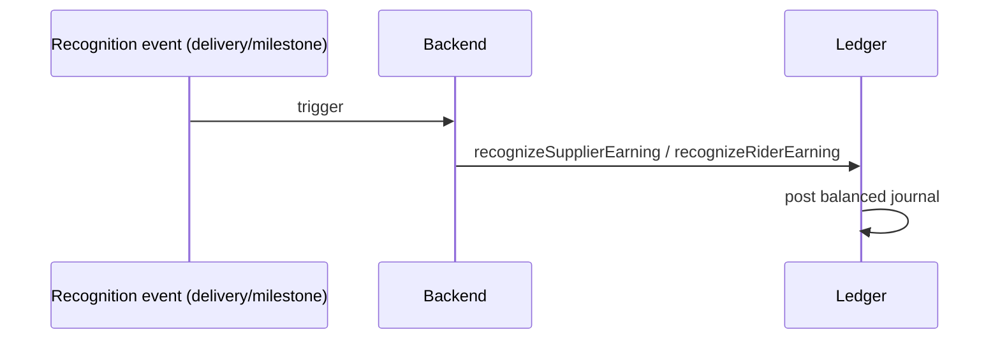
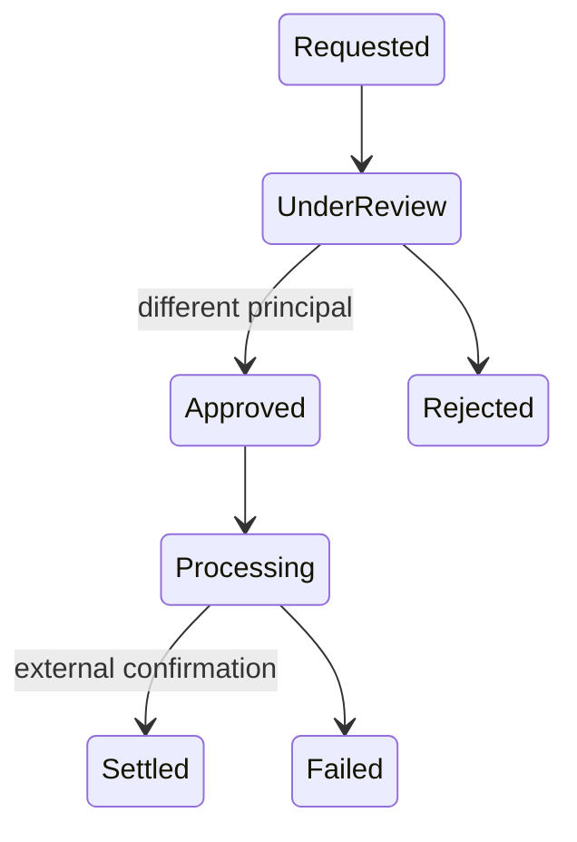
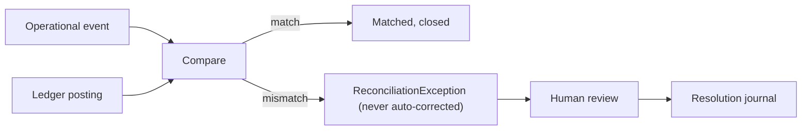

# Accounts and settlement diagrams

| Field | Value |
|---|---|
| Revision | 1.0 · 2026-10-30 |
| Owner | Documentation lead |
| Depends on | [accounts-web/PAYOUT_MANAGEMENT.md](../accounts-web/PAYOUT_MANAGEMENT.md), [database/FINANCIAL_DATA_MODEL.md](../database/FINANCIAL_DATA_MODEL.md) |
| Status | PROPOSED — NOT APPROVED. |

## Earning recognition

## Payout state machine (maker-checker)

## Reconciliation

