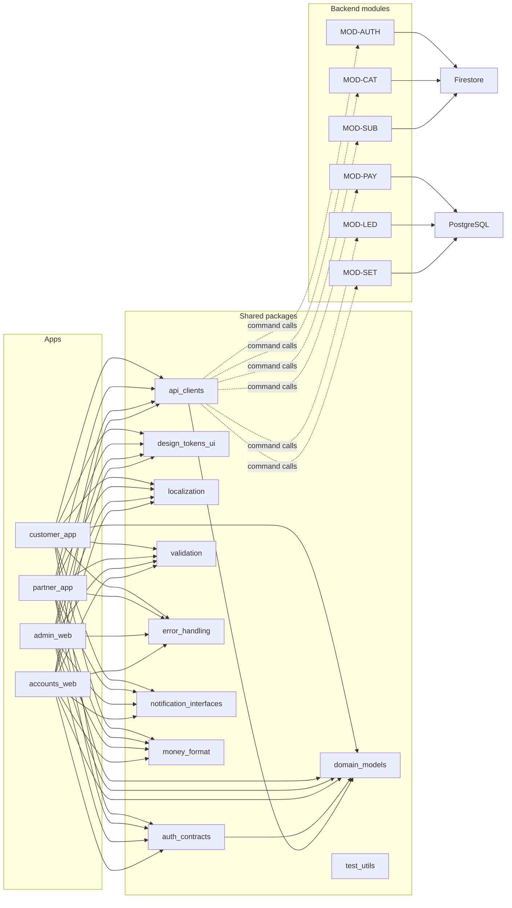

# Application architecture diagram

| Field | Value |
|---|---|
| Revision | 1.0 · 2026-10-30 |
| Owner | Documentation lead |
| Depends on | [architecture/MULTI_APP_ARCHITECTURE.md](../architecture/MULTI_APP_ARCHITECTURE.md), [setup/MONOREPO_AND_BUILD_OWNERSHIP.md](../setup/MONOREPO_AND_BUILD_OWNERSHIP.md) |
| Status | PROPOSED — NOT APPROVED. |

No cycle exists: shared packages never depend on an app, and `domain_models` is the only package other shared packages may depend on (NFR-023).
