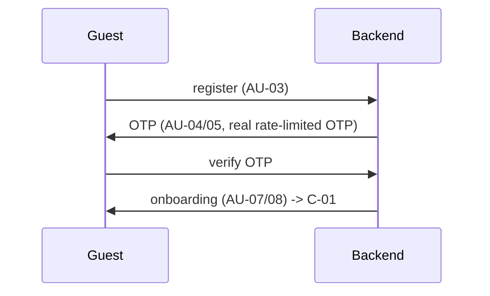
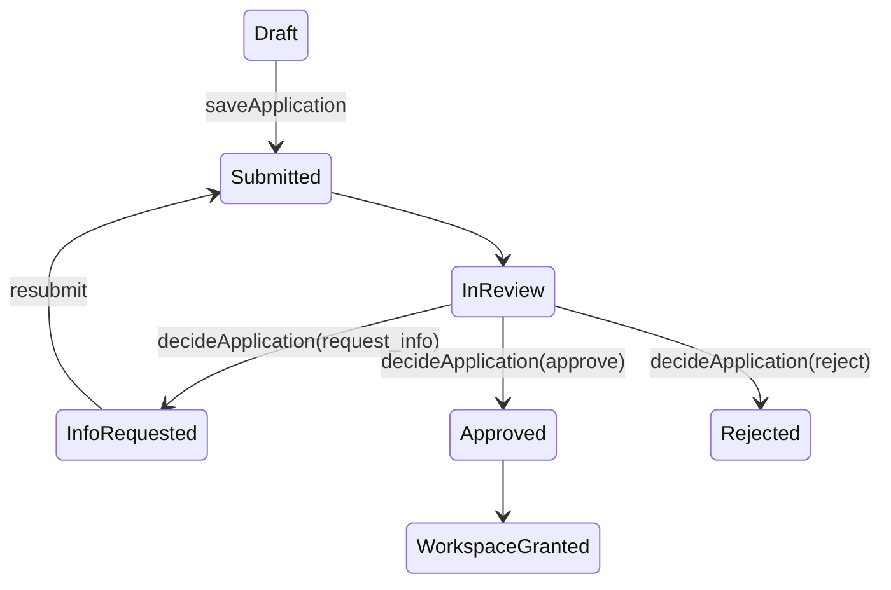
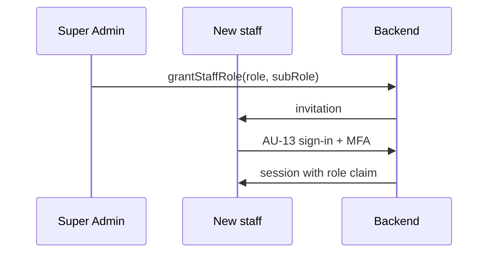
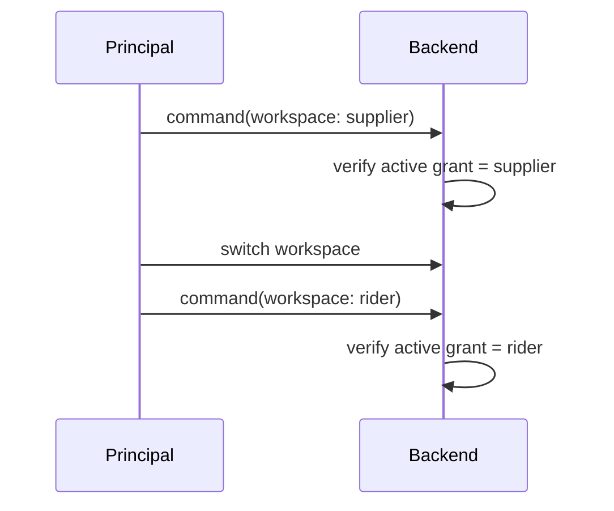

# Authentication and role flow diagrams

| Field | Value |
|---|---|
| Revision | 1.0 · 2026-10-30 |
| Owner | Documentation lead |
| Depends on | [ADR-011](../adr/011-roles-claims-and-sessions.md), [design/screens/CUSTOMER_PUBLIC_AND_AUTH_SCREENS.md](../design/screens/CUSTOMER_PUBLIC_AND_AUTH_SCREENS.md) |
| Status | PROPOSED — NOT APPROVED. |

## Customer sign-up and OTP

## Partner application and approval

## Invited staff (Admin/Accounts)

## Dual-role workspace switch (BR-023, PENDING)

