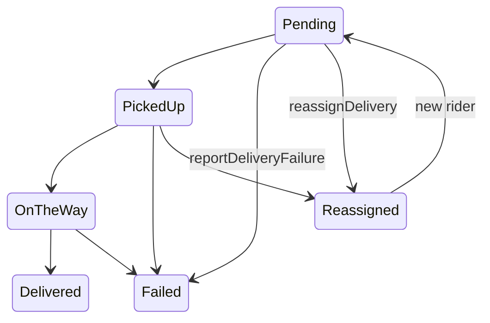

# Delivery states diagram

| Field | Value |
|---|---|
| Revision | 1.0 · 2026-10-30 |
| Owner | Documentation lead |
| Depends on | [delivery-state.mmd](delivery-state.mmd) (historical), [adr/003-status-and-reference-payments.md](../adr/003-status-and-reference-payments.md) |
| Status | The four confirmed states are retained unchanged; the exception/reassignment extension is PROPOSED. |

The four confirmed states (Pending → Picked Up → On The Way → Delivered) are unchanged from [adr/003-status-and-reference-payments.md](../adr/003-status-and-reference-payments.md); Failed and Reassigned are exception outcomes (DEC-014), never a fifth or sixth successful status.
