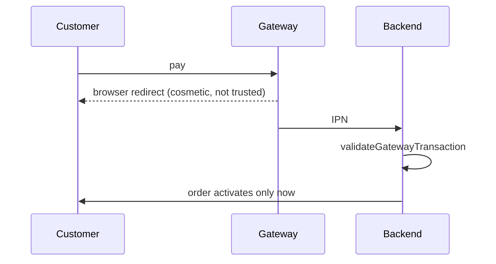
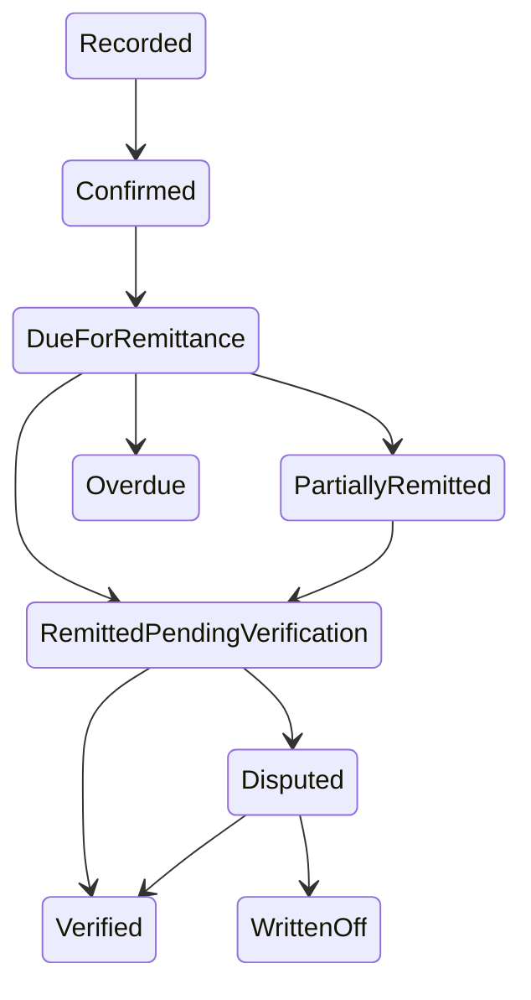

# Payment and COD workflow diagrams

| Field | Value |
|---|---|
| Revision | 1.0 · 2026-10-30 |
| Owner | Documentation lead |
| Depends on | [payments/PAYMENT_ARCHITECTURE.md](../payments/PAYMENT_ARCHITECTURE.md), [payments/COD_PAYMENT_WORKFLOW.md](../payments/COD_PAYMENT_WORKFLOW.md) |
| Status | PROPOSED — NOT APPROVED. |

## Online payment: redirect vs IPN vs validation

## COD: collection to remittance

