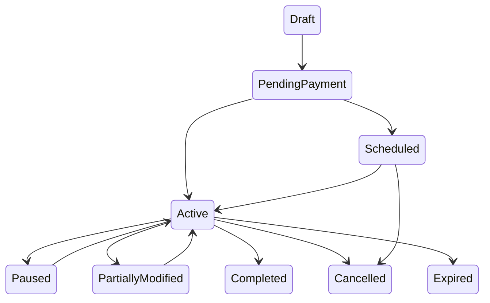
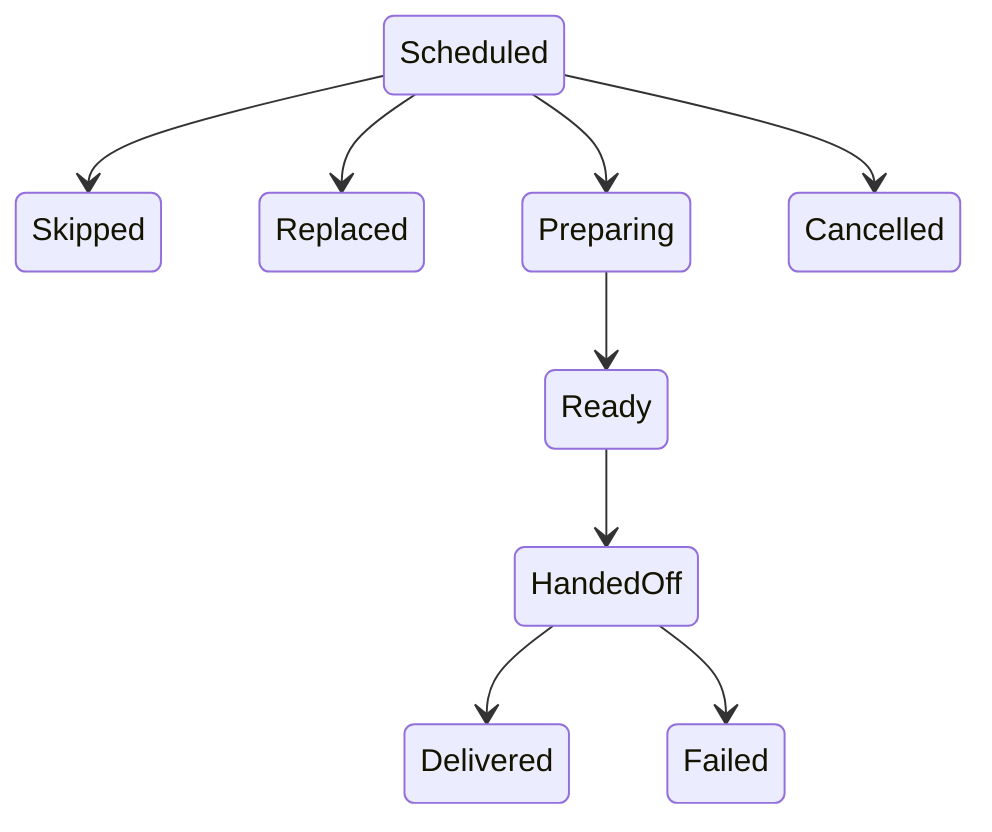

# Subscription lifecycle diagrams

| Field | Value |
|---|---|
| Revision | 1.0 · 2026-10-30 |
| Owner | Documentation lead |
| Depends on | [ADR-014](../adr/014-subscription-agreement-and-meal-obligations.md), [customer-app/CUSTOM_SUBSCRIPTION_ENGINE.md](../customer-app/CUSTOM_SUBSCRIPTION_ENGINE.md) |
| Status | PROPOSED — NOT APPROVED. |

## Agreement states

## Obligation states

