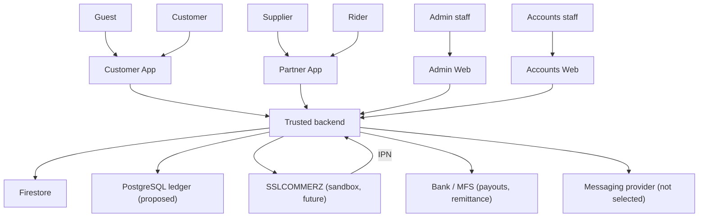

# System context diagram

| Field | Value |
|---|---|
| Revision | 1.0 · 2026-10-30 |
| Owner | Documentation lead |
| Depends on | [architecture/SYSTEM_ARCHITECTURE.md](../architecture/SYSTEM_ARCHITECTURE.md) |
| Status | PROPOSED — NOT APPROVED. No renderer executed. |

